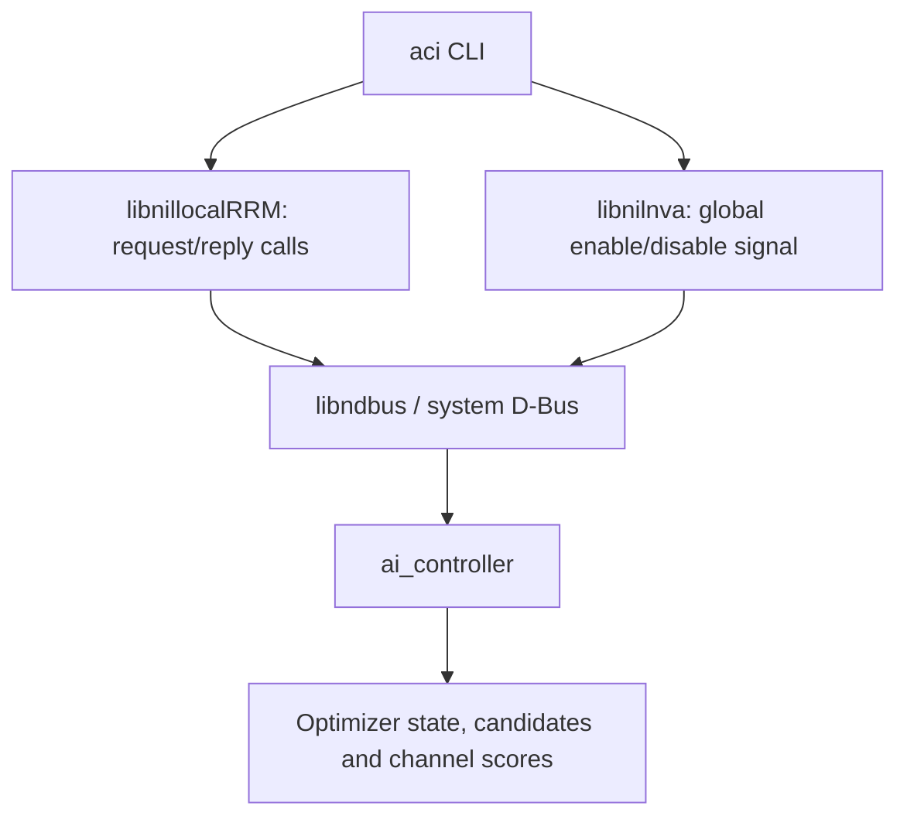

# Following ACI into the Beacon's Wi-Fi optimizer

`aci` is the local command-line interface to Nokia's Wi-Fi optimization engine. It provides more detail
about channel selection than the WebUI, and contains controls for the optimizer's runtime parameters.
Some advertised commands are incomplete, however. Following the request all the way into the controller 
matters here: a successful command can do nothing.

We traced the saved G6 IJL and HJL builds and the Beacon 9 JJM build, then used an existing Telnet
root shell for read-only checks on the G6. Its five relevant executable/library hashes match the saved 
HJL profile. The running controller reports **`ai_controller`, version `2.1.19`**.

No live setter was executed. No script or binary was copied to the router. The initial and final saved 
configuration hashes, automatic-channel settings and controller/agent process IDs match. Ordinary daemon 
logging and cache activity continued; this is not a claim that every filesystem byte stayed identical.

## This interface uses D-Bus

The request/reply API uses destination and interface `nokia.ai_engine`, with object path `/nokia/ai_engine`. 
Its wrappers use a five-second call timeout. Global enable/disable and the CLI's per-band auto control take 
signal paths, rather than those similarly named request/reply methods.

This is separate from TCP 37591. ACI does not open another router-control TCP port. We used it through an 
existing authorized shell; access as an unprivileged Linux user and the broker's complete policy have not 
been tested.

The methods pass D-Bus integers/strings and fixed-byte-array results. Names such as `ndbusReadParcelPointer`
refer to copying serialized data into local structures, not passing a usable remote process pointer. Several 
replies depend on the shipped structure layout and exact byte count; this is not a portable JSON API.

## What worked on the live G6

The router runs `3FE49996HJLL91 / HJL.L91p01`, HomeOS `24.04.00`. These getters returned usable output:

| Query                                | Observed result                                                                    |
|--------------------------------------|------------------------------------------------------------------------------------|
| `aci`                                | Controller name and version `2.1.19`                                               |
| `aci -g auto -b 24`                  | Enabled; target bandwidth 20 MHz                                                   |
| `aci -g auto -b 5`                   | Enabled; target bandwidth 160 MHz                                                  |
| `aci -g channel_list -b 24`          | Channels 1–13 in its 20/40 rows; wider rows empty                                  |
| `aci -g channel_list -b 5`           | A bandwidth-specific candidate list, from channel 36 through 140 in the 20 MHz row |
| `aci -g node -m "$NODE"`             | Cached master-node information and per-band contexts                               |
| `aci -g score -m "$NODE" -b 5`       | 69 channel/bandwidth rows with utilization and score                               |
| `aci -g align_score -m "$NODE" -b 5` | 69 rows including power, neighbour and OBSS score components                       |
| `aci -g location -m "$NODE" -c 108`  | Cached utilization, interference, activity and noise fields                        |

`NODE` was read from `/sys/class/net/br-lan/address`. There was no `/sys/class/net/br0/address` on this router,
despite the printer calling its field “Br0 MAC address”. Queries using `ath0` and `ath1` as internal radio names 
both returned `-1`; the operating-system interface name is not an established binding for that query.

The node cache reported a 5 GHz context on channel 108 at 160 MHz. Its 2.4 GHz score table was empty. An enabled 
automatic-channel flag does not by itself establish that every corresponding radio/context is active.

These results are useful for comparing the optimizer's candidate list, ranking and internal state across owned 
nodes. They need interpretation: this cache also printed a `MEDIATEK` chipset label, 6 GHz placeholders and 
timestamps formatted in 1970. The location printer labeled channel 108 `DFS: No`. None independently establishes 
the router's physical chipset, regulatory classification, radio capabilities or measurement freshness. 
A score of 100 is an engine value, not proof that a channel is currently clear or best.

## The advertised forced-channel command is a stub

The CLI accepts a `channel` setter and calls `ai_engine_setForceChannel`. The wrapper sends four integers to
the controller. The controller's registered callback then returns zero without using the inputs or requesting 
a channel change.

This is present in all three inspected controllers:

| Profile      | Callback object offset | Callback body     |
|--------------|------------------------|-------------------|
| G6 IJL       | `0x40`                 | `0x38e88–0x38ec0` |
| G6 HJL       | `0x48`                 | `0x5ac60–0x5ac98` |
| Beacon 9 JJM | `0x50`                 | `0x6acdc–0x6ad14` |

The ranges use an exclusive end address. Each body is ordinary stack-canary boilerplate around a success 
return. The service-registration and dispatch traces bind these callbacks to the actual `setForceChannel` 
method; this finding is stronger than merely seeing a stub somewhere in the executable.

Consequently, ACI's `Set Force channel ...` message does not establish control over the radio. We did not run the live command to produce another misleading success message. Actual physical channel selection through other services remains a separate investigation.

## There are real runtime controls

Four HJL callbacks store a supplied value in a controller global and return success:

| CLI selector | API method | Storage | Live value read |
| --- | --- | --- | --- |
| `utilization_threshold` | `setUtilizationThreshold` | Unsigned integer | 80 |
| `interference_threshold` | `setMinInterferenceThreshold` | Integer converted to float | 70.0 |
| `sensing_period` | `setSensingPeriod` | Unsigned integer | 30 seconds |
| `exploration_period` | `setExplorationPeriod` | Unsigned integer | 900 seconds |

The syntax is `aci -s <selector> -i <value>`. These are traced write paths, **not live setter tests**. The callbacks contain no file-save or timer-restart call; reboot persistence, the timing of their downstream application and subsequent overrides by other management components remain untested. The exact scoring interpretation of the interference-threshold API needs further tracing.

The G6's broken config-dump command does not expose these current values. We read exactly four parameter words from the matching controller's process memory, guarded by its executable hash, unique PID and unchanged executable mapping. There was no process attachment or memory write. The offsets and complete read evidence are retained in [runtime-parameters.json](resources/runtime-parameters.json); they are specific to this HJL binary and cannot be copied as portable addresses.

Other controls have distinct effects:

| Command family | Traced behavior |
| --- | --- |
| `enable` / `disable` | Broadcast the global automatic-channel control signal. |
| `-s auto` | Broadcast a per-band automatic-channel status signal, subject to the CLI bug below. |
| `-s channel_list` | Submit new runtime candidate lists for future selection; live behavior/persistence untested. Semicolon-separated input must be shell-quoted. |
| `-s log` | Change logging destination/level through the controller's logging library. |
| `start` | Can launch the local-RRM startup script; it is not a status query. |

These paths were traced without exercising them against the running optimizer. Changing a candidate list or selection policy may affect a later decision even if it does not immediately switch a channel.

## Help text and success messages need checking

There are several inconsistencies in the HJL CLI:

- **`dump_config` returns without requesting a dump.** The live command produced no output and exited zero. Its single-argument branch checks only the first three characters before returning.
- **The advertised `-s auto -b 24` example skips the signal.** The setter dispatch allows only unsigned band values at most 5. Band 24 and band 6 therefore never reach the per-band signal wrapper. The band-24 getter works because it follows a different branch.
- **`-g optimize_wifi` is an active-operation path.** It calls `optimizeWifi`; a blanket collector of everything beginning with `-g` would not be read-only. Conversely, `-s optimize_wifi` routes to a domain-retrieval helper in this build.
- **Exit zero often does not represent backend success.** The inert parser probe returned synthetic failures for getters and still observed zero exits. The alignment-score failure path instead returned the character count of its last diagnostic message: 35 in that fixture.
- **The domain printer treats every nonzero result as ETSI.** A synthetic backend error of `-7` also printed ETSI. The live label was ETSI, but that label alone is not a validated regulatory-domain result.
- **The action printer renders its buffer after a synthetic backend failure.** The final mock zeroes that output for deterministic evidence; the initial uninitialized rendering is retained privately as a failed probe setup.

For action queries, the library argument order is `(node, channel, band, width)`. The forced-channel wrapper instead takes `(node, band, channel, width)`. The `-w` input is passed as a raw integer; its full enum interpretation has not been established here. Do not substitute MHz based solely on the flag name.

## The saved configuration is a separate state layer

`/configs/localrrm/ai-configs.conf` matched the stock `/usr/etc/localrrm/ai-configs.conf` byte for byte before and after the read-only checks. It specifies `ENABLE=0` and 80 MHz defaults for both 5 GHz entries, while the running controller existed, automatic selection was enabled and the reported 5 GHz target was 160 MHz.

The file therefore cannot be used as a complete snapshot of effective state. It also contains DFS/exploration controls, synchronization periods, same-channel policy, utilization/reward thresholds, roaming delays, noise limits, backhaul/interference thresholds and logging settings. Those comments describe intended ranges; they do not prove that every CLI setter validates or updates the corresponding setting.

`run_localrrm.sh` waits for ECD/NVA and honors `/configs/em_no_auto_startup_flag`. It defines an `enable_controller` function involving `/configs/localrrm_auto_enable_flag`, but the captured script's final calls are only `start_controller` and `start_agent`. The existence of that function is not proof that it runs at every startup. Complete stock scripts/configs are retained in the profile comparison.

## What changed in the other builds

The older G6 IJL already has ACI and the main threshold/timer/channel-list interfaces. HJL adds selectors such as alignment scores, action dumps, blocked-channel dumps and the optimize/domain helper pair. The forced-channel stub exists in both.

Beacon 9 JJM adds `ics_status`, `NolOptimization`, `setDynamicbSTA`, `hysteresis_max` and `enable_next_radarlogging` selectors, and a real `getDumpConfig` call behind the formerly empty dump branch. Their live effects and restore semantics have not been tested. The later controller also retains the forced-channel stub. These are three captured builds, not a same-model G6 25.xx comparison or proof that every difference is caused solely by release year.

## Reproducing the investigation

[inspect-aci.sh](resources/inspect-aci.sh) is a getter-only collector for the five exact HJL executable/library hashes. It reads the version, status, candidates, node and scores; it does not include the active optimize command or diagnostic file-dump methods. It was syntax-checked offline, not copied to or executed on the router as a new helper. If using it later on a router, place it under `/tmp` and retain its output privately.

The [host-only parser probe](resources/probe_aci.py) executes the original hash-pinned G6 CLI under QEMU with **all vendor libraries replaced by inert mocks**. It does not execute the real RRM/controller backend or contact D-Bus/a router. All 28 final cases passed. That verifies CLI dispatch and selected failure behavior, not a successful physical setter.

The [command catalogue](resources/command-catalog.json), [exact native traces](resources/trace-index.json), [profile fingerprints](resources/profile-comparison.json), [full normalized live captures](resources/live-captures.json), [private original inventory](resources/retained-evidence.json) and [knowledgebase](../../knowledgebases/aci-wifi-optimizer.md) preserve the complete scope. Next investigations can follow the scoring formula and cache freshness, the internal radio-name/ABI mismatch, ECD's actual channel-application path, or the additional JJM controls. No live change is needed to reconstruct this result.

The [offline validation result](resources/validation-results.json) checks all 21 stock source fingerprints, 73 protected originals, 18 normalized live records, runtime bytes and 15 native ranges. Run `python3 resources/validate_aci.py --private-sources` in a Linux/WSL environment with the private originals available to repeat these checks; it makes no router connection.

The [ECD investigation](../easymesh-management/README.md) now follows the separate radio-configuration candidate: real channel/provisioning worker logic and a queued D-Bus request exist, with loopback inventory tested. Actual channel application remains untested; ACI's forced-channel callback is still a stub. Normal WebUI channel selection is a separate path.
