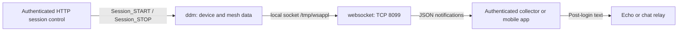

# Following port 8099 into the Beacon G6's notification service

TCP **8099** belongs to `/usr/bin/websocket`. It is an older mobile-app notification channel: local router processes publish device, Wi-Fi and mesh updates, and the service forwards them to authenticated WebSocket clients.

The inspected network handler does not dispatch JSON management commands. After login it handles text through an echo or chat path. Changing router settings belongs to other management interfaces; starting and stopping this reporting stream uses separate HTTP CGI handlers.

Device references follow the [shared aliases](../README.md#device-aliases). The owner selected a live G6 and supplied its build and binary hashes, but did not assign it a physical G6-A/B/C/D alias. This writeup covers **3FE49996HJLL91 / HJL.L91p01**, built on 2024-12-27. Both service binary hashes match the saved HJL firmware exactly.

## What port 8099 is for

Think of 8099 as the mobile app's **live update feed**. The app opens a connection, signs in with an existing router account, and leaves the connection open. When a router service has an update, it can send it immediately. For example, the app can update its device list when a phone joins Wi-Fi, display new signal readings, or redraw the mesh when a Beacon changes its backhaul link.

The feed can carry a snapshot of known devices as well as later changes. That makes it useful for a dashboard, a device-presence log, or a monitor that watches for weak mesh links. A connection can stay quiet even after a successful login. The router's reporting process decides when to publish. The app starts and stops its shared reporting window through a separate authenticated HTTP interface.

There are also two simple text behaviors. In the default mode, the service sends your text back to you. In chat mode, it relays your text to other authenticated connections. Sending JSON in either mode still sends text. Settings such as Wi-Fi names, channels, or firewall rules are handled elsewhere.

The Python client supports the ordinary account login, listening to all notifications, filtering by event name, sending echo text, and relaying chat text. It is available as a library and a terminal command. [Install and use the client](../../network-services/port-8099/README.md).

## First identify the listener

The owner supplied a listener line identifying `websocket` on a specific LAN address and port 8099. That supersedes the old scan's OpenPegasus/WBEM guess. The [aliased observation](resources/owner-observations.json) retains the process, build, hashes, active settings and socket metadata.

The native listener confirms the port: `libwebsocket.so:0xb10c` loads 8099 before creating/binding the server socket. The current `SERVER_IP` setting matches the specific LAN address observed by the owner.

Two ordinary requests were tested from the workstation:

- HTTP `GET /` returned `HTTP/1.1 501 Not Implemented`.
- A normal RFC6455 WebSocket upgrade returned `101 Switching Protocols` with the correct `Sec-WebSocket-Accept` value. Immediately closing before authentication produced the text `408 Request Timeout`; this is how the authentication wrapper handles that early return, not a failed HTTP upgrade.

No password, nonce-authentication attempt, collection start/stop or router-setting request was sent. An authenticated live event stream remains to be captured with a valid account/session.

## Follow the publisher and the network client separately



`ddm` starts the WebSocket application, generates `/tmp/ws_cfg.conf` and supplies account information over its local connection. `libws_client.so` prefixes local producer messages with a six-character ASCII decimal length. This local framing is not sent by a remote WebSocket client.

The local dispatcher also recognizes credential-cache updates and client-close requests. Those are Unix-socket messages, not remotely exposed router commands on 8099. The owner observed `/tmp/wsappl` as `srw-r-----`, mode **0640**, with owner/group displayed as `appServi`. The native `chmod` argument is 416, also 0640.

The socket is a transport for notifications; the data itself is assembled in DDM. Delivery is gated by its shared notification/session state. A successful WebSocket connection alone does not guarantee that the router is currently producing every event.

## What data it can publish

The recovered device and SSID builders use schema version **`6.1`**. This is an event-schema string, not the router's firmware release.

| Event                            | Data assembled by the inspected producer                                                 |
|----------------------------------|------------------------------------------------------------------------------------------|
| `AllDeviceInfo`                  | Known-device inventory. The builder explicitly permits an empty payload array.           |
| `DeviceStatusUpdate`             | Updated device state, including active/inactive information.                             |
| `NewDeviceAdded`                 | Newly discovered device information.                                                     |
| `DeviceInfo`                     | Device details, including a multiple-device variant.                                     |
| `Wifi_Associated_Devices_Update` | Associated-device signal and link measurements, with a timestamp.                        |
| `SSIDInfo` / `SSIDInfoChange`    | SSID identity, radio/band and state information.                                         |
| `MeshNetwork`                    | Mesh nodes and links, firmware identity, role, operating state and backhaul information. |

Device fields include gateway/device identities, IPv4/IPv6 addresses, hostname, friendly name, manufacturer, model, category, interface, active state, Beacon/critical-device flags, bands, SSID and reported rates. Wi-Fi updates add RSSI, rates, operating mode, interference and gateway/link-quality metrics. SSID records include `radioindex`, `ssidindex`, `ssidname`, `band`, `status` and a shared-code `MLO` field; the latter does not establish MLO support on G6 hardware.

Many numeric-looking values are encoded as strings. Some branches construct nested values, including an alternative `rssi` representation. Preserve the original types. The [field catalogue](resources/field-catalog.json) records actual native call sites/types and the remaining schema limits; not every unit, enumeration or nested link structure has been resolved.

A structural illustration, using a dummy gateway identity and the permitted empty inventory:

```json
{"gw":"02:00:00:00:00:01","event":"AllDeviceInfo","version":"6.1","payload":[]}
```

This is an illustration from the builder, not a live capture. `MeshNetwork` uses a different envelope with `aps` and `links`, plus timestamp/time-zone metadata. Do not require every event to contain `payload`.

## What the client sends

Use a WebSocket client, not the proprietary 36-byte framing implemented by the port 37591 package.

The normal account path expects its first WebSocket text message to contain Base64 over `username:password`. It is raw Base64 text, not a JSON object or HTTP Basic header:

```python
import base64

def account_message(username, password):
    return base64.b64encode((username + ":" + password).encode("utf-8")).decode("ascii")
```

The native validator checks a username cache and delegates verification to the router account backend through a loopback CGI request. It is not the Linux `/etc/shadow` verifier. The encoded-input bound is 199 bytes. The ordinary successful response is WebSocket text **`200 OK`**. Legacy nonce-related branches exist, but their complete upstream session semantics have not been verified and are not needed for the normal account workflow described here.

After login:

- Default/echo handling returns received text to the same client.
- Negotiating `chat` sends received text to other authenticated clients, excluding the sender.
- Neither path turns JSON text into router configuration operations.

These routing conclusions come from the exact matching native library. Post-login chat/echo and real-account login were not exercised against the live router.

The old message handler returns a nonzero unsupported-data result for WebSocket Ping/Pong, which its caller treats as a reason to close. A client implementation should disable automatic WebSocket ping timers for this legacy endpoint. The service configures TCP keepalive separately. This behavior was traced statically, not tested with live ping frames.

## Starting and stopping reporting

The shipped HTTP handler `websoc_session_web_app.cgi` accepts form fields:

| Field     | Value                                                                     |
|-----------|---------------------------------------------------------------------------|
| `command` | `Session_START{Mobile}` or `Session_STOP{Mobile}`                         |
| `timeout` | Optional on start; when supplied, an integer from 5 through 86400 seconds |

It writes an Analytics command through the configuration backend. The object header is 625, buffer size 547 bytes, and its command field starts at offset 32 with capacity 513. The `547` argument in the get/set calls is the buffer size, not the object ID.

The companion `websoc_session_app.cgi` supports mobile-session commands and the account-verification callback used internally by the WebSocket library. These HTTP handlers are separate from the WebSocket text channel. Use the existing authenticated HTTP workflow; this investigation did not invoke either handler or establish a standalone login/session recipe for them.

The DDM start path enables delivery flag `0x10`, updates shared timing state and sends an inventory/SSID update. Stop acts on the shared session timer. This is a router-level collection window, not an independent per-socket subscription. An automation should avoid unconditionally stopping reporting that another mobile app or collector may be using.

## Active limits on the owner's router

| Setting               | Observed value | Meaning established here                                                         |
|-----------------------|---------------:|----------------------------------------------------------------------------------|
| `TIMEOUT`             |             30 | Receive timeout during the authentication stage; cleared after success.          |
| `MAX_CONNECTIONS`     |              5 | Configured client limit for this server.                                         |
| `MAX_FAILURE_COUNT`   |              3 | Authentication-failure policy setting.                                           |
| `MAX_BLOCK_TIME`      |            120 | Blocking-policy duration field.                                                  |
| `MAX_KEEP_ALIVE_TIME` |            300 | Input to native TCP keepalive configuration, not the Mobile collection duration. |

For the current keepalive value, the code uses TCP idle 60 seconds, probe count 9 and integer interval `(300-60)/9 = 26 seconds`. It requests a 131072-byte send buffer. These are native socket-option values, not measured disconnect guarantees.

The immutable `/usr/bin/ws_cfg.conf` has block time 1800, whereas DDM's generated/live configuration uses 120. Use `/tmp/ws_cfg.conf` when describing the running system. The owner also observed zero-byte `/flash/ws_settings.dat` and `/tmp/ws_hosts.dat`. The supplied command did not list `/tmp/ws_origins.dat` and suppressed stderr; no precise failure reason is established by that omission.

## A second event interface is present in the frontend code

The shipped `web_whw` bundle contains a separate 60980 JSON client. The [completed follow-up](../webui-event-service/README.md) identifies its only direct caller as the FWA-gated SIM dialog; the checked G6 has no listener on 60980 or expected CGI file. Actual served assets match the saved HJL code.

The class prepares `Nokia.EventService/SubscribeEvents`, but its HTTP request path posts the separate generic body instead. Exact isolated replays reproduce that mismatch in G6 IJL/HJL and B9 JJM. The earlier inference of a submitted event subscription is superseded; it was the intended flow. No live 60980 authentication/subscription was attempted. This does not change the native 8099 findings above.

## What this contributes to managing several routers

A collector could maintain one authenticated 8099 connection per router, combine inventory snapshots with incremental events, and present device presence, signal/rate changes, SSID state and mesh/backhaul topology centrally. Router role and DDM's learned state determine what is visible.

For settings changes, use the router's supported authenticated HTTP management paths or an existing shell-management channel. The division for fleet software is straightforward: a control client applies the change, and an event collector observes the resulting state. Port 8099 supplies the latter part; it does not provide a general management-command dispatcher.

The Python client provides a connection per router and preserves notifications as they arrive. A fleet application can use those connections to build its own inventory and history. The client has been checked against local fixtures. A real account login, timed collection start and received-event capture remain live workflow checks. [Python package](../../network-services/port-8099/README.md).

## An example collector for several Beacons

The [fleet monitor](resources/fleet-monitor.py) uses one normal account connection per explicitly listed router. It prompts for passwords and emits JSON lines tagged with the supplied aliases. Event names and receive times are included by default. Raw payloads are opt-in because they can contain client addresses and names. Run it on a trusted management network because the stock service uses plain WebSocket. Install the [existing client package](../../network-services/port-8099/README.md) first.

```sh
python writeups/websocket-notifications/resources/fleet-monitor.py \
  --router G6-A=192.0.2.10=admin \
  --router G6-B=192.0.2.11=admin
```

Replace the documentation addresses and account names with your own. The example observes an existing reporting window. It leaves the shared Mobile session untouched, so a successful login can be followed by silence. Receive timeouts keep the connection open. A disconnect marks a possible gap and a reconnect starts a new connection generation. Temporary failures use bounded backoff. An account refusal stops collection for that router. [WebSocket reconnect guidance](https://www.rfc-editor.org/rfc/rfc6455.html#section-7.2.3).

### What to poll alongside the feed

| Question                        | What 8099 can contribute                                                                                                                                                                                                              | Where to reconcile state                                                                                                                                                                                                                                         |
|---------------------------------|---------------------------------------------------------------------------------------------------------------------------------------------------------------------------------------------------------------------------------------|------------------------------------------------------------------------------------------------------------------------------------------------------------------------------------------------------------------------------------------------------------------|
| Is a device present?            | `NewDeviceAdded`, `DeviceStatusUpdate`, `AllDeviceInfo` and `Wifi_Associated_Devices_Update` expose different parts of DDM's device view. A known device's active state alone does not establish an association with a particular AP. | For per-AP association, compare the station list on the relevant AP/SSID through an existing shell and a build-appropriate AP-daemon or driver getter. The prior live wireless pass tested hostapd `status` only. Treat station-list polling as a lab follow-up. |
| Did the mesh change?            | `MeshNetwork` can report nodes, links and backhaul quality.                                                                                                                                                                           | Poll the local ECD `/1/topology` getter from the controller shell. It was observed live on G6-A. Compare aliases and topology, and preserve ECD's data age. Two collectors in one mesh can describe the same node.                                               |
| Did the Internet uplink change? | A mesh backhaul event is useful context. The recovered 8099 event builders establish no dedicated Internet-WAN up/down feed.                                                                                                          | Use the existing management path to poll the actual WAN interface status and routes. Record management reachability, WAN link/route state and any Internet probe separately. Only loopback status was verified in the earlier ubus session.                      |

For a read-only poll from an existing authorized router shell, use the same loopback ECD getter used in the topology capture. Discover the logical WAN interface before querying it. The following commands show that workflow. Substitute the actual logical name for the example WAN object. The ECD getter was verified live. The WAN calls below are a suggested poll for the lab.

```sh
curl --noproxy '*' --connect-timeout 2 --max-time 5 -sS \
  http://127.0.0.1:18090/1/topology
ubus -t 5 list 'network.interface.*'
ubus -t 5 call network.interface.YOUR_WAN status '{}'
ip -4 route show default
ip -6 route show default
```

Poll on startup, on `snapshot_required` and at a fixed interval suited to the network. Store the timestamp of the last successful poll separately from the time of the last event. A quiet socket can coexist with a healthy router or an expired reporting window. The traced 8099 envelopes expose no verified sequence number, resume cursor or replay contract. A poll can reconcile current state after a gap, but it cannot reconstruct every event in between. Poll failures should leave the last known snapshot marked stale instead of replacing it with an empty inventory.

Five existing local WebSocket fixture tests and four collector tests passed. The collector tests include two concurrent loopback feeds with separate aliases. The collector does not open a router shell or perform those polls itself. No live authenticated event/poll comparison was made here. [Fleet validation](resources/fleet-monitor-validation.json) · [ECD topology capture](../easymesh-management/README.md#reading-the-topology) · [Wireless tools](../wireless-tools/README.md) · [Uplink monitoring](../uplink-vlan-firewall/README.md#how-uplink-state-is-monitored).

## Reproduce and inspect the evidence

The [offline collector](resources/collect-websocket-evidence.py) verifies 13 source-file fingerprints and four native constants without starting firmware or contacting a router:

```sh
python3 writeups/websocket-notifications/resources/collect-websocket-evidence.py \
  --root "$HJL_ROOT" --out config-private/websocket-file-recheck.json
```

[Evidence](resources/evidence.json), [trace index](resources/trace-index.json), [field catalogue](resources/field-catalog.json), [network dispatch](resources/client-loop-and-routing.txt), [event builders](resources/ddm-event-builders.txt) and [knowledgebase](../../knowledgebases/websocket-notifications.md) retain the exact scope. The [Python client validation](resources/port8099-validation.json) records the loopback tests and the installed-wheel checks. Traces preserve complete instructions in their bounded ranges; literal annotations are heuristic, not a decompiler or full control-flow proof. Raw owner observations and live response captures remain private behind the shared alias registry.
