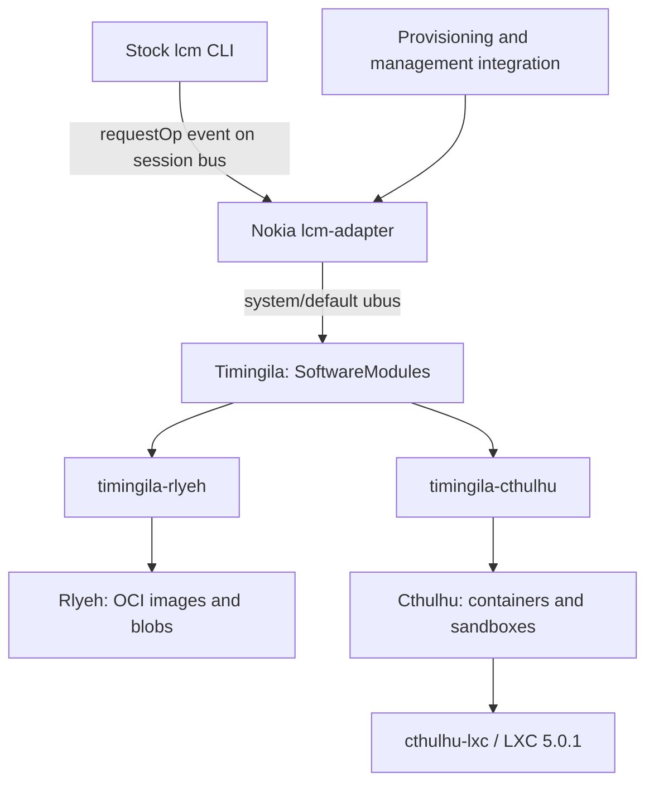

# Following application and container management through the stock firmware

The current G6 and Beacon 9 contain a full application lifecycle stack. It can install, update, start and stop application containers without replacing the router's operating system. This is a substantially different interface from the notification services on ports 37591 and 8099.

We have now run an owner-built unsigned application through the G6's stock manager. It downloaded the image, installed it, started it as a container, stopped it and removed it. AutoStart stayed disabled. The temporary registry was stopped and the test application removed before wrapping up on 2026-10-28. Beacon 9's services and settings were confirmed by the owner, but its package path has not been tested.

Device identities follow the [shared aliases](../README.md). The live G6 was not assigned a physical G6-A/B/C/D alias. Fresh hashes of `lcm`, `lcm-adapter`, the Cthulhu module and `librlyeh` matched the saved HJL profile. The owner supplied Beacon 9 build/process/ubus/getter output identifying `3TN01100JJMK44 / JJM.K44p01`, HomeOS `25.03.00`, built 2025-11-13; its lifecycle binary hashes were not freshly measured.

## What the package experiment established

The G6 ran a static AArch64 program which wrote a marker in its container's `/tmp` and slept. It opened no sockets. We kept the router's stock kernel, drivers and rootfs, and did not change DNS, Wi-Fi, firmware, boot settings or either verification flag. The app's state passed through `Installed`, `Idle` / `Stopped`, `Active` / `Running`, then back to stopped and removed. CLI `Message sent` only acknowledges submission; actual lifecycle objects and LXC state establish completion.

The first two fixtures also taught us what the accepted path needs. A mismatched registry tag and declared image version broke local manifest lookup. That malformed attempt left an orphaned DU and Rlyeh exited during cleanup; we removed only the identified test state and restored the stock Rlyeh process once. The second fixture installed but failed at launch. The final fixture supplied the mount-target directories and relied on the stock `/tmp` defaults. Those two layout changes were made together, so we have not isolated their individual effect.

The [complete procedure and package sources](resources/smoke-test/README.md) document the successful fixture, failed attempts and cleanup. The [structured outcome](resources/smoke-test/evidence.json), [exact fixtures](resources/smoke-test/fixtures.json) and [complete normalized captures](resources/smoke-test/normalized-captures.json) retain the evidence. Two offline rebuilds on 2026-10-29 reproduced the saved successful payload bytes exactly; documentation work did not repeat any router test.

## Start with the release comparison

| Component         | G6 IJL / 24.02 | ONT JJL and KJL / 24.03 | G6 HJL / 24.04 | Beacon 9 JJM / 25.03 |
|-------------------|----------------|-------------------------|----------------|----------------------|
| LXC               | 3.2.1          | 5.0.1                   | 5.0.1          | 5.0.1                |
| Timingila         | Absent         | 2.0.2                   | 2.0.2          | 2.3.1                |
| Rlyeh             | Absent         | 2.3.2                   | 2.3.2          | 2.4.0                |
| Cthulhu           | Absent         | 3.7.5                   | 3.7.5          | 3.9.0                |
| Cthulhu-LXC       | Absent         | 0.9.3                   | 0.9.3          | 0.10.0               |
| timingila-cthulhu | Absent         | 2.0.3                   | 2.0.3          | 2.2.0                |
| timingila-rlyeh   | Absent         | 1.0.5                   | 1.0.5          | 1.0.8                |
| librlyeh          | Absent         | 1.1.5                   | 1.1.5          | 1.2.0                |
| liblcm            | Absent         | 0.1.6                   | 0.1.6          | 0.2.5                |

The [profile comparison](resources/profile-comparison.json) retains exact package revisions, image metadata and file hashes. There is still no captured G6 25.xx image for a same-model comparison.

This supports shared software evolution, but not an explanation that assigns every difference to 25.xx. The high-level stack already exists in 24.03 and 24.04. The later ONT 24.03 CLI also advertises JSON inventory, `listen`, `PreserveData` and references `nokia.lcm.adapter`. Those features are not exclusive 25.xx markers. Build year is also separate from the release train.

## The pieces and their responsibilities



Timingila implements `SoftwareModules`. A **DeploymentUnit** is the installed package, an **ExecutionUnit** is a runnable unit, and an **ExecEnv** is the environment in which it runs. Cthulhu's default `generic` sandbox appears as `SoftwareModules.ExecEnv.1`.

Rlyeh acquires and stores image metadata/blobs. Cthulhu handles container creation, execution, writable storage and lifecycle state through its LXC backend. No executable named `docker`, `dockerd`, `containerd`, `runc`, `crun` or `podman` was found in the five selected roots. Docker-compatible image metadata does not mean Docker Engine is running.

These are components of the public prpl lifecycle-management family. The [upstream Timingila-Cthulhu description](https://gitlab.com/prpl-foundation/lcm/modules/timingila-cthulhu) explains that adapter's role. Current upstream documentation provides context; exact shipped behavior comes from the captured files.

## There are two ubus connections

The first live commands queried `/var/run/ubus-session/ubus.sock`. All three lifecycle model patterns returned `Not found`. Querying the default bus then found SoftwareModules, Cthulhu and Rlyeh, with environment/sandbox objects. The owner also found root-owned Timingila, Rlyeh, lcm-adapter and two Cthulhu process lines. Two processes are not proof of two application containers.

The Nokia adapter connects to both buses, handles `nokia.prpllcmadapter.requestOp`, and invokes SoftwareModules. Completion/failure event names include `nokia.prpllcmadapter.changeDUComplete` and `nokia.prpllcmadapter.AdapterCommandFailure`.

G6 `lcm list` showed DU 1 with status `-`, AutoStart `-1` and empty UUID/EUID. The old CLI reads the cfgmgr mirror. That placeholder does not establish a real installed package, particularly when no corresponding instance objects appear on the actual lifecycle bus.

The newer Beacon 9 CLI additionally uses `nokia.lcm.adapter` for inventory/configuration operations. Its advertised `get`/`set` parameter is specifically `CertificateVerification`; it is not a general setter for all router settings.

## The initial settings on both routers

| Property | G6 | Beacon 9 |
| --- | --- | --- |
| Environment | `generic`, `cpe-generic` | Same |
| State/runtime | Enabled, `Up`, `lxc:5.0.1` | Same |
| Cthulhu version | 3.7.5 | 3.9.0 |
| Active execution units | Empty | Empty |
| Allocated/available writable disk | 1024 / 986 kilobytes | 5120 / 4922 kilobytes |
| Allocated/available memory | `-1` / `-1` | 131072 / 131072 kilobytes |
| Allocated CPU percentage | 100 | 30 |
| InitialRunLevel | `-1` | 0 |
| CertificateVerification | false | true |
| SignatureVerification | false | false |
| Remove after uninstall | true | true |

These are the initial empty-environment readings; the G6 available writable disk was 985 kilobytes after test cleanup, compared with 986 before.

Both report `/usr/lib/timingila-rlyeh/timingila-rlyeh.so` and `/usr/lib/timingila-cthulhu/timingila-cthulhu.so` as the loaded plugins. The newer CLI returns an empty inventory rather than the G6's placeholder row. Beacon 9 also exposes an empty `AvailableRoles` string.

The writable disk allocation is distinct from the total image/cache budget. The adapter performs a separate image-storage admission check. `-1` means no explicit bound at that setting level, not unlimited physical resources.

There is a useful unresolved difference: all five selected `/usr/etc/nwf-product-cfg.json` files specify `ProductParameters.ContainerResources` with disk and memory values of 131072. The adapter reads those budgets and has an execution-environment `ModifyConstraints` path. Yet the G6 live environment retains memory `-1` and CPU 100, while Beacon 9 has memory 131072 and CPU 30. These active values cannot all be explained by the basic Cthulhu defaults. Startup/application of limits and saved state need further inspection; do not equate the image budget with the sandbox disk quota.

Beacon 9's live Cthulhu configuration confirms `UseOverlayFS=true`, `UseBundles=false`, a 10-second graceful-shutdown timeout and the LXC backend. The Celephais bundle-directory setting exists, but its `UseBundles` mode is false; the Nokia runtime layer described below is still parsed by the adapter's OCI-image path.

Each getter emitted successive JSON values: data, an empty object and `amxd-error-code: 0`. A collector should parse that JSON stream rather than treat the entire stdout as one document.

Earlier Beacon 9 diagnostics independently show loop-backed ext2 storage at `/opt/lcm/usr/share/cthulhu/data/mounts/generic`, backed by `data/images/generic`, with 4.8M reported size. This agrees with the live 5120-kilobyte allocation. Neither initialized storage nor an `Up` empty environment proves that an application has been installed.

## Installation has a packaging requirement

This route consumes OCI/Docker-compatible registry manifests and blobs plus Nokia runtime metadata. It is separate from firmware upgrade and does not require supplying config-export `key7_2` or firmware `key18` to the examined local CLI path.

The important extra field is a manifest annotation:

```json
{"annotations":{"com.nokia.runtime.config":"sha256:<digest-of-runtime-layer>"}}
```

The successful fixture supplies this field in a complete manifest. The annotation selects a runtime layer containing gzip tar data. The adapter extracts `config.json` and parses runtime resource/mount/hook information. That runtime file is distinct from the image's ordinary image-configuration blob.

G6's adapter fetches registry metadata/runtime data with its own curl helpers, prepares settings and calls `SoftwareModules.InstallDU`. Beacon 9's adapter first requests `Rlyeh.pull`, reads the local OCI index/manifest/blobs, prepares the runtime data and invokes installation. Its `Request Denied` messages also cover pull or runtime-preparation errors; the text alone does not identify an entitlement gate.

The tested package uses a separate runtime layer and a root layer with the stock mount destinations already present. Its registry tag, OCI index reference and declared version are all `0.0.1`. Both layers were prepared into the app rootfs. This establishes one working format on this G6; compatibility with arbitrary registry images remains unproven.

## What can be controlled

| Layer | Operations declared in the firmware |
| --- | --- |
| SoftwareModules | Install a deployment unit; add an execution environment |
| DeploymentUnit | Update; uninstall with data-retention input |
| ExecutionUnit | Request active/idle state; AutoStart; network configuration |
| ExecEnv | Enable/state, run levels, restart, constraints and deletion |
| Cthulhu | Create/update/start/stop/restart/remove containers and sandboxes |
| Rlyeh | Pull/list/status/remove images; garbage collection |
| Runtime inputs | CPU/memory/disk limits, host-object mounts, network settings |

The [method catalogue](resources/method-catalog.json) preserves exact shipped signatures. These are declarations, not successful live tests of every operation; runtime plugins can extend them.

The common CLI advertises the following syntax:

```sh
lcm list
lcm install -f org.example.myapp -l 'https://registry.example/routers/myapp:research' -a 0
lcm start -e "$EU_ID"
lcm stop -e "$EU_ID"
lcm update -i "$APP_UUID" -l 'https://registry.example/routers/myapp:next'
lcm uninstall -i "$APP_UUID" -r 1
```

This table includes recovered syntax as well as tested operations. The experiment used `install -i <app UUID> ... -a 0`, `start/stop -e <observed EUID>` and `uninstall -i <app UUID> -r 0`; it did not test update or retention with `-r 1`. The registry above is a placeholder. Discover the actual EUID from the model rather than copy historical indices. `-f` uses a name-based UUID-generation path; `-i` supplies the app UUID. These application identities are separate from router serial/password generation.

Beacon 9 help also advertises `list -j`, `listen -t`, `help`, `-d` data preservation and `get`/`set`. The later ONT 24.03 has several of those improvements too. Both Nokia CLI/adapter package records still report `1.0-1`, despite code differences; fingerprints and actual behavior matter more than that version field.


## Certificate checks and package signatures are separate

`CertificateVerification` controls the Rlyeh downloader's HTTPS certificate-chain and hostname checks. The recovered functions set libcurl's peer/name verification to `1/2` when enabled and `0/0` when disabled. See curl's [peer verification](https://curl.se/libcurl/c/CURLOPT_SSL_VERIFYPEER.html) and [hostname verification](https://curl.se/libcurl/c/CURLOPT_SSL_VERIFYHOST.html) definitions. Disabling these checks can leave encryption in use while removing server-identity validation.

`SignatureVerification` concerns the image's publisher/signing policy. It is separate from TLS and from matching a blob's digest against a downloaded manifest. A valid HTTPS server can serve an unsigned image; matching digests alone do not identify a trusted publisher. The G6 has GPG-based verification code; the newer B9 has image-authentication plugin machinery whose complete policy remains unresolved.

Owner readings are G6 certificate=false/signature=false, B9 certificate=true/signature=false. The G6 subsequently accepted our unsigned package from a self-signed private HTTPS registry without changing either flag. We did not test enabled-signature enforcement or a trusted-versus-untrusted certificate rejection matrix. For Beacon 9, an owner's registry should use a certificate the router already trusts; its certificate flag does not itself require Nokia's package-signing key. Runtime format, platform, resources and other policy still apply. These are application-downloader settings, separate from the WebUI certificate and whole-firmware validation. The [supplementary native proof](resources/tls-verification.json) retains both exact functions.

## The runtime we actually got

The program ran as PID 1 inside its PID namespace, with UID/GID 0. Its 16 MiB memory request appeared as `AllocatedMemory=16384` kilobytes and a cgroup limit of `16777216` bytes. CPU quota/period `10000/100000` became `AllocatedCPUPercent=10`, then cgroup quota/period `40000/100000` on the four-CPU host. This percentage applies to total host capacity.

The backend did not honor every requested OCI isolation field. The runtime requested empty capability sets, `noNewPrivileges=true` and a network namespace. The actual process had `CapEff=0000003fffffffff`, `NoNewPrivs=0`, and shared the host network namespace. Those generic OCI requests do not establish the effective isolation policy for this path.

The adapter supplied two host mappings even though the package requested no host objects: app persistent data at `/persistent-data`, and host `/tmp` at `/temporary-data`. The app used neither. Its own `/tmp` and `/run` used separate stock tmpfs mounts; its rootfs was read-only. A networked application therefore needs a deliberate port and data plan before deployment.

## Startup and Beacon 9 changes

G6 HJL PCD starts Rlyeh after cfgmgr/nuspd/rpcd, then Timingila, then Cthulhu. The adapter waits for cfgmgr/Cthulhu. `run_cthulhu.sh` enables memory-cgroup hierarchy, creates `/run` and starts Cthulhu.

Beacon 9 Rlyeh startup waits for `/tmp/uspRawAdded`; its wrapper checks session-bus objects `com.nokia.api.system`, `hlapi.event.notify` and `usp.raw`. Missing prerequisites cause failure and PCD restart. Disabling management components can therefore affect fresh lifecycle startup; independence from USP must not be assumed.

Other captured differences include:

- Environment variables, required/optional roles, available-role management and a DNS-SD reference field.
- Sandbox disk 1024 to 5120 kilobytes; USB serial devices added to its device list.
- Explicit LXC halt signal `SIGTERM`.
- Rlyeh's shipped certificate-verification default changes false to true; signature-verification defaults remain false. Both current verification values were confirmed by the owner's live getters.
- A newer image-authentication plugin ABI appears; the old direct GPG-related implementation/dependency changes. Full trust/plugin semantics remain unresolved.
- Cthulhu/Rlyeh logging changes to syslog, an extension-directory setting appears, and old onboarding defaults disappear.
- Timingila's ProxyManager declarations and mod-dmproxy entrypoint disappear from its main ODL.

Packaged rc.d links with absent init.d targets do not prove the services never start. Nokia's PCD supplies another startup path, and the G6 owner confirmed the live processes.

## Storage and persistence

Both current images use `/opt/lcm` as the LXC path; G6 IJL instead configures `/opt/lxc/NOS`. Relative subpaths include:

| Path | Purpose |
| --- | --- |
| `usr/share/rlyeh/images` | Local image layouts/metadata |
| `usr/share/rlyeh/blobs` | Cached blobs |
| `usr/share/cthulhu/layers` | Prepared/extracted layers |
| `usr/share/cthulhu/data/images` | Sandbox writable-storage images |
| `usr/share/cthulhu/data/mounts` | Mounted writable storage |
| `persistent-data` | Adapter's persistent host-data sources |

Saved ODL state also uses `/etc/config` and effective runtime storage paths. Actual durability/migration of that model state remains to be measured. In the test, normal `RetainData=false` uninstall removed the actual app objects and image layout, but left an empty app persistent-data directory. We inspected it and removed it with `rmdir`. Nonempty retention has not been tested; do not infer that `-r 0` clears every host-data path.

G6 `/opt` uses separate user_data/UBIFS storage; Beacon 9 `/opt` uses separate ext4 storage through a loop device. Payloads can outlive a Linux-bank switch, but booting G6 IJL removes the higher-level manager. Surviving files do not guarantee service startup.

Both current builds put `/opt/lcm` in `FactoryResetExtraBlackList`. In the traced reset implementation this means additional deletion, not preservation. Factory reset can remove the application storage; data-retention flags do not override that reset path.

For AdGuard Home or another owned service, the stock manager is now a demonstrated G6 execution route. The remaining work is the application-specific package, DNS/listen-port and data plan, then controlled update, retention and reboot/autostart tests. Those persistence tests and Beacon 9 package execution remain unperformed. The smoke test made no DNS change and was fully stopped and removed; normal manager history and logs remain.

The stock stack is a real candidate for deployment and fleet control through an existing authorized shell/provisioning channel. A WebUI-superadmin-only install route or generic remote HTTP container API has not been established. Local object access is separate from network reachability and remote-controller permissions.

## Reproduce the comparison

[inspect-lcm.sh](resources/inspect-lcm.sh) only reads build information, processes, inventories and selected settings; it does not launch services or install/start/stop apps.

From this directory, verify the selected saved profile using file reads only:

```sh
python3 resources/collect-container-evidence.py \
  --profile G6-HJL --root "$HJL_ROOT" --out "$PRIVATE_REPORT"
```

[Evidence](resources/evidence.json), [complete stock definitions](resources/stock-text.json), [native traces](resources/trace-index.json), [validation](resources/validation-results.json) and the [complete knowledgebase](../../knowledgebases/application-container-management.md) retain the full scope and remaining work.
