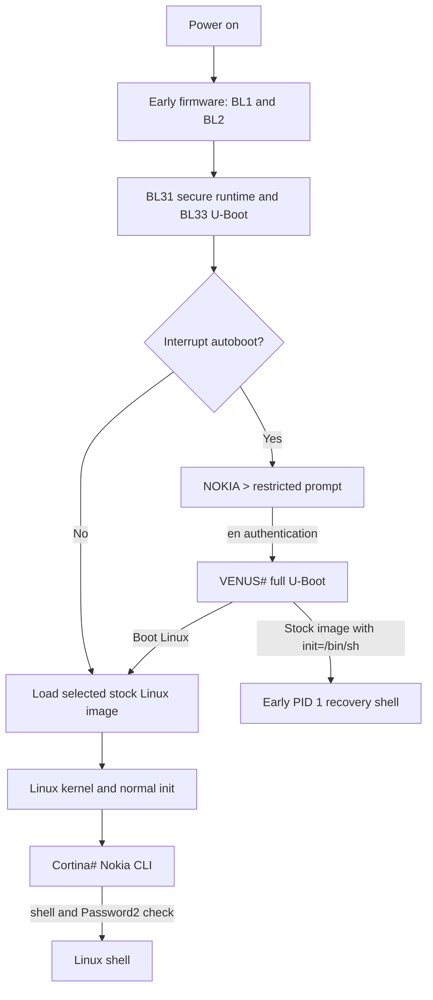

# Following the Beacon G6 from power-on to a UART shell

Why can the Beacon G6 print boot messages over UART but not give you a useful console? And when a prompt does appear, how do you know whether you are talking to the bootloader, Nokia's Linux CLI or a root shell?

The answer is that **the same serial connection passes through several different stages of startup**. Each stage is a different program, with its own job and, in some cases, its own access check. A working wire can carry early boot output even when later interactive access is suppressed. Passing one prompt's check does not automatically pass the next one.

This article follows that path on the Beacon G6: from the first boot messages, through the restricted Nokia and full U-Boot prompts, into Linux and its `Password2` gate. It also shows how a temporary recovery boot takes a different route to a shell. The main observations come from the examined G6 bootloaders and captured `IJL.J03p01` and `HJL.L91p01` firmware. Individual devices can differ; where a result is specific to one bootloader or a live test, that limit is noted.

## One cable, several programs

UART is a serial communication interface. A terminal connected to the board can display text sent by firmware and transmit keystrokes back to it. It does not define what those keystrokes mean: the program currently controlling the interface decides that.

A simplified path through the examined G6 looks like this:



This is a guide to the interfaces, not a complete sequence of every firmware component. BL31 provides secure runtime services; it is not the program that asks for the U-Boot password or presents the Linux CLI. The recovery branch requires full U-Boot access and a compatible image; it was tested on a particular G6 setup, as described below.

| What you see                       | Stage that owns it                 | What it tells you                                                                                        |
|------------------------------------|------------------------------------|----------------------------------------------------------------------------------------------------------|
| Early firmware and U-Boot messages | Boot firmware, before Linux        | The serial output path works at that point. It does not prove later input or a Linux console is enabled. |
| `NOKIA >`                          | Restricted bootloader command gate | Autoboot was interrupted and the limited Nokia prompt is available.                                      |
| `VENUS#`                           | Full U-Boot                        | The bootloader command interface is available; Linux has not yet taken over.                             |
| `Cortina#`                         | Nokia's CLI in Linux userspace     | Linux has started a command application, not necessarily a general-purpose shell.                        |
| `/ #` or another shell prompt      | A Linux command interpreter        | Check the user and process context; a root shell can be reached by more than one route.                  |

Prompt text helps identify the stage, but the command and its result matter too. For example, `id -u` reports the shell's numeric user ID, while `echo $$` reports that shell's process ID. A shell running as root after normal startup and a root shell running as PID 1 have different surroundings even if their prompts look alike.

## Early messages, then silence

When I first connected to the G6 UART, it printed early boot information and then became quiet. The log contained:

```text
serial_enable = 0
>>>>>>>> Serial console Disabled <<<<<<<<
...
serial_is_dis=1
```

Those messages point to a software-controlled serial path. Seeing early text establishes that output was working at that stage; it does not prove the wiring or terminal settings are correct for every possible problem. Here, the bootloader and kernel arguments provided a more specific explanation for the later silence.

In the first examined G6 U-Boot, a saved environment setting named `console` influences the serial path and the kernel arguments. On that unit, setting `console=1` made the bootloader pass `serial_is_dis=0` in place of `serial_is_dis=1`, allowing the console path used in the investigation. This was my deliberate change, not evidence that the device shipped with that setting.

A U-Boot *environment* is a collection of stored bootloader settings. On the examined G6, two redundant copies are in the NAND partition named `uboot-env`, separate from the Linux firmware banks. `/etc/fw_env.config` tells Linux's environment tools where to find the copies; an absent `console` entry is a valid unset state. Both examined bootloaders omit it from their compiled default environments, even though the first has code that can consume it.

The two captured bootloaders are not identical. The G6-B kernel-argument builder uses a plain early-console/console string without the same `serial_is_dis` selection seen in the first bootloader. That is a measured code difference, not proof of exactly how the entire UART path behaves on G6-B: a second live UART trace was not collected. The [G6 comparison](../comparing-other-g6-routers/README.md) and [SSB evidence](../../knowledgebases/g6-ssb-comparison-evidence.json) describe the captured variants.

`console` must not be confused with `secboot`. The first concerns serial exposure in the examined path. A separate `secboot=1` branch reaches OTP/hash-key provisioning logic and warns about writing a hash key. On the examined unit, `secboot=2` was already provisioned. Enabling a console does not require treating `secboot` as a UART switch. The [UART console tutorial](../../tutorials/enable-uart-console/README.MD) documents the specific change, backup and verification steps.

## Interrupting boot reaches a restricted prompt

Once serial interaction was enabled, interrupting autoboot did not immediately expose the full U-Boot shell. The first prompt was:

```text
NOKIA >
```

Its small command set includes `show`, `exit` and `en`. The `en` command asks for a password; a successful check leads to `VENUS#`, the full U-Boot command interpreter. If a familiar U-Boot command is unavailable at `NOKIA >`, that alone does not show that the underlying bootloader lacks it: the restricted gate is handling the command first.

These prompts occur **before Linux starts**. They are distinct from a WebUI login, an operating-system account and the later `Password2` prompt.

### What the bootloader checks

The examined G6 `en` verifier reads `EXT_BOOT_PWD` from the logical `SECURITY` record in `extfs` when that stored field is populated. It is a verifier, not the plaintext password:

```text
typed candidate → SHA-256 → standard Base64 → first 12 characters
                                             ↓
                               compare with EXT_BOOT_PWD
```

The traced gates require a twelve-byte candidate and an eight-byte identity. A stored hash-derived verifier does not reveal the original plaintext just by being read. The field belongs to a logical record accessed through Nokia's `libextfs` interface; its presence in the `extfs` partition should not be treated as a stable raw NAND offset. The [U-Boot access tutorial](../../tutorials/unlock-uboot-en-console/README.MD) explains the tested approach to setting a chosen verifier and preserving the record.

The verifier also has a serial-derived fallback. Reconstructing that calculation did not make it the active path on a unit with a populated `EXT_BOOT_PWD`: the stored field took precedence. That distinction explains why a correctly reconstructed fallback candidate need not open a particular device's gate.

Both captured G6 bootloaders retain the stored-verifier and fallback paths. Thirty-six offline cases exercised the original verifier code with synthetic factory records and intercepted storage and SHA calls; they did not test a live login on the second unit. The examined Beacon 9 bootloader has matching normal comparison and fallback behavior in the identified paths, but also tries an RI `EXT_BOOT_PWD` after an unsuccessful or empty EXTFS lookup. These are behavior comparisons, not byte-identical bootloaders or proof of a common factory password. [Comparison evidence](../../knowledgebases/g6-ssb-comparison-evidence.json).

The saved original verifier values examined across multiple devices differ; the first G6's later modified snapshot must be kept separate from its earlier value. The ONT adds a distinct stored verifier to that comparison, but its bootloader verifier was not newly traced and no ONT UART login was tested. These observations do not recover factory plaintexts or establish how every factory password was generated. [ONT evidence](../xs2426xa-24-03-comparison/resources/writable-findings.json).

## U-Boot loads Linux, and ownership changes

In a normal boot, U-Boot selects a firmware bank and loads its Linux **FIT** image. The FIT packages the kernel and device-tree information needed to start the system. The bootloader also passes a command line to the kernel: this is where arguments such as `serial_is_dis` can affect what happens after the handoff.

The examined G6 has two Linux rootfs banks, separate from the shared bootloader and environment partitions. Changing a Linux bank therefore does not inherently replace U-Boot or its stored environment. An upgrade that changes shared components, boot policy or the layout is a different case; the [slot and rollback writeup](../firmware-slot-rollback/README.md) covers the bank-selection details.

Once Linux starts, it mounts filesystems and launches userspace. In normal operation on the examined G6, stock squashfs is visible under `/rom`, the active root uses a runtime overlay, and persistent configuration is mounted separately under `/configs`. A temporary change in the runtime overlay and a persistent startup instruction are different things. The [storage writeup](../storage-and-flash/README.md) explains the layout and the [startup-hook investigation](../persistent-overlays/README.md) follows how persistent scripts can recreate runtime changes.

The visible UART interface can then be Nokia's `Cortina#` CLI, a Quagga/vtysh-style userspace application. At this point Linux is already running. Commands understood by this program are not U-Boot commands, even though both programs use the same cable.

## The Linux CLI's `Password2` is another kind of gate

The `Cortina#` CLI offers a `shell` command. On the analyzed firmware it invokes Nokia's `sec_cli`/ `secmulti` security path and requests `Password2` before allowing the shell. Despite the name, the examined stock check is not simply a comparison with the U-Boot verifier or a Linux password hash.

The verifier reads the exact `keysrc1` message from `/tmp/secKeySrc.conf` and verifies a supplied Base64 token using the public key at `/usr/etc/ecc_pub.pem`. The examined key uses the binary-field elliptic curve `sect131r2`; the check uses ECDSA with SHA-256. The decoded token has the vendor's length-prefixed `R` and `S` representation rather than the ordinary ASN.1 DER format produced by a default OpenSSL signature operation.

A public key can verify a signature without giving the device the corresponding private signing key. The stock private signing key was not found in the runtime firmware. The observed design is consistent with a separate signing authority, but it does not identify who holds that key or establish a universal support workflow.

The [UART root-shell tutorial](../../tutorials/unlock-uart-root-shell/README.MD) describes development-unit modifications that use a user-owned key pair or a runtime handler override. Those changes do not recover Nokia's private key, and they operate at a later stage than the `en` check.

### Why another password does not necessarily work here

Several credentials coexist on the device:

| Check | Consumer | Material being checked |
| --- | --- | --- |
| U-Boot `en` | Bootloader, before Linux | Candidate transformed and compared with the stored `EXT_BOOT_PWD` verifier, or a fallback path when applicable |
| UART `Password2` | Linux `sec_cli`/ `secmulti` path | Signature token for the local `keysrc1` message |
| Linux account login | Linux authentication path | The relevant account's password verifier |
| WebUI login | Web management authentication | The WebUI account's configured credential |

On the examined G6, `ONTUSER` and `superadmin` both had UID 0 in the Linux account database, with different login shells; their shadow entries used SHA-256-crypt. UID 0 describes their privileges after an applicable login, not a guarantee that either account can pass the UART CLI's signature check. WebUI and Linux accounts can also have different current values despite sharing a name. The [credential map](../credential-map/README.md) follows the separate consumers and [credential investigation](../credential-reverse-engineering/README.md) traces their sources.

## A different path: start a shell as Linux's first process

The normal route through `Cortina#` is not the only way the examined G6 can start Linux. With access to full `VENUS#` U-Boot, I loaded the installed stock `HJL.L91p01` FIT from `rootfs0` and supplied `init=/bin/sh` as a temporary kernel argument. The resulting UART shell reported:

```text
/ # id -u
0
/ # echo $$
1
```

That is a root shell acting as PID 1, the first Linux userspace process. The usual init chain and CLI had not run, so this route reached a shell before the normal `Password2` check. U-Boot reported successful signature and hash checks on the stock image. The result is not a demonstration that an unsigned image, modified bootloader or persistent replacement firmware is accepted.

There was a practical bootloader detail: the manual sequence had to set the partition map in memory before U-Boot could find `rootfs0`. Attempting the `mtdparts` listing while its variable was unset caused an abort and reset. The [recovery writeup](../uart-recovery-from-uboot/README.md) explains that sequence and its limits; the [recovery tutorial](../../tutorials/recover-uart-root-shell-from-uboot/README.md) provides the commands.

This early shell is not a normally booted router. Networking, services, the normal runtime overlay and `/configs` cannot be assumed to be ready. In a later session I mounted the configuration volume read-only, but UBIFS reported deferred recovery and the visible database pair differed from an earlier normal-boot observation. File restoration and its acceptance on a normal boot remain unverified. A delayed reset was also observed; watchdog expiry is plausible but unconfirmed, and sustained stability after the suggested watchdog-stop commands has not been established.

## Console access and firmware trust answer different questions

The serial switch, `en` gate, `Password2` verifier and signed boot chain are separate controls:

- The serial setting affects whether the boot path exposes console interaction.
- `en` determines whether the restricted bootloader prompt releases full U-Boot.
- `Password2` is checked by a Linux userspace security path during the normal CLI route.
- Image verification concerns whether an image is accepted under the applicable boot policy.

Changing one does not by itself settle the others. The G6's early boot chain includes BL1, BL2, BL31 and BL33/U-Boot; saved packages and certificates provide evidence about later-stage authentication. A fifth G6 separately reported its root-key status as enabled. That status is not a serial-matched measurement of each earlier capture, and the first-stage BL1 binary was not recovered for direct analysis. The [secure-boot investigation](../secure-boot/README.md) separates those observations from the stock FIT checks and other boot experiments.

When investigating another unit, record the model and build, the complete boot log, which prompt appears, the kernel command line and whether the environment values are saved or unset. Then identify the program receiving the command before interpreting a password failure or missing output. The [boot and console knowledgebase](../../knowledgebases/boot-and-console.md) retains the historical trace and the [research state](../../knowledgebases/research-state.json) records later corrections.
