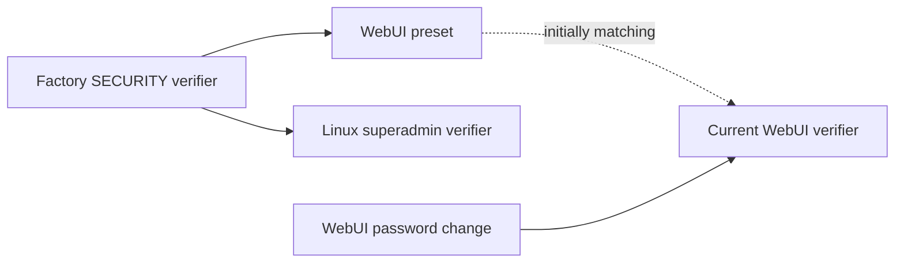

# From factory data to the Beacon G6's account settings

Where does a router's factory login come from, and what happens to it when you change a password? On the examined Beacon G6, the answer is spread across factory records, operator-specific rules, the WebUI configuration database and Linux's account files. These are related stores, but they do not remain one synchronized password.

I found a useful example in the `superadmin` account. Before a WebUI password change, the factory management verifier matched both the WebUI's preset value and the Linux account's saved verifier. After the change, the WebUI's **current** value differed while the preset and Linux values still matched the factory record. The change had succeeded; it was applied to a different destination.

This article follows that result back to the factory data and the BOQA provisioning policy, then forward to the settings used at login. The findings concern the examined G6 firmware and captured device state; a packaged policy, an offline trace and a live account observation are identified separately. Device names use the project's [shared aliases](../README.md#device-aliases). The [provisioning pipeline](../provisioning-pipeline/README.md) follows a related but distinct question: how operator configuration recipes reach management services.

## What provisioning adds to firmware

A firmware image provides programs, default definitions and rules. A particular device also needs an identity and settings appropriate to its hardware and operator. **Provisioning** is the process of supplying or selecting that information so the software can initialize or manage the device.

Inputs can come from several places: factory-written identity and security records, defaults packaged with the firmware, and operator-specific configuration. The resulting settings can be copied into databases or account files for individual services. Once those destinations are writable, a later change to one copy does not necessarily change the original source or every other copy.

The G6 investigation found four useful layers:

| Layer                     | What it holds in the examined G6                                                        | Why it matters                                                                                         |
|---------------------------|-----------------------------------------------------------------------------------------|--------------------------------------------------------------------------------------------------------|
| **RI identity**           | Device and operator fields such as serial, programming date, operator ID and label code | Supplies identity and inputs used by provisioning rules; it is not the current WebUI account database. |
| **`extfs` / `SECURITY`**  | Factory security fields, including boot and WebUI-related verifiers                     | Supplies values selected by particular consumers; the fields do not all use the same format.           |
| **Management data model** | Named settings, including current and preset WebUI password fields                      | Gives management services their own stored configuration, separate from the factory record.            |
| **Linux account files**   | Account metadata in `/etc/passwd` and password verifiers in `/etc/shadow`               | Controls Linux account authentication, not every password prompt on the device.                        |

A **data model** is an organized set of named configuration and state parameters. A path such as `InternetGatewayDevice.X_Authentication.WebAccount.Password` identifies a parameter in that model; it is not a filesystem path.

The direction of copying matters. A factory verifier can be selected as a default and appear in more than one destination, but seeing equal values does not make those stores aliases. Once the current WebUI value changes, the preset and Linux account can remain unchanged.

## Finding factory fields inside `extfs`

The captured NAND layout has a partition named `RI` and another named `extfs`. On the examined unit, `extfs` appeared as `mtd9`, but the number should be checked on each device. More importantly, a field such as `EXT_WEB_MGNT_PWD` is not a normal file with that name or a reliable raw flash offset.

Nokia's `/usr/lib/libextfs.so` exports functions for working with named logical records. I used a read-only helper to request `SECURITY` and parse the returned fields. The logical object was 8,192 bytes; that is the size of the retrieved record, not the size of a complete `extfs` partition backup. The record included `EXT_WEB_PWD`, `EXT_WEB_MGNT_PWD`, `EXT_BOOT_PWD` and other protected variable fields.

On a device you already administer, the following only identifies partitions; it does not read or modify their contents:

```sh
cat /proc/mtd
grep '"extfs"' /proc/mtd
```

The [storage and flash writeup](../storage-and-flash/README.md) explains the difference between the logical record and the raw partition. Finding a string in a flash dump is not a reason to assume a guessed byte offset is safe to write.

## Similar names, different verifiers

The suffix `PWD` does not tell us whether a field is plaintext, what it protects or how it is checked. The consumer provides that context.

| Field in the examined `SECURITY` record | Observed format or use                                                                                                           |
|-----------------------------------------|----------------------------------------------------------------------------------------------------------------------------------|
| `EXT_WEB_PWD`                           | A SHA-256-crypt verifier, recognizable by its `$5$` prefix, associated with the WebUI `admin` default in the examined policy.    |
| `EXT_WEB_MGNT_PWD`                      | A SHA-256-crypt verifier associated with the WebUI `superadmin` preset and the Linux `superadmin` account in the examined state. |
| `EXT_BOOT_PWD`                          | A twelve-character verifier used by the bootloader's `en` check; it is not a Linux SHA-256-crypt entry.                          |

On the first examined G6, the `EXT_WEB_PWD` verifier checked against that unit's label code. The factory management verifier matched the WebUI preset and Linux `superadmin` shadow entry. The [G6 comparison](../comparing-other-g6-routers/README.md) found the same source distinctions in a second unit, including a different salted management verifier. Those observations do not establish a common plaintext or a factory `superadmin` generation formula.

This distinction, though, is completely dependent on your operator policy. My BOQA router sets the label password as the admin (NormalUser) as well, but other operator paths may set a global default password and ask the user to set one on first login.

The bootloader uses a different comparison: it hashes the entered candidate with SHA-256, Base64-encodes the digest and compares the first twelve characters to `EXT_BOOT_PWD` on the populated-field path. The [boot and console writeup](../boot-and-console/README.md) explains that gate and its fallback. A shared storage record does not make these fields interchangeable.

## How an operator rule selects the factory defaults

The G6 firmware contains `preconfiguration_global.xml`, a collection of default and operator-specific rules. Although named XML, the stored resource was encrypted and compressed. Decoding it exposed the BOQA branch used in the examined context, including rules for the WebUI `admin` and `superadmin` accounts.

A rule named `genpwd_longpasswd` initially looked like an explanation for the factory account values. A generic management-password generator also existed and could be reproduced against the firmware's library, but its output did not match the examined factory hashes. The missing step was to follow **which branch consumes the rule**, not just which generator is present.

The BOQA preconfiguration enables `KeepLablePassword`, the spelling used by the firmware, through an `AccountKeepLablePwd` option. The traced handler in `libdbgen.so` selects factory WebUI verifier fields from `SECURITY` for this path rather than using the ordinary regeneration result. Thus a generator can be present and functional while a device's selected policy uses a provisioned verifier instead.

This is a trace of the relevant BOQA policy and handler, supported by the observed matching values; it is not a claim that every device applies the same branch at every startup. The operator ID, product conditions, available factory fields and actual caller all matter. A rule's presence in an XML file does not prove it was selected or that every resulting setting is still current. The [operator policy writeup](../operator-profiles-and-credential-policy/README.md) compares the selectors and their limits.

## Following the `superadmin` verifier after a password change

Two management parameters were decisive:

```text
InternetGatewayDevice.X_Authentication.WebAccount.Password
InternetGatewayDevice.X_Authentication.WebAccount.PresetPassword
```

The first is the mutable WebUI password value. The second held the factory/preset verifier in the examined state. The normal `cfgcli -g` display masks password output, so it did not itself show whether the underlying values were equal.

I used a read-only diagnostic calling `cfg_GetParamValueByUri()` from `libcfg.so` to compare the underlying values. After a deliberate WebUI password change, the new WebUI password verified against the mutable field. The preset field still matched `EXT_WEB_MGNT_PWD`, as did the Linux `superadmin` shadow entry. This establishes separate destinations for that observation; it does not establish that every password-changing route on every build leaves Linux unchanged.



The arrows show the selected source and observed relationship, not a claim that all copies are rewritten on every boot. In particular, the dotted relationship represents the initially matching values; the password change updated the current WebUI value and did not make the three stores one live-synchronized object.

For ordinary, masked inspection of the current field:

```sh
cfgcli -g 'InternetGatewayDevice.X_Authentication.WebAccount.Password'
```

A masked response is a presentation choice; by itself it does not establish the stored format or equality with another field. Avoid publishing hashes or device-specific credentials when collecting evidence. The [credential map](../credential-map/README.md) distinguishes the login interfaces and their consumers.

## Changing a password and storing a verifier are different operations

The data-model value is stored as a crypt verifier, but the normal HJL setter accepts a new **plaintext** password and invokes a runtime callback that applies policy and hashes it. In the captured BOQA policy, supplying a 63-character `$5$` verifier to that normal path fails the illegal-character and length rules. The `-f` option does not skip that callback.

This distinction matters when reading a stored value or designing a restore: a representation accepted in storage is not automatically valid input to a setter. The [WebUI password tutorial](../../tutorials/set-webui-superadmin-password/README.MD) documents the corrected plaintext setter and immediate-save option. A separate raw-verifier restoration path has its own conditions and should not be assumed to have the semantics of an ordinary password change.

## Security-engine files are another layer

The logical `SECURITY` object is not the same thing as the security engine's packaged or runtime databases. The examined firmware used `/usr/etc/sec.key` as a static database and `/tmp/sedb.conf` as a runtime database, with runtime source values in `/tmp/secKeySrc.conf`. These files serve key consumers; their presence does not mean that every credential is derived from one shared key or stored in one format.

The examined security container uses a marker, an eight-byte salt and AES-256-CBC ciphertext, with a SHA-256 integrity check over the plaintext. The traced derivation uses PBKDF2-HMAC-SHA256 with 100 iterations in that path. Static and runtime decryption use different source inputs. Both captured databases decrypted and passed their integrity checks.

For the investigated unit, the recovered `key14` material matched between those two decoded databases. It includes material used by generic password-generation functions, including the management generator. That equality ruled out a static-versus-runtime `key14` mismatch as the explanation for the tested management generator's disagreement with the factory management verifier; the BOQA policy's factory-field branch provides the relevant distinction. The [security-key inventory](../security-keys/README.md) covers other keys and consumers without treating them as interchangeable.

## Operator recipes and saved settings are separate again

The captured `ENC_CFGBOQA112` and `ENC_CFGBOQA114.org` files add another provisioning layer. Offline decoding showed that six captured 114 copies from four G6s contain the same operator recipe, even though the locally encrypted files differ. The recipe requests USP/MQTT management settings and uses a placeholder whose traced source is the default Wi-Fi preconfiguration accessor. That placeholder is not the Linux management password.

A recipe expresses requested settings; its presence does not prove when it was applied or that a management connection is active. The [provisioning-pipeline writeup](../provisioning-pipeline/README.md) follows the recipe, local encryption, retained configuration and agent state, with the offline and live limits kept separate.

## What remains unknown

The evidence supports the factory-verifier selection and the observed current/preset/Linux comparison. It does not identify runtime code that reconstructs the original factory `superadmin` plaintext from the examined serial, MAC address, label code or tested generic management generator. The verifier may have been provisioned during manufacture or produced elsewhere, but its origin is not established. A matching hash is evidence of a relationship between stored values, not a recovered plaintext-generation algorithm.

For exact source traces and test inputs, start with the [password research knowledgebase](../../knowledgebases/password-reverse-engineering.md), its [source record](../../knowledgebases/source-records/password-reverse-engineering.json) and the [current research state](../../knowledgebases/research-state.json). Those technical records include wider credential research; the [configuration import and export writeup](../configuration-import-export/README.md) separately explains what a WebUI backup can carry.
