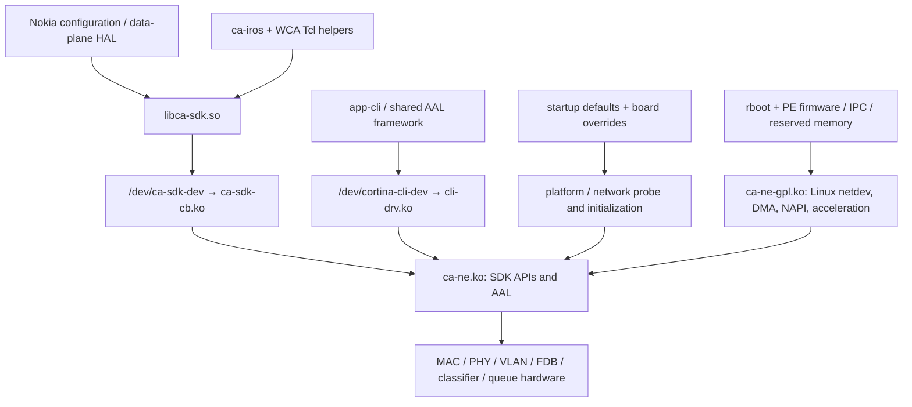

# Following the Beacon G6's Cortina hardware controls

The G6's Ethernet hardware is controlled by a substantial Cortina software stack. There is an SDK,
a Tcl console, a separate AAL console, board configuration, Linux network drivers, packet-engine 
firmware and several diagnostic/control interfaces. Together they explain considerably more than 
a list of `ca_*` commands would.

This investigation follows those layers in the captured **CA8289/Venus G6**, concentrating on what 
a future OpenWrt port needs to preserve or replace. The main profile is `3FE49996HJLL91` / `HJL.L91p01`, 
with `3FE49996IJLJ03` / `IJL.J03p01` as the older comparison. Nothing was run on the router during 
this investigation. Native SDK tests ran on the workstation with device operations intercepted.

The most consequential finding is that these builds have **different SDK ioctl numbering**. Their 
identically named packages and shared kernel release do not make their SDK components interchangeable.

## Where the controls live

| Component                                                 | Role established from the firmware                                                                                                                                      |
|-----------------------------------------------------------|-------------------------------------------------------------------------------------------------------------------------------------------------------------------------|
| `/usr/bin/iros`, `/usr/bin/ca-iros`                       | Shell wrapper and Tcl application for Cortina SDK/AAL commands.                                                                                                         |
| `/etc/ca-iros.rc`                                         | Loads WCA helpers, imports `gw::*`, loads IROS helpers, initializes signal handling and enters the interactive loop.                                                    |
| `/etc/cortina/iros/qa/wca/SC_COMMAND_LIB.tcl`             | High-level `wca_*` wrappers: named parameters, defaults, constructors, structure accessors and native calls.                                                            |
| `/usr/lib/libca-sdk.so`                                   | User-space API wrappers and SDK character-device transport.                                                                                                             |
| `ca-sdk-cb.ko`                                            | Creates `ca-sdk-dev`; translates numeric SDK messages into kernel API calls.                                                                                            |
| `ca-ne.ko`                                                | Cortina API/AAL: ports, VLANs, forwarding tables, classification, queues, policers, shapers and shared SDK blocks.                                                      |
| `ca-ne-gpl.ko`                                            | Linux integration, probe/init, transmit/receive, DMA/NAPI, PHY/ethtool and acceleration hooks.                                                                          |
| `/usr/bin/app-cli`, `/usr/lib/libca-cli.so`, `cli-drv.ko` | Separate generated AAL command framework, using `cortina-cli-dev`. `app-cli` does not declare `libca-cli.so` as a dynamic dependency; it contains the framework itself. |
| `ca-plat-kernel.ko`, `/usr/lib/libca-plat-user.so`        | Platform abstraction and related device interfaces; watchdog, OTP, MDIO, I²C and timer support.                                                                         |
| `libscfg.ko`, `/etc/scfg/{default_scfg,scfg}.txt`         | Startup defaults and board overrides.                                                                                                                                   |
| `hcfg-core.ko`, `phyadpt.ko`                              | Configuration/PHY integration dependencies.                                                                                                                             |
| `/usr/bin/rboot`, `/taroko/*`                             | Packet-engine payload loading and packaged PE images.                                                                                                                   |
| `/usr/lib/libhal_dp.so`                                   | Nokia data-plane HAL: directly imports 77 SDK functions and depends on SDK, platform, PHY, VLAN and Nokia libraries.                                                    |

The [artifact catalogue](resources/artifact-catalog.json) records package ownership, dependencies, hashes, ELF functions/objects, 
module metadata and script references. The [native Tcl registrations](resources/native-command-table.json) contain **6,655 distinct 
SDK-prefixed commands**, including structure helpers; these are not 6,655 independent hardware features. 
The [WCA catalogue](resources/wca-catalog.json) retains **563 `wca_*` procedures**, required/optional declarations, defaults, 
native calls and enums. There are 660 inspected `gw` procedures overall.

The separate [AAL CLI catalogue](resources/aal-cli-catalog.json) preserves **7,133 user command descriptors**, their exact grammar/help
and callbacks, plus **7,130 kernel dispatch descriptors**. Grammar is relative to its CLI node. For example,
the VLAN membership getter advertises `show port_memship_map <0-0xf> <0-0xffffffff>`; its argument ranges
are parser definitions, not proof every device/port value works. The 300-byte `__g_cmd` object is recorded 
as a nonmatching object rather than miscounted as another descriptor.



Nokia's HAL and Cortina's tables remain involved when a Linux bridge or firewall setting changes. The 
earlier [uplink/VLAN/firewall investigation](../uplink-vlan-firewall/README.md) covers the management layer that can recreate settings.

## Initialization is part of the driver

The module-load fragments order platform support before startup configuration and networking, followed 
by PHY support and the command interfaces. The relevant files are `50-ca-plat`, `52-ca-scfg`, 
`66-ca-network-engine`, `67-ca-phydrv`, `90-ca-cli-drv` and `95-ca-sdk-cb`; earlier libphy and hcfg 
fragments are retained too. The network fragment contains two numeric lines as well as `ca-ne` and 
`ca-ne-gpl`; it should not be rewritten as a module-name list without checking the stock loader.

The Linux-facing module registers a platform driver. A saved sysfs capture identifies the bound driver 
as **`ca-ni`**, compatible **`cortina,ni-interface`**, OF node `/ethernet@f4300000`. Its initialization
window calls `ca_cfg_init`, looks up named resources, maps them and reaches `ca_init`.

`ca_init` is substantial. Its call chain includes AAL/NI initialization, transmit/receive and data-path setup, 
PHY initialization, port/Ethernet setup, FDB, QoS, VLAN, special-packet/classifier and mirror initialization, 
L3 queue/buffer setup, interrupts, IPC and conditional tunnel/L3/NAT/multicast/hash-flow initialization. The 
[exact trace](resources/traces/ca-ne--ca_init.txt) preserves the branches and errors. Calling it on a running router is not a harmless way 
to make the CLI available.

A new driver's first objective is therefore larger than bringing up a PHY link. The MAC, classification
pipeline, CPU queues, DMA buffers, interrupts and firmware communication must agree about where packets go.

## What the board configuration tells us about ports

`default_scfg.txt` supplies common defaults; `scfg.txt` explicitly overrides them. Both files are 
byte-identical between the compared IJL and HJL builds. The [effective template](resources/effective-board-config.json) retains every
parsed field and its default/override origin. These are immutable template values, not a fresh read 
of the running configuration.

| Linux interface                       | SCFG index | Configured internal IDs, omitting `0xff` | Driver-init tuple                                      |
|---------------------------------------|-----------:|------------------------------------------|--------------------------------------------------------|
| `wan0_eth`                            |          0 | `0x07`, `0x20`                           | `{0,0,0}`                                              |
| `eth1`                                |          1 | `0x00`                                   | `{1,1,1}`                                              |
| `eth2`                                |          2 | `0x01`                                   | `{2,1,1}`                                              |
| `eth3`                                |          3 | `0x04`                                   | `{3,1,1}`                                              |
| `eth4`                                |          4 | `0x02`                                   | `{4,1,1}`                                              |
| `eth6`                                |         15 | `0x03`                                   | `{15,6,6}`; commented as speed-test support            |
| `ssid1`, `ssid11`, `ssid12`, `ssid13` |  5,16,17,8 | `0x12`, `0x13`, `0x14`, `0x15`           | Dedicated indices; tuples retained in the catalogue    |
| `ssid0`, `ssid01`…`ssid05`            |       9…14 | `0x29`…`0x2e`                            | Dedicated indices                                      |
| `accel0`, `accel1`                    |        6,7 | No port entries                          | First tuple element `0xffffffff`, documented as unused |

The tuple is documented as `{my_mac_index, cpu_port, egress_cpu_port}`. It is not another list of
Ethernet socket labels.

Other relevant settings are:

- `CFG_ID_GE_PORT_BIT_MAP=0x1f`, effective `CFG_ID_XGE_PORT_BIT_MAP=0x80`.
- PHY addresses `{1,2,3,4,7,0,0,6}` and interface-mode codes `{0,0,0,0,0x0a,0x08,0x0c,0x12}`.
- `CFG_ID_NE_DMA_TO_L3FE={1,0,0,0,0,0,0,0}` and `CFG_ID_NE_TX_LDPID={7,0x19,0x19,0x19,0x19,0x19,0x19,0x19}`.
- Flooding-domain membership, TR143/application acceleration and deep-queue enablement on template ports 0,1,4.

The SDK adds another namespace: encoded ports use an upper 16-bit type and lower port identifier. The
shipped enum includes Ethernet=3, CPU=4, subport=5, offload=6, L2RP=7, trunk=8, L3=10 and VUNI=11, plus 
optical types. `0x30007` expresses Ethernet type 3, port 7. It is not a raw SCFG byte, interface index 
or MDIO address.

The native PVID getter checks the type; its Ethernet branch accepts low IDs 0…7. Other types have 
different bounds. Some native branches accept a type absent from the Tcl enum, so helper enums do not
replace driver checks. Earlier examples using `0x30018`/`0x30019` must not be turned into a physical G6 PVID map.

Nokia's connector inventory remains WAN and LAN3 at 2.5GbE, LAN1/LAN2 at 1GbE. The table narrows down 
the software mapping, but a complete **printed socket → Linux interface → SDK port → PHY address** map
still needs a controlled cable/link test. `eth4` and speed-test `eth6` do not establish additional 
accessible sockets.

## The SDK wire format, and the build mismatch

`libca-sdk.so` opens `/dev/ca-sdk-dev` read/write and issues **ioctl request 0**:

| Offset | Encoding           | Meaning                                    |
|--------|--------------------|--------------------------------------------|
| 0      | LE16               | SDK operation number                       |
| 2      | LE16               | Payload length, excluding header           |
| 4      | Operation-specific | Device ID, arguments and inline structures |

For inspected per-port messages, the device ID begins at 4, encoded port is LE32 at 8 and output generally
starts at 12. Statistics/queue operations add arguments; global getters differ. `ca_sdk_ioctl` rejects
null messages and total lengths over 8192 bytes with status 15.

The callback module creates its character device dynamically; read major/minor from sysfs on the matching 
build. Its handler copies the message, dispatches through `g_sdk_handler_table` and copies the response 
back. [Callback tables and traces](resources/dispatch-and-traces.json) retain exact function identities.

| Property                                |          IJL.J03 |                                HJL.L91 |
|-----------------------------------------|-----------------:|---------------------------------------:|
| Real callbacks                          |              767 |                                    768 |
| Operation 554                           | `ca_aal_lpm_add` | New `ca_classifier_free_entry_num_get` |
| `ca_aal_lpm_add`                        |              554 |                                    555 |
| `ca_init`                               |              565 |                                    566 |
| `ca_info_get`                           |              569 |                                    570 |
| Last real callback, `ca_aal_dsl_delete` |              766 |                                    767 |

The remaining entries shift exactly one place, including the terminal null entry. Operations 0…553 match. 
The **original** `ca_info_get` wrapper was executed in isolation from each library and emitted 569 or 570 
respectively. Pairing the HJL library with the IJL callback module could select a different kernel operation 
despite matching API names.

Keep the SDK, callback module, network engine, Nokia HAL and applicable kernel/platform dependencies together
as a matched build. Package version `1.0.0-0` and kernel string `4.14.275` are insufficient compatibility checks.

Both originals copy output for status **0 and 14**. The WCA source names these `CA_E_OK` and **`CA_E_EXISTS`**; 
14 is not a generic “partial success” code. Status 15 is `CA_E_DEV`. Preserve the return status instead of 
treating copied bytes as proof of success.

## VLANs, switching and isolation

There are native implementations behind these controls. PVID reaches `aal_port_ilpb_cfg_get/set`. VLAN port 
control combines membership mapping, ingress/egress port behavior and default VLAN configuration. Its 
**40-byte** structure has ten 32-bit fields:

| Offset | Field                             |
|-------:|-----------------------------------|
|      0 | `drop_unknown_vlan`               |
|      4 | `ingress_membership_check_enable` |
|      8 | `egress_membership_check_enable`  |
|     12 | `ingress_vlan_action_enable`      |
|     16 | `egress_vlan_action_enable`       |
|     20 | `default_tag_add`                 |
|     24 | `default_tag`                     |
|     28 | `outer_tpid`                      |
|     32 | `inner_tpid`                      |
|     36 | `dot1p_use_inner_dot1p_if_pop`    |

Offsets were checked against native Tcl leaf accessors. The [accessor record](resources/structure-accessors.json) retains exact leaves/traces.
TPID fields use SDK selectors/types; do not automatically populate them with a literal EtherType such as `0x8100`.

Frame admission is a separate **16-byte** structure: `drop_untag`, `drop_priority_tag`, `drop_multiple_tag`,
`drop_single_tag`, as 32-bit fields. PVID alone does not configure tagged/untagged admission or both 
directions of membership enforcement.

Other controls include membership/tagging lists, ingress/egress actions, TPID tables, FDB 
add/delete/iteration/learning, flooding, STP, isolation, redirection and mirroring. The isolation setter 
constructs a destination bitmap and complements it before `aal_port_mmshp_check_set`; the getter 
complements that membership bitmap and converts set bits through `ca_port_id_get`. Its destination list 
must not be treated as an ordinary allow-list without following the inversion.

These could support per-port VLANs, guest isolation, FDB inspection and port mirroring. They do not
establish that a proposed rule blocks every accelerated/CPU path. That needs packet tests covering 
unknown unicast, broadcast, multicast, tagged/untagged traffic and warm offloaded flows.

The captured kernel disables `CONFIG_NET_DSA`, `CONFIG_NET_SWITCHDEV` and `CONFIG_BRIDGE_VLAN_FILTERING`. 
Stock dotted interfaces such as `eth1.0` also involve vendor VLAN plumbing. OpenWrt bridge-VLAN 
configuration cannot be assumed to program this SDK. Future integration must connect Linux bridge/VLAN/FDB 
state to hardware. [Switchdev](https://docs.kernel.org/networking/switchdev.html) and [DSA](https://docs.kernel.org/networking/dsa/dsa.html) describe relevant kernel models; this investigation 
does not establish stock support for either.

## Forwarding, CPU traffic and packet engines

The stack contains L2/L3 classifiers, hash/HashLite tables, LPM routes, next hops, NAT, flow statistics, 
multicast, exception/special-packet handling, CPU classifiers and tunnels. Supplied examples build those 
objects explicitly; they are not merely display commands.

The Linux-facing driver contains transmit/receive, DMA-LSO, NAPI and CPU-queue integration. 
`ca_ni_init_cpu256_module_probe` prepares interfaces and receive buffers, resolves interrupts, adds 
NAPI and enables CPU256 queue paths. Buffer pools, CPU destinations and reserved memory therefore 
belong in the porting design alongside link setup.

`/taroko/` includes `wfo-qca-nss-pe0.bin`, multicast payloads, `mapt_dp0.bin`, `ipsec_dp0.bin` and a 
throughput-test payload. Their ownership, sizes and hashes are recorded. The files support a 
packet-engine/offload architecture; each packaged payload is not evidence that its optional mode is 
active.

Two files named `offload_firmware`, the init file and `/taroko/offload_firmware`, are genuinely empty 
in the verified raw-bank-derived image. `rc_srv6` refers to missing `/taroko/srv6_dp0.bin`; raw-image 
extraction also finds no such file. Shared Tcl examples contain SRv6 construction code, but a working
G6 SRv6 datapath was not established.

The diagnostic tree has separate `api`, `aal`, `ni`, `adapt` and `kernel_hook` controls. Examples 
include `aal_table`, `bypass_l3fe`, `datapath_mode`, queue/counter diagnostics, CPU dispatch, `tx_ldpid`, 
acceleration and bypass-port controls. The startup `boot` script writes an L2 fast-path debug node when 
it exists. These are active control surfaces, not interchangeable read-only files.

Likewise `/etc/cortina/eval/nat.sh` flushes firewall tables, changes interfaces/bridges and forwarding, 
and changes bypass behavior. `rc_iperf` loads PE test firmware and writes registers/VLAN membership. These 
scripts document mechanisms; they are unsuitable as production initialization recipes or harmless diagnostics.

For a port, get a verified CPU packet path working before adding acceleration. Then test filtering with 
acceleration both cold and warm. A successful `iptables` invocation, SDK result or Linux counter cannot 
establish that every hardware-forwarded packet traverses that hook.

## QoS, shaping and counters

Cortina provides eight-queue SDK definitions, scheduling, port/queue shapers, policers, WRED/ECN and 
priority/DSCP mappings. The scheduling enum distinguishes SP=0, DWRR=1, DRR=2, WRR=3, RR=4 and SPRR=5.
These are SDK values, not a guarantee that every mode is valid on every internal port.

Native accessors establish the shaper as four 32-bit fields: `enable`, `pps`, `rate`, `burst_size`. 
The policer is six: `mode`, `pps`, `cir`, `cbs`, `pir`, `pbs`. Implementations select L2 or L3 traffic-engine
paths according to the port. Examples do not establish all G6 rate/burst units, rounding or limits; 
source-level arithmetic checks and measurements remain necessary before presenting an OpenWrt control.

Hardware scheduling is separate from Linux SQM. This kernel has fq_codel but lacks the previously investigated 
HTB/TBF/ingress/action prerequisites. A hardware shaper does not itself implement CAKE, bidirectional SQM or
qdisc integration. The earlier [platform record](../../knowledgebases/custom-rootfs-platform.md) retains exact configuration evidence.

Counter reads need care: `wca_eth_port_stats_get` and `wca_queue_stats_get` default **`read_clear=1`**. 
An ordinary-looking stats command can consume counters. For a passive baseline, explicitly request 
`-read_clear 0` where supported. Native Ethernet stats structures differ too: the original getter copies 
200 bytes, `_get_ex` copies 408. They cannot share a guessed decoder.

Once the matching stock console is already available, these are inspected named-parameter forms:

```tcl
wca_eth_port_link_status_get -device_id 0 -port_id 0x30007
wca_port_pvid_vlan_get -device_id 0 -port_id 0x30007
wca_l2_vlan_port_control_get -device_id 0 -port_id 0x30007
wca_eth_port_stats_get -device_id 0 -port_id 0x30007 -read_clear 0
wca_queue_stats_get -device_id 0 -port_id 0x30007 -queue 0 -read_clear 0
```

These forms come from shipped wrappers. They were not executed on the router; the port is a software-mapping 
candidate, and individual operations can return port/configuration errors. The `iros` wrapper also deletes 
saved Tcl history before starting, so launching it is not completely without side effects.

## Platform resources, pins, LEDs and watchdog

The original FIT's G6 DTB is 38,940 bytes, SHA-256 
`965377f706a2d0b5d1f80e99e7ddb97d15aecfcf2179252b5d5a6b4ba9b03362`. The [board-resource record](resources/board-resources.json) retains 
**all 269 nodes and every property byte**, including clocks, resets, interrupts, reserved memory, PHY and 
calibration references.

NI resource addresses must retain their high cells. `ni_hv` is **`0x4f4300000`**, not merely `0xf4300000`;
`mdio_cfg` is `0x4f4329118`, DMA-LSO is `0x4f7001000`. The same tree also has lower-address resources, 
including standalone MDIO at `0xf4329118`, and a separate `pe_offload` declaration. They must be investigated
in their driver/translation context. Dropping the high cell is not an equivalent tree.

NI names 16 resources: `ni_hv`, `glb_network`, `mdio_cfg`, `xram`, `dma_lso`, `ddr_cache`, `ddr_noncache`,
`pon`, `pon_glb`, `qm_axi_reorder`, `internal_phy`, `xfi`, `sgmii`, `qx`, `rxaui`, `crypto_spacc`. It also 
declares reset controls, IRQs, memory regions and OTP `param`/`calibration` cells. ATU nodes describe
PCIe/PE/crypto translation settings, coherent high-address values and PE `keep-init`. These are not proof
of a standard isolated IOMMU domain.

The saved `analysis/beacon-g6-stock.dtb` was independently compared with the original FIT. Only 
`/memory/reg` and `/chosen/bootargs` differ; hardware resources discussed here match the original. The memory
change matters for a port, as explained in the [hardware writeup](../hardware/README.md).

| Control            | Original DT/driver description                                                   | Porting consequence                                                                              |
|--------------------|----------------------------------------------------------------------------------|--------------------------------------------------------------------------------------------------|
| Pin control        | `cortina,g3-pinctrl`, `0xf4320078`/`0x1c`                                        | Matching mux driver/binding needed.                                                              |
| GPIO               | `cortina,ca77xx-gpio`; controller `0xf43292c0`/`0xb4`, mux `0xf4320080`/`0x14`   | Banks advertise 16,17,12,8,8 lines; use bank/line references rather than guessed global numbers. |
| WPS/reset/WLAN     | Bank 3 lines 0/6/7, active-low; codes `0x211`/`0x198`/`0xee`; 30 ms debounce     | Input events and reset/WLAN policy are separate.                                                 |
| LEDs               | `cortina,cortina-leds`, `0xf4320144`/`0x44`                                      | Hardware blink/polarity and triggers need support; this is not simply `gpio-leds`.               |
| Watchdog           | `cortina,wdt`, `0xf432901c`/`0x30`, reset control `0xf4320020`                   | Preserve servicing/reset behavior during bring-up.                                               |
| MDIO               | Standalone controller plus NI `mdio_cfg`; PHY adaptation modules/libraries       | Generic PHY support does not replace board/controller initialization.                            |
| I²C                | `cortina,ca77xx-i2c`, `0xf4329160`/`0x28`, 100 kHz; CPU regulator declared       | Preserve clock/regulator dependencies. The declaration is not a voltage-tuning recipe.           |
| Thermal            | `cortina,thermal-sensor`, `0xf43201ec`/`0x10`                                    | DT has 90°C/115°C trips and cooling links; retain thermal handling.                              |
| OTP                | `cortina,cortina-otp`, `0xfff80300`/`0x100`; NI param/calibration references     | Preserve calibration/factory data. SDK OTP write/lock controls were not exercised.               |
| Clock/reset/IPC/PE | Cortina clocks, three reset-controller blocks, IPC, PE control/logging and pools | Required dependencies when replacing the kernel.                                                 |

LED labels include WLAN, WPS, Internet, WAN and power colors, plus reference-design USB/VoIP entries. 
The tree also has an enabled `aqr113` node while Nokia's G6 block diagram names RTL8221B on the 2.5GbE paths. 
Shared declarations need physical corroboration; they do not prove extra connectors or that particular 
PHY chip are installed.

The platform SDK starts with OTP, MDIO, I²C, timer and watchdog operations. `cap_watchdog_get/set` wrap 
three 32-bit words and call `aal_get/set_wdt_config`; their inspected wrappers return zero without propagating 
the AAL result. That result alone cannot confirm a hardware change. These controls also do not turn 
OTP-backed secure boot into a reversible software switch. The [secure-boot investigation](../secure-boot/README.md) remains 
authoritative.

## What this gives a future OpenWrt port

There are two useful paths. OpenWrt-based user space retaining the stock kernel/drivers can reuse matched
vendor interfaces. A different-kernel port needs native drivers or source-level adaptation of this stack. 
Modules depend on the target kernel's interfaces, configuration and build inputs; changing a version 
string does not make the 4.14 modules compatible with a new kernel. [Linux's module documentation](https://docs.kernel.org/kbuild/modules.html) 
describes those requirements.

Package metadata identifies source-feed paths under `cortina_feeds/ca_packages/` for the network engine, 
SDK and CLI and declares GPL licensing for inspected components. These are useful source-request breadcrumbs. 
They are not code recovered from the dump, and this investigation did not recover a complete matching 
CA8289 network SDK source tree. Retained bring-up files include a UART source; that is not the network engine.

A practical sequence is:

1. Preserve board resources, calibration, reserved memory and a recoverable boot path. Bring up UART, interrupts/timer, clocks, resets and watchdog.
2. Implement MAC/PHY and CPU DMA. Verify RX/TX, allocation/cache handling, IRQ/NAPI, MTU, negotiation and all physical sockets before adding acceleration.
3. Confirm SCFG-to-connector mapping experimentally, including unused/test interfaces and Wi-Fi internal ports.
4. Implement Linux-facing bridge, VLAN, FDB, STP, multicast and isolation semantics, with hardware membership and CPU exception handling.
5. Add offload/QoS with measured counters, cache invalidation and packet tests showing that policies still apply. Cover cold/warm flows, IPv4/IPv6, multicast/broadcast and reconnects.

Remaining work is specific: physical port/PHY mapping, complete DMA descriptor/packet-header layouts, PE protocols and active selection, queue limits/rate units, Linux bridge/offload integration and packet-level enforcement. The catalogue covers the shipped surface; those hardware behaviors are not claimed solved.

## Evidence and verification

The [resource guide](resources/README.md) indexes scripts, source hashes, command/dispatch catalogues, structure accessors, comparison and disassembly. The [knowledgebase](../../knowledgebases/cortina-hardware-controls.md) retains the complete continuation and original script context.

Offline checks exercised **36 original getters × three statuses × two builds = 216 cases**, plus both original transports under mocks. Every saved instruction byte was compared with its original ELF section; callback mappings and the original FIT DTB were independently checked. These validate the recovered interfaces. They did not test physical links, forwarding, isolation, acceleration, reboot behavior or hardware setters.
