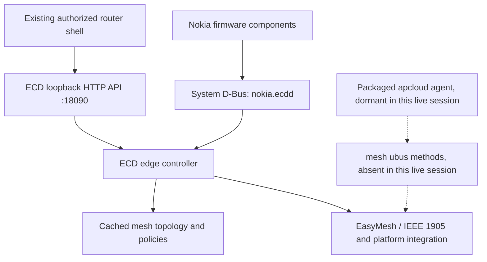

# Following ECD and apcloud into EasyMesh management

`ecd` is the Beacon's local edge controller for the EasyMesh stack. It maintains the mesh topology 
and has management interfaces for steering, backhaul policy and radio configuration. This gives us 
more than another telemetry stream, although a registered operation is not the same as a successfully 
tested control.

On the live **G6-A**, ECD listens at **`127.0.0.1:18090`**. Its version and cached-topology endpoints
work. Nokia's separate D-Bus service, **`nokia.ecdd`**, is also present. `apcloud` is installed in 
the saved G6 firmware but was not running during this investigation; the `mesh` ubus object its client 
code expects was absent on both checked buses.

This investigation used saved G6 IJL/HJL and Beacon 9 JJM files, plus read-only requests through the 
owner's existing G6 shell. No file was transferred to the router, no setter or scan was invoked, and no 
cloud agent was launched or contacted. ECD and NVA kept the same process IDs and ECD kept its loopback 
binding through the final check.

## There are several interfaces here



ECD is separate from [ACI](../aci-wifi-optimizer/README.md), TCP 37591 and the WebSocket notification service. The observed HTTP listener is local to the router. It is not a LAN or WAN management endpoint at that address, and this investigation did not expose it through a relay or change its bind address.

`run_ecd.sh` calls this the Technicolor EasyMesh stack. It exits when `/configs/em_no_auto_startup_flag` exists, optionally sources `$HOME/ecd.conf`, then executes `/usr/bin/ecd`. The packaged `ECD.pcd` has `ACTIVE=NO` and system-init/NVA dependencies; that does not override the fact that ECD is running on this unit. Both REST override files, `/configs/easymesh/rest_listen_address` and `rest_listen_port`, were missing. The effective listener was established from the live socket owner, rather than guessed from those filenames.

## Reading the topology

These commands run **inside an existing router shell**:

```sh
curl --noproxy '*' --connect-timeout 2 --max-time 5 -sS \
  http://127.0.0.1:18090/1/version
curl --noproxy '*' --connect-timeout 2 --max-time 5 -sS \
  http://127.0.0.1:18090/1/topology
```

Both returned HTTP 200. The version response was:

```json
{"version":"1.16.15","id":""}
```

The topology response has an `aps` array. Each AP can describe its identity, IP/MAC addresses, software, uptime, gateway role, backhaul state and quality, route cost, links and SSIDs. The live response contained one AP and two backhaul SSID entries. Its serial identified the current device as G6-A. [The aliased sample](resources/topology-sample.json) preserves all returned fields, and [the normalized capture](resources/live-captures.json) retains the complete shell output.

These are useful for collecting fleet inventory, spotting missing extenders, following backhaul changes and comparing the controller's view with ACI's channel scores. Identity and SSID fields make the unredacted response private. The response is cached controller data: an `encrypted:false` field, for example, is not an independently verified statement about the radio's actual Wi-Fi security.

## The management surface

We recovered the actual native REST registrations, including their HTTP methods and callback addresses. The two G6 builds have the same **68 static initializer registrations**. That count excludes the separately constructed server utility routes. The [complete catalogue](resources/route-catalog.md) and per-profile JSON retain every recovered registration.

| Family | Registered operations | What is established |
| --- | --- | --- |
| Inventory | Version, topology, AP information, capabilities, graph, metrics and configuration views | Version and topology were queried live; the other handlers need individual schema/side-effect review. |
| Client steering | Steering requests, global/per-AP enablement, idle steering, RSSI thresholds, roaming margins, backoff and ping-pong policies | Native POST registrations; exact request bodies, target selection and live outcomes remain untested. |
| Backhaul | Steering, enable flags, dynamic band switching, fronthaul management | Native GET/PUT registrations; effects and persistence remain untested. |
| Measurements | Channel scans, CAC requests/termination, AP metric queries and scan policies | Some action routes are registered as **GET**. A GET name or method does not make an endpoint read-only. |
| Radio/configuration | Current-channel information, RRM, configuration database and policy settings | Needs careful separation of cached-model updates from actual hardware configuration. |
| Diagnostics | Logging controls and debug views | Logging setters and server utility routes were not exercised. |

Do not run a crawler against `/debug/*`. In particular, `/debug/ch_scan_request`, `/debug/cac_request` and `/debug/cac_termination` are registered GET operations that can request work. `/quit` also exists among the server's utility routes and was not invoked.

## The channel path differs from ACI's stub

ACI's registered `setForceChannel` callback does nothing in the three captured builds. ECD contains substantial radio-configuration code instead.

The G6 HJL D-Bus wrapper sends `ecd_setradiochannel_rpc` to destination `nokia.ecdd`, path `/nokia/ecd/application`, interface `nokia.ecd.application`. It serializes a **52-byte request** and expects a status plus a **12-byte result**, with a 15-second method-call timeout. These are firmware structures, not 52 characters of JSON or process pointers usable remotely.

The server registration binds this method through a callback table. The bound callback validates pointers and submits a queued operation with request/result sizes 52/12. Separately, the worker's channel handler calls `ConfigurationMinder::set_channel_power_configuration`. That implementation validates channel/bandwidth, consults provisioning state, submits a channel-selection event and has branches that update default-channel/default-bandwidth state. The named default setters themselves update RAM; they do not directly save configuration. The evidence retains the exact registration, queue submission, worker call sites and implementation. The follow-up resolves opcode5 through the native jump table to that worker, including its separate result socket pair. Downstream RF behavior and cancellation remain untested.

This is a credible control path to investigate further, with potential persistent effects. We have not sent it a channel request, established every field's accepted values, or demonstrated an RF change. The main field layout is now decoded below. The REST route `/debug/current-op-channel` is also not a verified shortcut: its handler parses channel information and reaches internal data updates; its complete downstream hardware effect is unresolved.

## The queued request is now mapped

The registered callback sends opcode5 through an internal message queue. We followed that message to a native jump table, which selects the channel worker. The worker returns its status over a local Unix socket pair; this does not create a network listener. The52-byte request carries:

| Offset | Field |
| --- | --- |
| 0x00 | NUL-terminated AP MAC string, before the band field; exact declaration/padding capacity unknown. |
| 0x24 | 32-bit band selector. |
| 0x28 / 0x29 | Primary and backup channel bytes. |
| 0x2c | 32-bit bandwidth value; its encoding still needs checking. |
| 0x30 | 32-bit reason value, narrowed to one byte internally. |

An all-zero MAC has special handling. Other MACs must resolve to an AP that the cached model regards as online. Invalid band selectors are rejected. These conditions and the configuration worker show real behavior, while actual channel switching remains untested.

The earlier concern about the three `ics_set_default_*` names is now narrower: their implementations only update a RAM array. That does not establish persistence for the rest of the request path. [Exact routing, layouts, traces and remaining limits](resources/channel-path/README.md) are retained with an offline validator. No additional router commands were executed for this follow-up.

## What apcloud adds

The G6's packaged `apcloud` identifies itself as an XcellAir AP cloud-management agent. Its code includes configuration polling, metrics and fault reporting, local configuration changes, radio restart and reboot paths. Its ubus clients request:

| Object/method | Native client evidence |
| --- | --- |
| `mesh.get_topology` | Empty initialized blob; five-second invocation timeout. |
| `mesh.send_ecd_config` | Parses supplied JSON into a blob; ten-second timeout. |
| `mesh.update_mesh_channel` | Builds `mac`, `radio`, `channel`, `bw`, `txpwr`; five-second timeout. A traced branch uses radio label `5GU`. |

Those are calls made by the agent. They do not establish a live object or a working universal `ubus call` command. The saved ACL concerns `appService`, `apcloud_event.update`, mesh subscriptions/listening and event publication; it is not a complete authorization contract for the missing mesh methods.

The saved UCI template has `status.enabled=0`, TLS/CA settings, a development cloud hostname and generic `admin`/`admin` defaults. Its model/interface names also look generic. These are packaged defaults, not a demonstrated effective cloud profile, production credential or active connection. We did not start the agent or contact that destination. The complete template, package metadata and paths are retained in [the profile evidence](resources/profile-comparison.json).

## Comparing firmware

| Saved profile | ECD version | Static initializer registrations | apcloud in selected root |
| --- | --- | --- | --- |
| G6 IJL.J03 | 1.14.22 | 68 | Present |
| G6 HJL.L91 | 1.16.15 | 68 | Present; absent from the checked live process list |
| Beacon 9 JJM.K44 | 1.19.13f | 71 | No matching executable, configuration or package paths found |

The Beacon 9 adds PUT registrations for `/debug/rrm_threshold`, `/debug/bh-rrm-threshold` and `/debug/bh-nb-age-time`; every recovered G6 method/path pair is retained. This is a comparison of registered surfaces, not proof that all shared handlers behave identically. We have not obtained a G6 25.xx build or queried the Beacon 9's live ECD API, so these differences cannot all be assigned to the firmware generation alone.

## What we can use now, and what remains

The tested route is read-only inventory through an already authorized router shell. It can feed a fleet dashboard without enabling another network-facing service. A read-only [collector](resources/inspect-ecd.sh) and full [evidence/verification instructions](resources/README.md) accompany this writeup.

For control, the next useful step is to finish the bandwidth/reason meanings and downstream application/persistence trace, then test the operation on a spare mesh with a known restore path. Steering and backhaul operations also need multiple nodes/clients to observe their effects. There is no completed general remote-control client in this investigation, and no control change was needed to establish the current findings.
