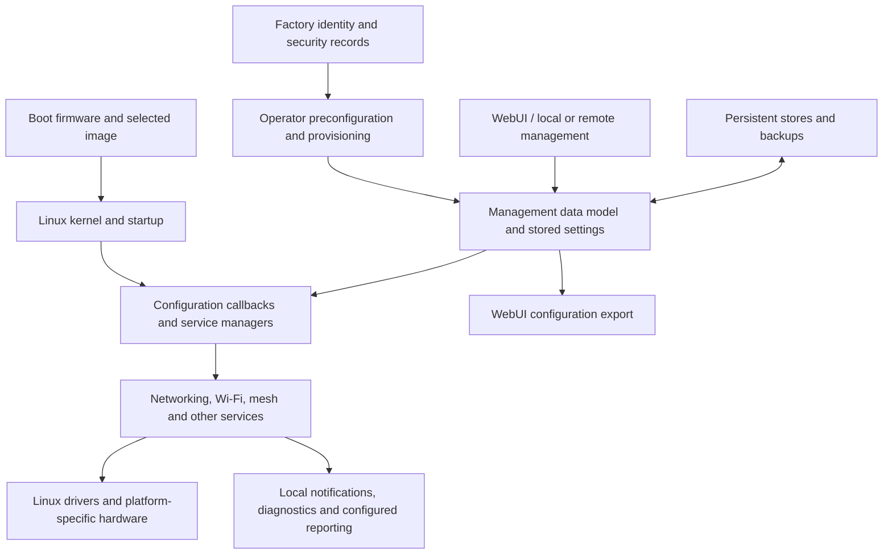

# How the pieces of HomeOS fit together

When you change a setting in the WebUI, what actually happens inside the router? The browser is the visible part of a system that includes factory provisioning, a configuration database, service managers, Linux networking and hardware-specific drivers. The answer is rarely a direct line from a button to a chip.

This article is a guide to those relationships. It follows the Beacon G6's captured HomeOS 24.04 `HJL.L91p01` firmware as its main example, with the G6's 24.02 `IJL.J03p01`, XS-2426X-A HomeOS 24.03 and Beacon 9 HomeOS 25.03 `JJM.K44p01` used where the linked investigations explicitly compare them. A model, a software release, an operator profile and a physical device are separate variables; a cross-product difference cannot automatically be assigned to any one of them.

## The system at a glance

The arrows show relationships established in the project, not one universal call sequence. Some components talk directly to one another, and a saved setting may be consumed later rather than applied immediately. Each layer answers a different question: what software started, where a value came from, what a service requested, and what actually happened on the device.

## 1. Boot brings up the software, not every service at once

On the examined G6, early firmware hands control to U-Boot, which selects a Linux bank and loads its FIT image. Linux then starts userspace and the device's management and network services. The same UART can show messages or prompts from several stages, so the prompt identifies which program currently owns the interaction. [Boot and console](../boot-and-console/README.md) follows that handoff; [secure boot](../secure-boot/README.md) asks separately which images and stages are verified.

A root shell is not necessarily a fully running router. The tested G6 24.04 recovery boot started `/bin/sh` as Linux PID 1 before normal initialization. It established a stock-kernel shell, not working Wi-Fi, networking or a restored configuration. [UART recovery](../uart-recovery-from-uboot/README.md).

## 2. Firmware and persistent state live in different places

The G6's captured 24.02 and 24.04 images use NAND with UBI volumes and SquashFS root filesystems. In the observed normal boot, the writable root overlay is in RAM, while `/configs`, `/logs` and `/opt` have separate persistent backing stores. A change visible under `/` may therefore disappear after reboot, while a script under a persistent store may be run again by a startup hook.

The captured Beacon 9 25.03 uses eMMC and GPT with separate ext4 data filesystems. These layouts are not interchangeable. The [storage index](../storage-and-flash/README.md) links the maps for each device; [startup hooks](../persistent-overlays/README.md) explains how persistent instructions can recreate a runtime change.

Firmware banks are only part of the storage picture. Selecting another Linux bank can change its kernel and root filesystem while shared configuration and bootloader state remain. The [slot and rollback](../firmware-slot-rollback/README.md), [upgrade](../firmware-upgrade-path/README.md) and [factory reset](../factory-reset/README.md) articles follow different operations and what each can change.

## 3. Factory data and operator rules supply inputs

A firmware image contains programs and defaults, but an individual device also has identity and provisioned material. In the examined G6 24.04 path, RI provides identity fields, while the logical `SECURITY` record in `extfs` holds security-related values. Operator preconfiguration selects rules for the device's environment.

Those sources can feed a management database or a service-specific store. They are not necessarily the current value after later configuration changes. For example, a WebUI account's current password verifier can differ from its retained factory preset and Linux account verifier. [Factory data and password stores](../configuration-and-provisioning/README.md) traces that example; the [credential map](../credential-map/README.md) identifies the separate interfaces.

Provisioning can also involve an operator recipe. The captured G6 24.xx encrypted configuration files include a common recipe for management settings, with device-specific values filled through local sources. A saved recipe, a setting in an agent database and a live server connection are three different observations. [Provisioning pipeline](../provisioning-pipeline/README.md) follows those boundaries, and [operator profiles](../operator-profiles-and-credential-policy/README.md) explains why one operator ID can select different rules in different subsystems.

## 4. A setting passes through a management model

A name such as `InternetGatewayDevice.X_Authentication.WebAccount.Password` is a **data-model parameter**, not a file path. In the examined G6 24.04 build, tools and applications use Nokia configuration interfaces; `libcfg.so`, `cfgmgr` and `ndbd` participate in retrieving, storing and applying values. A service or callback may then translate a model change into an account update, a network rule or another service action.

For example, changing the whole-device work mode to `AP_Bridge` through the normal setter reaches a callback that changes network configuration and schedules a reboot in the traced G6 24.04 path. Merely writing a label or inspecting the model value does not prove that clients can forward packets. [Router work modes](../router-workmodes/README.md) and the [AP tutorial](../../tutorials/set-ap-mode/README.md) connect that setting to the observed LAN-uplink behavior.

The WebUI is one client of the management system, not the system itself. Other paths include local management interfaces and operator protocols. Their presence and authorization differ: an endpoint name, a shipped client or a schema entry is not proof that a service is enabled or accessible. See [WebUI and mobile authentication](../webui-mobile-app-authentication/README.md) and [internal ubus management](../internal-ubus-management/README.md).

## 5. Saving settings is not saving the whole router

The WebUI export serializes management records, compresses and encrypts them as a downloadable `config.cfg`. The stored `dmdb_encryption.cfg` is a different binary database with a different container and key path. Neither is a raw flash image or a complete copy of arbitrary scripts, bootloader state and factory records.

The distinction becomes important during recovery and cross-device comparison: a decoded backup tells us what records it contains, while the destination's importer and services determine what can be applied. The [WebUI export investigation](../configuration-import-export/README.md), [stored database writeup](../stored-configuration-database/README.md) and [storage maps](../storage-and-flash/README.md) explain the respective coverage and verification limits.

## 6. Services turn configuration into network behavior

Once a setting reaches a service, it still has to become actual behavior. The examined G6 24.04 path includes Linux network interfaces, bridges and firewall rules as well as Nokia and Cortina platform components. A successful management call, a rule template in a binary, an installed rule and a packet observed at its destination are progressively different kinds of evidence. [Uplink, VLANs and firewall ownership](../uplink-vlan-firewall/README.md) follows that chain.

Hardware can also handle traffic through accelerated paths. The G6 24.02 and 24.04 images include an auxiliary Cortina Wi-Fi-offload payload running Zephyr RTOS; the main system remains Linux. A historical UART log witnesses the payload starting, but that does not establish that a particular flow used it or that a QoS rate was enforced. [G6 offload and QoS](../cortina-offload-and-qos/README.md) separates the Linux hooks, packet engine and measurement gaps.

Wi-Fi management is likewise not one daemon. [Wireless tools](../wireless-tools/README.md) describes radio-facing state; [EasyMesh management](../easymesh-management/README.md) follows ECD and apcloud; [mesh messaging](../mesh-messaging/README.md) covers the optimizer's distinct TCP 37591 protocol. They share a networking context without being interchangeable control interfaces.

## 7. Observability and recovery have their own owners

Information can stay in a local model, be sent to an authenticated LAN client, or be sent to a configured external collector. [Telemetry](../telemetry/README.md) distinguishes those paths; [WebSocket notifications](../app-websocket-notifications/README.md) describes the LAN stream. A configured destination is not proof that a report was sent.

Likewise, a process supervisor, diagnostics daemon, kernel panic policy and hardware watchdog can respond to different failures. Finding a packaged rule or a loaded component does not establish that it caused a particular restart. [Diagnostics and recovery](../diagnostics-and-recovery/README.md) follows those separate responsibilities.

## Reading a comparison or planning the next investigation

The project began with the Beacon G6 and HomeOS 24.xx, then added ONT and Beacon 9 captures to distinguish shared software from platform- or configuration-specific behavior. The [firmware inventory](../firmware-versions-and-builds/README.md) identifies builds and banks, the [G6 comparison](../comparing-other-g6-routers/README.md) holds the hardware model constant across several units, and the [XS-2426X-A comparison](../xs2426xa-24-03-comparison/README.md) examines another 24.03 product. Beacon 9 25.03 changes both release and hardware platform.

When following any result through these articles, keep its evidence type with it: a saved firmware path demonstrates packaged code; an offline test demonstrates the exercised inputs and mocks; a live observation describes the measured device and moment; a hypothesis needs another test. The [writeup index](../README.md) offers topic-based reading paths, while the [knowledgebase index](../../knowledgebases/README.md) provides detailed traces and research handoffs.
