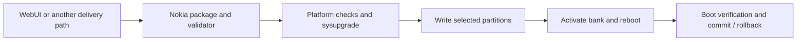

# How Nokia HomeOS validates and installs firmware

What happens after you upload a firmware file, and can a readable image be modified to install an additional service? The examined Beacon G6 HomeOS 24.04 `HJL.L91p01` build says `ENCRYPT=n`: its ordinary firmware body is readable without an image-decryption key. It also says `SIGN=y`. **Readable firmware is not the same as firmware the updater will accept.**

I followed the upgrade from the authenticated WebUI through Nokia's validator and into the platform flashing scripts, and compared the G6 HomeOS 24.02 `IJL.J03p01` and Beacon 9 HomeOS 25.03 `JJM.K44p01` implementations where stated. One motivating example was adding an AdGuard Home installer to a stock-derived image; the same questions apply to any change to that image.

The findings are mostly offline code traces and intercepted tests. A genuine G6 24.04 package was later obtained and compared with saved firmware, but no modified upgrade image was flashed or booted through this route. A synthetic encrypted package reached an intercepted burn entry under specific conditions; that is not proof of a successful flash, accepted boot or secure-boot bypass.

## The stages of an upgrade

The browser upload is the beginning, not the flash operation itself. The file must pass several stages, each answering a different question:

| Stage | Question | Evidence boundary |
| --- | --- | --- |
| Delivery | How did the file reach the router? | WebUI, remote-management and local paths can converge on the vendor validator. |
| Outer validation | Is the Nokia package and its security material acceptable to the selected handler? | Plain signing and the conditional encrypted handler have different checks. |
| Platform checks and write | Does the inner image match the platform, and which partitions are targeted? | The intercepted encrypted test stopped before these checks and any write. |
| Activation and boot | Which bank is selected, and will its image boot and be committed? | A successful validation or write alone does not establish an accepted boot. |



The [firmware inventory](../firmware-versions-and-builds/README.md) identifies the captured builds, and [slot rollback](../firmware-slot-rollback/README.md) explains bank selection. The rest of this article follows the image through those stages before returning to what they mean for an installer.

## From the browser to the image handlers

The WebUI uploads multipart data to `upgrade_web_app.cgi`. It checks the session
and privilege, stages the upload through `swdl_start_upgrading` and
`swdl_transmit_image_segment`, and finishes with `swdl_end_upgrading_write_image`.
The actual image work is in `/usr/lib/libupgrade.so`.

```text
upgrade_web_app.cgi
  -> libupgrade.so: staged upload and image handlers
  -> swdl_burn_image_to_flash: version and platform policy
  -> libupgradeimpl.so: Qualcomm or Cortina backend
  -> /sbin/sysupgrade
  -> /lib/upgrade/platform.sh
```

Normal firmware uploads have a Nokia outer wrapper ending with `3RDP`. Just
before that is a directory length and a list of type/offset/length entries.
The entries select plain firmware, signature data, encrypted firmware, a hash,
and some other vendor payload types. An installed rootfs partition dump is not
the same thing as this complete upload file.

## Other ways into the updater

The browser is only one entry point. I checked the complete IJL.J03 and HJL.L91
root filesystems from the second G6 to see what else can install an image. The Linux entry points below are retained in both builds; U-Boot recovery is a
separate bootloader path:

| Entry point | What it does |
| --- | --- |
| WebUI upload | upgrade_web_app.cgi stages an uploaded firmware file through libupgrade. |
| TR-069 | tr069client handles an ACS firmware download and feeds the staged writer. |
| TR-369 / USP | nuspd implements FirmwareImage Download() and Activate(), including AutoActivate. Agents and the management setting must be enabled. |
| Nokia cloud, mesh, app and portal | swmgnt and libotaSwAgent download and coordinate updates. otasw_upgrade_app.cgi triggers OTA rather than accepting another file upload. |
| Vendor batch provisioning | batch_upgrade receives signed discovery/response messages over raw Ethernet, downloads via HTTP and calls the staged writer. Live listener state was not checked. |
| Local vendor command | `swug -u <image-file>` writes through libupgrade, activates the other bank and reboots on success. |
| Lower-level Linux tools and RPC | sysupgrade and imageTool perform the platform update; local rpc-sys methods wrap sysupgrade using /tmp/firmware.bin. MTD/UBI tools are installed too. |
| U-Boot | bn can flash firmware banks and other targets over the network; nand and ubi provide lower-level recovery writes. |

The cloud route is particularly easy to overlook. libotaSwAgent's upgrade
function calls nal_writePassiveImage in libnal, which calls swdl_write_image.
The extra cloud, app and mesh triggers therefore still meet the vendor image
validator. TR-069, USP, batch provisioning and swug also feed that layer.
Another delivery method does not make the ordinary G6 signature check disappear.

There is a similar trap in the startup configuration. nuspd's PCD rule is
inactive by default, but cfgmgr can start it explicitly and then start obuspa
when TR-369 is enabled. The schema defaults that enable setting to false.
These facts establish conditional support; they do not tell us whether either
live G6 has a USP controller. The batch client's commented init-script line is
also incomplete evidence: cfgmgr retains a separate cfg_bootBatchUpgrade
callback that launches it.

Already having Linux root changes which layer is available. Calling sysupgrade
or imageTool directly reaches the platform's inner-image path rather than the
browser's outer wrapper. That still requires correct vendor packaging, hardware
metadata and boot compatibility. The standard NAND package lists boot, rootfs
and imginfo; boot targets shared SSB, while rootfs targets the other bank.
It is not a one-file application installer.

The local rpc-sys wrapper provides upgrade_test, upgrade_start and upgrade_clean
around /tmp/firmware.bin; keep selects whether sysupgrade receives -n. Its
socket configuration and appService ACL are present, but an externally reachable
RPC endpoint and live permissions were not established.

The retained ca.upgrade utility had no normal caller in an exact-string search,
so it remains a legacy-tool lead rather than another confirmed active service.
The bundled Qualcomm wlanfw-upgrade.sh selects IPQ model strings and updates
Wi-Fi firmware, not the Cortina G6 rootfs.

USB, TFTP and serial loading at U-Boot can put an image in RAM; bootm alone does
not install it. Switching to a populated alternate bank also does not rewrite
firmware. Keep those operations separate from flash writes, especially when
considering what survives an upgrade.

The [complete inventory](../../knowledgebases/firmware-upgrade-path.md#g6-firmware-and-rootfs-update-entry-point-inventory-2026-10-26)
retains conditions, addresses, data effects and untested branches. Its
[evidence](../../knowledgebases/firmware-upgrade-entrypoints-evidence.json) and
[static sources](resources/upgrade-entrypoints/README.md) cover both builds.
This follow-up was offline; it adds no successful flash or boot claim.

Firmware discovery and transfer are covered by the [OTA download writeup](../ota-firmware-downloads/README.md). The acquired HJL delivery contains rootfs and imginfo subimages. Its FIT, rootfs and Wi-Fi payloads match the current stock dump. This specific file lacks a boot subimage. The [release catalogue](../firmware-versions-and-builds/README.md) reconciles branch names, marketed releases and per-model image IDs.

## Signing and encryption are separate paths

The examined builds report:

| Build               | SIGN | ENCRYPT | SIGNER |
|---------------------|------|---------|--------|
| Beacon 9 JJM.K44p01 | y    | y       | NCG    |
| G6 HJL.L91p01       | y    | n       | NCG    |

The plain firmware handler rejects an unsigned image when the running build
requires signing. The signature handler uses `CS_verifyDataSign`, a public CA
at `/root/rootca.pem`, and signer-attribute checks. Both ROMs have the same
Nokia DHBU root certificate. That certificate is not a signing private key.

There is a more interesting distinction in the encrypted handler. It asks for
runtime `key18`, decrypts the payload, checks a separate SHA-256 value and calls
the burn entry. It does not perform the plain handler's signature-seen check.
Configuration export's serial/key7_2 formula is not used here, and there is no
sl_num equivalent in this decryption path.

I tested that distinction under QEMU using the original image-dispatch code and
stock encryption library. The input was 19,600 bytes of synthetic nonbootable
data. The key lookup supplied a synthetic known key18, and the burn function
was replaced with a read-only comparison stub.

In both builds, an encrypted package with the matching hash reached that stub
without a signature entry or signature-verifier call. The decrypted bytes
matched the original. Missing key18, a wrong hash, raw input and unsigned plain
firmware were rejected. A signature entry whose verification returned failure
also stopped processing.

This is evidence of a userland validation-path exception. **It is not a tested
flash or boot bypass.** The stub was at the entry to swdl_burn_image_to_flash,
before version policy, inner-image checks, target selection and platform writes.
The signature API was intercepted to count calls and fail if called; no genuine
Nokia-signed image was used as a positive signature test.

The [second-G6 comparison](../comparing-other-g6-routers/README.md) checks the older validator with six synthetic cases and intercepted flash/command entry points. Its conditional encrypted handler behaves the same way, while its normal SIGN=y policy and common root CA remain. Both G6 factory captures lack EXT_KEY_FW; shared key17 does not provide that absent firmware-key input.

## Reading key18 from an already-rooted router

The encrypted handler uses the **full runtime key18**, not the configuration-export key formula. A diagnostic on an already rooted G6 can query the stock API; its output is sensitive and must remain private. The captured G6 HomeOS 24.04 result returned status 608 and no nonempty key18. A successful output-file write alone does not establish that a key was available.

The optional [key18 reader procedure](read-key18.md) retains the build, query and handling steps. This is a diagnostic for a device already under your control, not a way to obtain root access or prove that an encrypted image will be accepted.

## What would happen after validation

The Qualcomm backend on Beacon 9 invokes the vendor sysupgrade path. It expects
a suitable FIT image, extracts imageInfo, checks hardware part-number metadata,
and maps the included sections to partitions. Boot-selection changes use the
boot-info interface, sb_flag and switch_partition.sh.

The G6 backend also invokes sysupgrade, but its Cortina platform script uses
imageTool and imginfo. Its normal rootfs target is the other rootfs bank relative
to active_part. Activation and commitment use the image_activate/image_commit
helpers and ca.sb. Images can contain other partition components as well.

On Beacon 9, the late boot script schedules `swug -c` after sixty seconds and
separately runs the executable `/configs/pre_app_boot.sh` hook. The examined G6
boot script runs the hook but has no equivalent enabled delayed commit command.
The [slot-rollback follow-up](../firmware-slot-rollback/README.md) now traces the stock swug -s all interface and cfgmgr auto-commit in both G6 builds. Twenty isolated native tests confirm both captured U-Boot selectors' activation, missing-commit fallback and retry behavior. A live downgrade and hardware recovery remain untested. The commented init-script command does not remove cfgmgr's separate automatic commit path.

Both inspected G6 platform_copy_config bodies format rootfs_data[1-active_part] when SAVE_CONFIG=1 (sysupgrade's default), without excluding cfg_partition. Both devices' saved cfg_partition is rootfs_data1. From active_part0, that is the same partition mounted at /configs; from active_part1 the formatter targets rootfs_data0. Archive-copy lines in that function are commented out. This is a reachable source-level persistence risk, not a measured live erasure. See the [startup-persistence context](../../knowledgebases/startup-persistence.md) and migration tutorial for the distinction between known-bank caller compatibility and upgrade survival. No live updater flag change, flash or bank switch was performed.

## The bootloader has its own upgrade target

The G6 platform script explicitly has an SSB write path. Both inspected HB_Config.json files configure these subimages:

```text
boot:gpt-nandinfo.img
rootfs:root.mubi
imginfo:image.info
```

platform_do_upgrade iterates that configured list. Its target mapping includes:

```sh
boot)       do_flash_mtd $tag $1 "ssb" ;;
part_table) do_flash_mtd $tag $1 "uboot-env" ;;
rootfs)     do_flash_mtd $tag $1 "rootfs$((1-$(get_boot_index)))" ;;
```

The boot tag therefore targets the partition named ssb, mtd0 in the captures, through imageTool. The part_table case exists in the script but is **not in either inspected build's configured SubImageInfo list**. Its presence alone does not establish that a normal upgrade rewrites uboot-env. Actual package contents, tag handling and the selected updater configuration must be checked; no real upgrade package was flashed in this investigation.

SSB contains the BL2/BL31/BL33 boot chain and certificates. BL33 is U-Boot. Both supplied SSBs contain two matching FIP payload copies inside the same shared partition. Those copies are not a separate U-Boot assigned to rootfs0 and another assigned to rootfs1. The captured A/B activation/rollback code changes Linux-bank selection; selecting the previous rootfs does not restore bytes overwritten in shared SSB.

This explains why bank rollback and bootloader rollback must be treated separately. The two G6 routers run identical current Linux builds but have different BL33 binaries, different console-policy paths and different certificate validity starts. That proves a Linux version label does not identify the installed bootloader. It does not reveal when either SSB was installed or prove that a particular historic OTA updated it. The common U-Boot banner is not sufficient to distinguish them; retain the [SSB component comparison](../comparing-other-g6-routers/README.md) and hashes.

A bootloader update can change whether the saved console setting is honored or how the en verifier is evaluated even if uboot-env and extfs bytes are retained. Password2 remains a Linux-side verifier: the existing sec_cli overlay still requires its files and Linux startup caller after such an update. No bootloader flashing or bootloader-persistence patch was attempted here.

## An installer is an example of these boundaries

The original question was whether a modified stock image could install something such as AdGuard Home through the existing WebUI upgrade page. The answer from the examined G6 HomeOS 24.02 and 24.04 paths is that an unsigned modification to the ordinary plain image is rejected under `SIGN=y`, even though `ENCRYPT=n` makes that image readable. Keeping the stock kernel and drivers would not remove package validation, hardware/version checks, flash-layout requirements or boot verification.

The synthetic encrypted-handler result is a research lead, not a completed installer. It needed an injected key18, and the checked G6 24.04 runtime did not supply a nonempty one. The test stopped at a stub before platform validation, writing or boot. A genuine G6 `HJL.L91p01` delivery was subsequently obtained and its rootfs and Wi-Fi payloads compared with the stock dump; that supplies a reference package, not proof a modified one will be accepted. [OTA acquisition](../ota-firmware-downloads/README.md) · [key18 provenance](../security-keys/README.md#following-the-missing-firmware-key-input).

A configuration-based access bootstrap is a separate investigation with its own import and account-application limits; it is not a firmware upgrade. [Service-provisioning analysis](../service-provisioning-from-superadmin/README.md). A separate custom-rootfs AdGuard experiment reached a live RAM-only daemon and DNS checks on a development G6; it did not establish a reusable stock-WebUI firmware installer or a persistent installation. [AdGuard research record](../../knowledgebases/custom-rootfs-adguard.md).

## Recovery without another firmware write

The [UART recovery test](../uart-recovery-from-uboot/README.md) reached a root shell through the existing stock FIT and `init=/bin/sh`. It can recover a shell when a rootfs update removes the Password2 startup arrangement, provided the existing bootloader entry and compatible boot image remain available. No custom bootloader or rootfs rewrite was needed for the successful test.

The same investigation traced U-Boot's bn command. Unlike Linux platform_copy_config's opposite-running-bank formatter, bn target0/1 first erases rootfs_data with the **same target number**, then writes rootfs0/rootfs1. Thus bn image1 can erase /configs when cfg_partition=rootfs_data1. Its partition-write interface must not be confused with a one-file installer. No bn/NAND/UBI write was tested; see the [source-scoped evidence](../../knowledgebases/uart-recovery-from-uboot-evidence.json).

## The ONT is a separate upgrade target


The XS-2426X-A rootfs profiles advertise `SIGN=y` and `ENCRYPT=n`, and the ONT has its own SSB. A signed ONT package has yet to be inspected. The [availability queries](../ota-firmware-downloads/README.md#what-the-vodafone-ont-queries-established) returned no package for either tested version. The G6 validation and recovery results apply to the G6 builds studied.

## An accepted upgrade and an accepted boot are separate

The [secure-boot investigation](../secure-boot/README.md) traces a separate G6 early-stage certificate chain and required Linux FIT configuration key. Upload/package validation exceptions do not automatically disable these power-on checks or establish that a modified bootloader will run.
