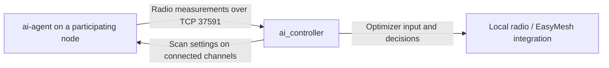

# Following port 37591 into the Beacon G6's mesh optimizer

This article follows optimizer messages between `ai-agent` and `ai_controller` on TCP 37591. For EasyMesh topology, steering and management through ECD and the packaged apcloud agent, see [EasyMesh management](../easymesh-management/README.md). An optimizer message is not automatically an ECD management operation.

TCP **37591** belongs to `/usr/bin/ai_controller`, the controller side of Nokia's local Wi-Fi optimization messaging. `/usr/bin/ai-agent` connects to it through `/usr/lib/libmeshmsg.so`. The protocol carries measurements and scan instructions used by the mesh optimizer.

Device references follow the [shared aliases](../README.md#device-aliases). Source paths use the privately mapped firmware profiles. The owner supplied a live listener observation, but did not identify its physical G6 alias or firmware version in that output. Detailed application addresses below belong to the examined **HJL.L91p01** image. The older IJL.J03p01 binaries were checked for the port/service family, and both builds' native transport codecs were subsequently verified offline. The usable Python implementation and complete field-by-field transport documentation are in [port-37591](../../network-services/port-37591/README.md).

## First identify what is actually listening

The owner ran a read-only `netstat` command. Its relevant fields were:

```text
tcp  ...  <router-LAN-IP>:37591  ...  LISTEN  <pid>/ai_controller
```

That establishes the process and its bind address for this observation. It does not establish WAN reachability, which firewall rules are installed, or whether optimization is currently enabled. The accompanying reads of the two EasyMesh REST address/port files produced no stdout, with stderr redirected; that alone does not tell us whether those files were missing, empty or unreadable. The [observation record](resources/live-listener-observation.json) preserves this distinction.

The native code confirms the port. At `ai_controller:0x54c30`, the compiler loads `0xffff92d7` before calling `mm_start_service_server` at `0x54c3c`. This is a signed promotion of a 16-bit value: the library masks the argument to `0xffff`, giving **37591**. Searching only for an ordinary positive constant missed it initially. The agent writes the same low 16 bits into its client configuration at `0x1471c`.

The controller obtains its address through `nal_getNodeIp()`. In the owner's observation it bound a particular LAN address. There is also a packaged cfgmgr rule template:

```text
-I %s -i br+ -p tcp --dport 37591 -j ACCEPT
```

This shows an explicit firmware policy reference to the port. A template in a binary is not a captured live firewall rule or proof that every operator branch installs it.

## Follow the two directions separately



The controller's incoming callback is called `process_slave_requests` in its retained log strings. It receives reports from agents. The agent's `process_master_requests` callback receives the controller's instructions. Understanding that separation matters: an instruction implemented by the agent is not automatically an instruction accepted by the controller's listening endpoint.

| Direction | What the examined code handles | Evidence |
| --- | --- | --- |
| Agent → controller | Sensing samples and node/radio state. Fields include `mac_addr`, `ip_addr`, `bh_type`, `is_ext`, `chipset`, per-band data, available channels, channel surveys and `buddies`. | `request_type` 0 and 7 reach the sensing handler at `0x46258`. |
| Agent → controller | Scan-result reports. | `request_type` 6 reaches the handler at `0xdbdc`. |
| Agent → controller | `AIR_IQ_DATA`, the firmware's named interference/scan-data path. | `request_type` 10 reaches that report handler and updates related state. |
| Controller → agent | Configure neighbor scans, channel surveys and buddy discovery, including SSID/channel filters. | `action_type` 0 reaches `process_sensing_broadcast` at `0xb5ec`. Required keys include `neighbor_scan_24`, `channel_survey_24`, `neighbor_scan_5`, `channel_survey_5`, `buddies_discover`, `channels` and `ssids`; there are also 6 GHz branches. |
| Controller → agent | Enable or disable agent scan activity and reset associated state when that setting changes. | `action_type` 12 reaches `process_config_scan` at `0x97b4`, through the wrapper at `0xc1ac`, and reads `enable`. This is not a demonstrated radio-power switch. |
| Controller → agent | Set a flag used by the later sensing/full-scan state machine. | `action_type` 13 sets a byte at `0xc5a0..0xc5a8`. Its complete scheduling semantics remain partially traced. |
| Transport, both directions | Peer registration, request/reply routing, broadcast, heartbeats, timeout and link-down handling. | Named `libmeshmsg.so` routines and the controller/agent initialization paths. |

The controller's HJL jump table covers values 0 through 10. Type 5 logs the received JSON. Types 1–4, 8–9 and out-of-range values go to the unrecognized-action path. This is the observed dispatcher, not a list of every feature in the entire optimizer.

The measurements feed the controller's sensing database and channel-decision machinery. For example, its sensing path records per-band survey/channel information and the controller imports `nwa_notifyRadioChannel`. Actual radio/EasyMesh integration extends beyond this TCP handler. These observations do not establish a direct channel-setting, firmware-upload, account-management or shell-command request on port 37591.

A shared implementation contains 6 GHz branches even though the G6 hardware does not thereby gain a 6 GHz radio. Capability checks and the installed hardware still apply.

## What is on the connection

`libmeshmsg.so` implements a proprietary TCP framing layer. The traced send and receive paths use a **36-byte header**: a 32-byte watermark field containing the literal `TCP_WATER_MARK`, followed by a four-byte network-order payload length. Request/reply, login/logout and heartbeat records have `nokia_memsmsg_...` markers; the `memsmsg` spelling is present in the firmware.

Application messages include a JSON envelope with `type`, `sequence`, `mac`, `version` and `ai-meshmsg-data`. The controller constructs an envelope whose type is `AI` and version is `1.0.0`. The receiving wrapper locates `ai-meshmsg-data`, removes the outer suffix, and forwards the inner JSON to the application callback.

The transport can send to one peer or broadcast across connected clients. The controller and agent enable heartbeat and timeout handling. The agent's configuration also contains the neighboring value 37592; a field in an outgoing client configuration does not prove another listening service on that port. The controller has a separate nearby local CLI/control path; its capabilities should not be assigned to the TCP report dispatcher.

## What does “login” authenticate?

In the traced implementation, `build_login_msg()` constructs a login record carrying the peer's URL/address identity. `login_msg_received()` extracts that identity, finds or replaces a channel with the same identity, invokes a connection notification and updates the channel mapping. The controller's connection callback logs/registers the connection. No password, certificate, signature or keyed challenge is checked in those reviewed paths.

The transport is plain TCP. Its shared-library dependencies contain no TLS/crypto library, and the reviewed application wrapper passes plaintext JSON to cJSON without a decryption step. Import absence is supporting evidence; the actual send/receive and login/actor paths are the basis for this conclusion. The controller's unrelated `libcrypt` dependency does not turn this connection into encrypted or authenticated transport.

That makes port 37591 relevant to an untrusted-LAN design. It is a local optimization control plane whose traced path does not authenticate peers cryptographically. Restricting reachability to the intended participants is an appropriate boundary. The review did not establish every topology check, successful unaffiliated-peer registration, forged-report acceptance or practical effect on a live router. That initial static phase had no protocol client or packet injection. The later package phase below uses only local peers and offline codec tests; no router session or exploit was tested.

## Does this also exist in the older G6 image?

Yes, both IJL.J03p01 and HJL.L91p01 contain `ai_controller`, `ai-agent`, `libmeshmsg.so` and the controller/agent 37591 constants. The binaries are **different** between the two images. In IJL the controller constant is at `0x33510` and the agent constant is at `0xfa7c`; HJL uses `0x54c30` and `0x1471c`.

This establishes the same service family and port in both builds. The detailed request/action and authentication trace above was performed on HJL. It is not a claim that all IJL structures, checks or addresses are identical. Four selected HJL startup-wrapper/PCD filenames are absent from the extracted IJL root and are recorded as absences rather than replaced with HJL files.

## Reproduce the file checks

The [offline collector](resources/collect-mesh-evidence.py) checks the build identities, source hashes, signed port constants, library APIs/dependencies, rule template and HJL request jump table. Supply your own extracted roots:

```sh
python3 writeups/mesh-messaging/resources/collect-mesh-evidence.py \
  --hjl-root "$HJL_ROOT" --ijl-root "$IJL_ROOT" \
  --out config-private/mesh-evidence-recheck.json
```

The [offline verification report](resources/validation-results.json) records the file, instruction-stream, link and privacy checks. The [collected evidence](resources/evidence.json), [controller transport trace](resources/controller-transport.txt), [controller application trace](resources/controller-application.txt), [agent actions](resources/agent-actions.txt), [agent scan implementation](resources/agent-action-implementations.txt) and [complete bounded transport-library trace](resources/meshmsg-core.txt) retain the underlying instructions. Literal annotations are heuristic, not a decompiler or a complete data-flow proof. GNU's nearest exported-symbol labels in stripped binaries are not the true names of every internal function.

The live observation is owner-supplied. Protocol analysis and verification used offline file inspection and host disassembly tools. In that initial phase, no firmware code or protocol session was executed. The later package phase below executes only original codec routines offline and local Python sessions. No native mesh daemon was started and no router was contacted or changed. The [knowledgebase](../../knowledgebases/mesh-messaging.md) retains callback addresses, directional mappings, validation, failed approaches and the remaining questions.

## Using the protocol from Python

The [port-37591 package](../../network-services/port-37591/README.md) now implements the six native record kinds, framed TCP streams, URL login/logout, request/reply payloads and heartbeat acknowledgement. It provides an agent client for the router's controller, a small lab controller server, direction-checked report/action helpers, and offline encoding/decoding commands. The [application catalogue](../../network-services/port-37591/docs/application-data.md) states what each known HJL report or instruction carries and marks the nested radio schemas that remain unresolved.

The canonical record starts with the decimal transport sequence, a newline, `nokia_memsmsg_<kind>`, a newline, the peer URL, a newline, `nokia_memsmsg_payload`, another newline, and exact payload bytes. The 36-byte header's big-endian length covers that entire record. Login/logout payloads repeat the URL and end with NUL. Requests/replies preserve an explicit byte count; the application normally adds a terminating NUL. Heartbeats contain non-JSON text such as `{sequence:9}, {interval:12000},{count:4}` plus NUL; acknowledgements contain `{sequence:9}` plus NUL.

The original HJL and IJL libraries produced seven synthetic vectors each under QEMU, covering every record kind and a request without NUL. Their own send/receive framing functions were exercised through AF_UNIX socket pairs. Both builds agree on these bytes. Their outgoing buffers differ: IJL uses 64 KiB and HJL 128 KiB. The Python package defaults to the common 64 KiB bound; this native send-buffer comparison is not a claim about a receive-side firmware rejection limit. Unused native header padding is zeroed in public fixtures.

Heartbeat units are now resolved as milliseconds through the timer call chain and clock arithmetic, rather than inferred from the argument magnitude. The [retained timing traces](../../network-services/port-37591/docs/wire-protocol.md#timer-unit-evidence) support this conclusion; live timer scheduling has not been measured. Full scope, native-library hashes, failed attempts and reproducible instructions are retained in [validation](../../network-services/port-37591/docs/validation.md) and [provenance](../../network-services/port-37591/research/provenance.json).

The Python client completed a 45-second controller session covering login, heartbeat, acknowledgement, request receipt and logout. The controller sent an action 12 enable request and an action 0 scan request. The client did not act on them or send an application report. The first request carried an empty URL, so the decoder now accepts empty metadata while keeping connection and login identities strict. The suite passes 30 tests under WSL and in an installed Windows wheel, including local login, report and action exchanges. The live router alias and build were unspecified, and report ingestion and radio effects remain unverified. [Live evidence](../../network-services/port-37591/research/live-validation.json).
