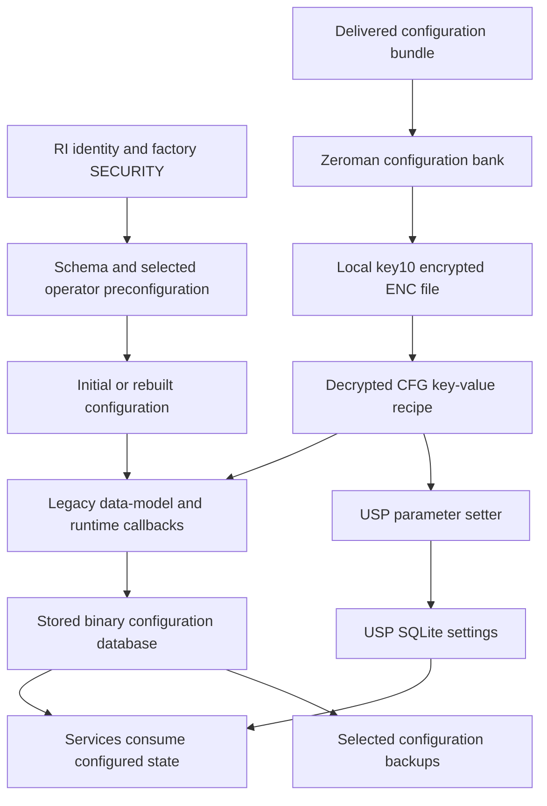

# Putting the Beacon G6 provisioning files together

Device references use the [shared aliases](../README.md#device-aliases). Per-device source references, key-input values and service fingerprints in the accompanying resources are aliases; the private mapping is not published.

The files named `ENC_CFGBOQA112` and `ENC_CFGBOQA114.org` are now readable.
They contain operator configuration, rather than another firmware image.
The most useful result is that all six captured 114 copies decrypt to exactly
the same 7,564-byte text across four G6s. Their different ciphertext had hidden
a common recipe.

That recipe enables a TR-181/USP management path, configures an Ooredoo MQTT
broker, and leaves placeholders for credentials that the router fills from its
own identity and default Wi-Fi configuration. This connects several things
we had previously examined separately: RI, the preconfiguration XML, key10,
Zeroman, the remote-update file and `usp.db`.

All work here was offline. The original G6 cryptographic API was checked under
QEMU; no provisioning handler, import, reset, daemon start, firmware boot,
router command or external server request was performed.

## What provisioning material we actually have

| Material | What it supplies | What it does not establish |
| --- | --- | --- |
| RI partitions | Serial, operator, country, label code, programming date and hardware identity | Current management settings or a complete factory password generator |
| `extfs` / `SECURITY` | Factory password verifiers, protected variable fields and Wi-Fi material; Beacon 9 also has `EXT_KEY_FW` | Plaintext for every field or one interchangeable device key |
| Packaged data-model definitions and `preconfiguration_global.xml` | Schema defaults and operator-specific rules, including factory-versus-generated account choices | Which mutable values are current after later provisioning |
| `sec.key`, `se.conf` and runtime security databases | Packaged keys and runtime key sources used by particular consumers | A single encryption scheme for all files |
| `ENC_CFGBOQA112` / `114.org` | Captured operator parameter recipes stored by Zeroman | A Linux image, a device-specific plaintext password, or proof of the delivery channel |
| `cfg_update_remote_encryption.kv` and availability markers | A retained remote-update parameter file and loader bookkeeping | Whole-file encryption merely because of the filename |
| `usp.db`, TR-069 transport files and the binary configuration DB | Separate persisted settings/state for the configuration and management layers | That a configured agent is currently connected or enabled |
| HTTP/SSH keys and certificate provisioning paths | Service identity and locally protected certificate/key files | Nokia's firmware-signing or Password2 private authority keys |
| `default_scfg.txt` / `scfg.txt` | ASIC and board startup defaults plus customization | Another copy of the operator's full InternetGatewayDevice database |
| `/opt/.backup/configs` and preservation policy | Retained settings, overlay and key copies on examined G6s | Another firmware bank or an atomic rollback of all router state |

There are also supported provisioning types in the code for XML, PRE, GFT,
WEB, CFP, VDR, CFG, CRT and DBG payloads. Those references describe capabilities;
our newly decoded real payloads are CFG files. A referenced profile path or
callback is not evidence that its corresponding payload was installed.
The older G6 `custom.cfg` files in the examined stores are empty placeholders.

## The direction of copying matters

The basic relationship is:



This is a map of the observed readers and writers, not a claim that every
router replays every step on each boot. Existing databases, migration results,
availability markers, immediate-versus-deferred application and reset paths
change which branches run.

Factory data is a source. The current data model and Linux account database
are destinations with their own writers. For example, the BOQA
`KeepLablePassword` path selects factory WebUI verifiers, while the G6's
ordinary ONTUSER creator uses the already documented version-derived generator.
The Beacon 9 retains related schema but its normal dedicated creator is a
no-op. A provisioning flag does not override the need for consuming code.

The old `cfg/se.conf` label `3TN00121LJJJ37` remains configuration/security
metadata. It is not a newly recovered complete firmware image.

## What the ENC layer encrypts

G6 `libzeroman.so` explicitly requests `key10`, then calls
`SE_aesGcmDeFile()` to read the local `ENC_` copy. The writer extracts a
recognized member from an input tar bundle and calls `SE_aesGcmEnFile()` to
produce its local encrypted copy. The original delivered tar archive was not
recovered here, so this does not settle its signature, source or transport
provenance.

For the verified G6 profiles:

```python
key10 = Base64(PBKDF2_HMAC_SHA256(
    exact_RI_serial + exact_ProgDate + effective_source5,
    salt=b"key10", iterations=100, length=64
))[:64]
```

The captured samples validate `effective_source5 = b"invalid_key_src5_str"`.
The serial retains its lowercase RI spelling. This is the same derived key10
already verified against their stored databases, with a different file wrapper:

| File | Wrapper | Cryptographic input |
| --- | --- | --- |
| Zeroman `ENC_…` | `salt4 | GCM tag16 | ciphertext`, no WebUI header | key10's 64 returned ASCII bytes |
| Stored `dmdb_encryption.cfg` | Header magic `0x124126`, then salted CBC container | key10, with the stored-file CBC rules |
| WebUI exported `.cfg` | Header magic `0x123123`, then GCM payload | SHA-512 composition of serial, key7_2, applicable key18 fragment, operator and mnemonic |

Zeroman derives 44 bytes with PBKDF2-HMAC-SHA256, its four-byte file salt and
10 iterations. The split is AES key32/IV12. It uses the same examined fixed
32-byte AAD as the other security-engine GCM API. That shared primitive does
not make the three file formats interchangeable.

Seven real files authenticated: six 114 copies and the fourth G6's 112 copy.
The original `SE_aesGcmDe()` API produced byte-identical plaintext for the
independent G6 test. Wrong rounds or omitted AAD failed the initial checks.
The [offline decoder](resources/decode-provisioning.py) writes a new private
file; it does not apply configuration:

```sh
# Set RI_SERIAL and RI_PROGDATE to the exact RI values from your own router.
python3 writeups/provisioning-pipeline/resources/decode-provisioning.py     ENC_CFGBOQA114.org config-private/decoded-operator-profile.kv     --serial-source "$RI_SERIAL" --programming-date "$RI_PROGDATE"
```

Use the exact source inputs belonging to the captured file. A known operator
recipe is shared plaintext; key10 is not thereby a shared per-device key.
This does not turn an ENC file into a valid ordinary WebUI import.

## What 114 actually asks the router to configure

The file starts with `#!file_type=cfg_update_remote`. Its active metadata is
`$version=0.0.1`, `$no_rts_called=0`, `$if_reboot=1` and `$usp=1`.
The comments describe `$version` as the file format version and the reboot
request as conditional on real local changes. The `$usp` option selects the
USP parameter path for the following section. `$force_write` and
`$operator_id` examples in comments are not active assignments in these two
profiles.

The common 114 recipe:

- Enables `ManagementServer.X_ASB_COM_TR181Enabled` and
  `ManagementServer.X_ASB_COM_TR369Agent_Enable`.
- Clears the legacy NWCC L1/L2/RemoteMobileAccess URL fields and sets the
  Wi-Fi `OperatorUniqueID` to `BOQA`.
- Configures MQTT over TLS to `verne.superwifi-cpe.ooredoo.qa`, port `443`.
- Names the controller `self.nokia:nwcc` and uses device-specific request and
  notification topics under `devices/usp/%M/…`.
- Adds a persistent `Device.Boot!` subscription and a list of boot-report
  parameters, including versions, hardware/model, serial, local agent identity,
  timezone, work role/mode and uptime.

The endpoint is concrete evidence of the Ooredoo relationship. It does not
explain every character of `BOQA`, prove a live connection, or establish that
an identical file was delivered to the Beacon 9.

The complete common parameter views are retained as
[112](resources/ENC_CFGBOQA112-semantic.json) and
[114](resources/ENC_CFGBOQA114.org-semantic.json). They contain substitution
tokens, not expanded device passwords. Their quoted/raw USP syntax is retained
alongside a semantic view; these JSON reports are not upload files.

## The credentials are filled in locally

The HJL `restoreRemoteCfg()` path resolves these placeholders:

| Token | Traced successful-source behavior |
| --- | --- |
| `%M` | RI MAC address formatted with hyphens and uppercase letters |
| `%U` | The same formatted MAC string; used for this profile's MQTT username |
| `%P` | Default Wi-Fi credential obtained through the selected preconfiguration's WLAN1 PreSharedKey accessor |
| `%S` | `ALCL` followed by the uppercase RI serial suffix; supported by the helper |

Thus the common recipe can be identical while the broker credentials and
per-device topics differ. There is no literal universal MQTT password in these
files. The `%P` accessor is not simply a read of the current mutable Wi-Fi
password, nor a read of the Linux root or superadmin credential. Its
preconfiguration callback follows the relevant RI/value rule. The exact
result on a live device still depends on that rule and the available sources.

This was traced statically, not tested by logging into the broker or running
the provisioning callback. No credential was sent to a server.

## What changed between the packages named 112 and 114

| Setting | 112 | 114 |
| --- | --- | --- |
| Total active assignments, including metadata | 97 | 99 |
| MQTT ConnectRetryTime | 5 seconds | 120 seconds |
| MQTT ConnectRetryMaxInterval | 120 seconds | 7,200 seconds |
| Boot parameter entries | 17 | 15 |
| MQTT PublishQoS | Not explicitly assigned | 1 |
| MQTT CleanStart / RequestResponseInfo | Not explicitly assigned | Both true |
| USP notification retry / expiry fields | Not explicitly assigned | Added |

The later-named file adds explicit ProvisioningCode and USP notification retry
settings. Its boot list drops FriendlyName, ControllerCode and ProvisioningCode,
adds uptime, and reorders retained fields. This is a change in configuration
policy; there is no new Linux build implied by either filename, and the names
do not date when the files were shipped or applied. The literal `.org` suffix
also does not prove factory-original provenance.

Across the full parameter map there are eight added keys, six removed keys and
ten changed common keys. Several changed common keys are reordered indexed
boot entries rather than changes to the meaning of a retained parameter.

## The saved remote file is another copy of this recipe

All six examined G6 `cfg_update_remote_encryption.kv` copies are readable text.
They contain the same 99 original assignments as decoded 114, with one extra
metadata assignment: `$encryption=1`. The files use different line formatting;
we verified assignment identity, not a byte-identical normalized whole file.

The `_encryption` name and flag therefore do not mean that these particular
files have the Zeroman GCM wrapper. Their common MQTT password assignment is
still `%P`. Full field-encryption behavior for other remote files is a separate
parser question; a suffix alone cannot establish it.

The retained `tr069_conf/cfg_update_remote_file_name` bookkeeping on the second
and fourth G6s says `CFGBOQA112`, while 114 and its matching remote file are also
present. These captures are not an atomic provisioning history. They do not
prove which actor delivered each file or the exact order of subsequent copies.

Zeroman's directories numbered 2–5 and their `active`/`commit` markers are
configuration-bank state. They are separate from rootfs0/rootfs1 and U-Boot's
`sb_flag`. A marker's presence is not a successful boot or network session.

## Which settings survived into agent storage

The saved USP SQLite `data_model` tables contain hashed keys, instance strings
and values. Exact broker/controller value witnesses were found as follows:

| Captured store | Rows | Ooredoo broker and Nokia controller values present |
| --- | --- | --- |
| `G6-A` | 691 | No |
| `G6-B` | 698 | Yes |
| `G6-C` | 689 | Yes |
| `G6-D` | 102 | Yes |
| Beacon 9 | 717 | Yes |

These are saved-state witnesses, not a complete reverse mapping of every
hashed URI or a live authentication test. The first G6's different retained
state remains an observation; it is not proof that the common profile was
never applied.

The supplied G6 WebUI export enables TR-369. The supplied Beacon 9 export
disables it, despite retaining the operator broker/controller configuration.
The raw flash and exports need not be simultaneous. This separates a retained
profile, its requested settings, saved agent state and a currently active
management connection.

TR-069's `tr.conf` and `tr181.conf` also retain transport settings, including
client interfaces/ports and certificate configuration. The ACS URL and other
managed values belong to the main data model; these small transport files are
not a complete copy of it. The SW-management cloud client is another separate
consumer, with its own retained API credential. No new OTA query was made.

## Why these files can come back after an ordinary reset

The shipped `HB_Config.json` normal-reset whitelist explicitly includes remote
preconfiguration/update files, Zeroman, certificates and `tr069_conf`.
Its DataGuardian dynamic-backup list includes the remote files, Zeroman,
configuration database and overlay. This supplies a concrete explanation for
retained provisioning material and `/opt/.backup/configs` copies.

It is a policy file and captured backup evidence, not a live reset/restore
experiment or a guarantee for deep reset and every upgrade. The deep-reset
list differs. None of these directories is another firmware image.

The hardware `default_scfg.txt` and overriding `scfg.txt` are another distinct
layer: their comments and entries describe ASIC/board startup values. They
should not be mistaken for operator parameter recipes simply because they
also contain the word configuration.

## Certificates add two more key consumers

The Zeroman certificate path requests `key15` for private-key-file protection.
The examined security API reads PEM/DER private keys and writes encrypted PEM
using `aes256` and a passphrase. It requests `key16` for `SE_certSign()`, which
copies certificate bytes and appends a local 32-byte SHA-256-based integrity
tag. The observed digest helper interleaves key bytes after each positive
512-byte input chunk.

This is local file protection, not issuing a certificate with Nokia's CA or
recovering a vendor signing key. Neither entry is in the eleven-entry packaged
static stores we decoded. Their live values and complete provisioning sources
remain unmeasured. The saved HTTP/SSH service keys, the Password2 verification
key and the firmware trust certificate remain separate materials.

## What the Beacon 9 adds, and what remains open

Its selected p28 configuration filesystem is ordinary ext4 in this capture.
Read-only extraction recovered 95 regular files without changing the image.
The Zeroman content directories are empty, but `usp.db` contains the operator
broker/controller values. The alternate p29 backup holds two equal stored-DB
files; no operator ENC file was recovered there. A specific G6-style backup
operator path was absent from p31; that is not an exhaustive reconstruction of
all user-data contents.

The initial G6 missing-source5 key10 profile failed against the actual Beacon 9
stored database. The [Vodafone ONT follow-up](../xs2426xa-24-03-comparison/README.md)
resolved that difference: sec_extfs hashes selected decoded factory fields into
source5, and the Beacon 9's own material now decodes all four saved database
copies. Its WebUI export continues to use the separate key7_2/key18 composition.
Shared service endpoints do not make per-device factory inputs interchangeable.

The remaining gaps are specific: original delivery/archive/signature provenance,
complete branch ordering on every reset/migration path, live connection and
credential behavior and the key15/16 lifecycle.
The [complete knowledgebase](../../knowledgebases/provisioning-pipeline.md) and
[source-pinned evidence](../../knowledgebases/provisioning-pipeline-evidence.json)
retain the full decoded parameter maps, source traces, negative results and
private-source references. The [Beacon 9 companion](../../../Nokia-Beacon-9/writeups/provisioning-pipeline/README.md)
keeps its model-specific limits explicit.

The [validation record](resources/validation-results.json) retains the seven real-file checks,
14 negative cases, source fingerprints and documentation/privacy checks. No
provisioning callback or live management connection was tested.

## Physical reset behavior traced

The [physical reset investigation](../factory-reset/README.md) now follows the actual button handler, scheduled environment flag and startup cleanup. Normal reset preserves the union of the deep and normal lists while deleting the working database and custom configs startup payloads. G6 normal reset also skips hidden top-level entries and leaves most opt/.backup; Beacon9 clears its separate backup area. Deep reset removes stored normal-reset operator material, with G6 reformatting only selected data volumes. No live reset or final configuration/login test was performed.
