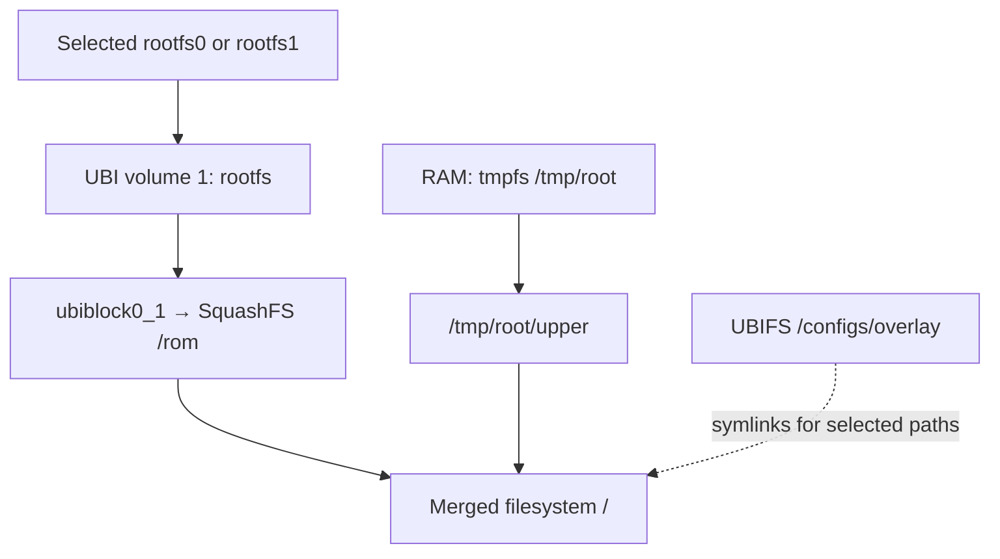

# Mapping the Beacon G6's NAND and filesystems

## Start with the flash layout

The Beacon G6 stores its firmware and persistent data in NAND. In both captured routers, the kernel identifies a Micron MT29F4G08ABAFAWP: 512 MiB of SLC NAND, split into twelve initial MTD partitions. Two partitions contain firmware banks; the remaining regions hold boot packages, environment records, factory data and writable data stores.

I compared the partition tables, UBI information, mounts and actual dump files from both G6s. The physical partition map agrees, but the filesystems visible after boot add another layer of names and devices. That distinction explains where a file is stored, what survives reboot, and which dump contains the bytes needed to recover it.

## The NAND geometry

The captured driver reports:

| Property                        |              Captured value |
|---------------------------------|----------------------------:|
| Main data capacity              | 512 MiB / 536,870,912 bytes |
| Physical eraseblock (PEB)       |     256 KiB / 262,144 bytes |
| Data page / minimum I/O unit    |                 4,096 bytes |
| Spare or OOB area per page      |                   256 bytes |
| UBI VID-header offset           |                 4,096 bytes |
| UBI data offset within a PEB    |                 8,192 bytes |
| Usable logical eraseblock (LEB) |     248 KiB / 253,952 bytes |

NAND is erased in blocks and read/written through the controller's page and ECC handling. MTD exposes the flash regions. UBI adds logical volumes, wear levelling and bad-block management; UBIFS is a writable filesystem on those volumes. The [kernel's UBIFS documentation](https://docs.kernel.org/filesystems/ubifs.html) describes these layers.

Here, the first two 4 KiB pages of a UBI eraseblock precede its data area: 262,144 - 8,192 = 253,952 bytes. Filesystem capacity is smaller again because UBI reserves blocks and the filesystem has its own metadata. A 30 MiB partition therefore does not provide 30 MiB of free files.

## The twelve physical partitions

The offsets below follow the layout passed by the captured bootloaders. Their sizes agree with both Linux /proc/mtd snapshots. Offsets are main-area NAND offsets; OOB bytes are separate.

| Linux MTD | Partition      | NAND offset  |    Size | Contents                                                  |
|-----------|----------------|--------------|--------:|-----------------------------------------------------------|
| mtd0      | `ssb`          | `0x00000000` |   4 MiB | Boot-stage packages and certificates                      |
| mtd1      | `uboot-env`    | `0x00400000` |   2 MiB | Redundant bootloader environment                          |
| mtd2      | `RI`           | `0x00600000` |   1 MiB | Factory identity/provisioning                             |
| mtd3      | `rootfs0`      | `0x00700000` |  80 MiB | Firmware-bank UBI image                                   |
| mtd4      | `rootfs1`      | `0x05700000` |  80 MiB | Firmware-bank UBI image                                   |
| mtd5      | `rootfs_data0` | `0x0a700000` |  30 MiB | UBI data partition                                        |
| mtd6      | `rootfs_data1` | `0x0c500000` |  30 MiB | UBI data partition; current /configs backing store        |
| mtd7      | `cfg`          | `0x0e300000` |   8 MiB | Separate configuration partition; legacy migration source |
| mtd8      | `log`          | `0x0eb00000` |  15 MiB | UBI storage mounted at /logs                              |
| mtd9      | `extfs`        | `0x0fa00000` |   5 MiB | Nokia logical-record store                                |
| mtd10     | `0:ART`        | `0x0ff00000` |   1 MiB | Factory/radio calibration store                           |
| mtd11     | `user_data`    | `0x10000000` | 256 MiB | UBI storage mounted at /opt                               |

The map ends at 0x20000000, exactly 512 MiB. The first 256 MiB contains all regions through 0:ART; the second 256 MiB is user_data. The [CSV map](resources/partition-map.csv) preserves the byte offsets and sizes.

rootfs_data0 and rootfs_data1 are separately named data partitions. Their suffixes do not establish which one the running firmware mounts. Likewise, the partition named cfg is not automatically the filesystem mounted at /configs. The actual selection is described below.

## Each firmware bank is a UBI image

An 80 MiB rootfs0 or rootfs1 dump contains a UBI container. In the captured normal boots, the selected bank is attached as ubi0 and exposes these volumes:

| Volume ID | Name | UBI type | First G6 allocation | Second G6 allocation | Contents |
| --- | --- | --- | ---: | ---: | --- |
| 0 | fit | Static | 20 LEBs | 20 LEBs | FIT containing the kernel and DTBs |
| 1 | rootfs | Dynamic | 281 LEBs | 248 LEBs | Read-only SquashFS image |
| 3 | wifi_fw | Dynamic | 8 LEBs | 8 LEBs | Separate SquashFS firmware image |

The volume numbers are explicit: the third listed volume is ID3. A dynamic UBI volume can hold a read-only filesystem; dynamic describes the volume, not whether SquashFS files can be edited.

Linux opens volume1 through ubiblock0_1 and mounts its SquashFS as the stock root. Volume3 is exposed through ubiblock0_3 and mounted at /lib/firmware/IPQ8074/WIFI_FW. The FIT volume is a different object from the SquashFS rootfs. A complete bank image includes the UBI layout around all three.

The second G6 illustrates the difference between allocation and content. Its rootfs volume reserves 62,980,096 bytes, against 71,360,512 on the first. The 33-LEB difference appears as 8,380,416 available UBI bytes on the second. Nevertheless, both contain the same 39,269,512-byte SquashFS image, verified by hashing the range recorded in its superblock. The larger volume dump does not represent a different filesystem; the difference is outside the used image.

## Why /proc/mtd grows after UBI attaches

The initial twelve entries describe the physical partition map. Later entries in these captures are UBI-volume views exported by the kernel's gluebi driver, which emulates MTD devices on UBI volumes. Its erase size follows the volume's LEB size. This is visible as 0x3e000 rather than the raw partitions' 0x40000. See the [Linux 4.14 gluebi implementation](https://raw.githubusercontent.com/torvalds/linux/v4.14/drivers/mtd/ubi/gluebi.c).

| Captured Linux node | Volume represented |
| --- | --- |
| mtd12, fit | ubi0 volume0 |
| mtd13, rootfs | ubi0 volume1 |
| mtd14, wifi_fw | ubi0 volume3 |
| mtd15, log | ubi8 volume0 |
| mtd16, user_data | ubi11 volume0 |
| mtd17, rootfs_data1 | ubi6 volume0 |

These entries reuse storage already counted in the physical map. Adding their sizes to the twelve partitions would double-count it. The same name can therefore appear twice: mtd8 is the raw log partition, while mtd15 is its logical UBI-volume view.

A static volume's gluebi size follows its stored payload length. That explains why mtd12 and its dump are 5,005,934 bytes even though the fit volume reserves 5,079,040 bytes. For the dynamic rootfs volume, the exported size follows the allocated volume, so the SquashFS superblock is needed to identify the used image length.

Neither MTD numbers nor UBI numbers alone establish the backing storage. U-Boot even called rootfs0 mtd5 during the successful recovery test, whereas these Linux captures call it mtd3. In Linux, correlate /proc/mtd, /sys/class/ubi/ubiX/mtd_num and the mounted volume. Keep U-Boot's numbering separate.

## What the running filesystem is backed by

Both saved normal-boot mount tables show the same arrangement:

| Path | Backing storage | Filesystem and lifetime |
| --- | --- | --- |
| /rom | Selected bank, ubi0 volume1 | Read-only SquashFS |
| / | SquashFS lower tree plus /tmp/root/upper | Writable OverlayFS view |
| /tmp and /tmp/root | RAM | tmpfs; discarded at reboot |
| /configs | rootfs_data1, ubi6 volume0 | Persistent UBIFS |
| /logs | log, ubi8 volume0 | Persistent UBIFS |
| /opt | user_data, ubi11 volume0 | Persistent UBIFS |
| /lib/firmware/IPQ8074/WIFI_FW | Selected bank, ubi0 volume3 | Read-only SquashFS |

The root upper layer is RAM. The preinit code calls ramoverlay, creates /tmp/root/upper and /tmp/root/work, then pivots the mounted tree so that the original SquashFS is visible at /rom. An ordinary replacement in the root overlay survives only for that boot. OverlayFS presents the upper object while retaining the lower copy, as described in the [kernel's OverlayFS documentation](https://docs.kernel.org/filesystems/overlayfs.html).



Some paths deliberately point out of that RAM upper layer. /usr/exe/link.sh reads OverlayPersistentFileList from HB_Config.json and creates links into /configs/overlay. Startup seeds missing persistent targets from /rom. Both inspected versions, HJL.L91 and the recovered IJL.J03, list:

```text
/etc/config
/etc/dropbear
/data/vendor/wifi
/etc/scfg
/lib/wifi/wifi_nss_olcfg
/lib/wifi/wifi_nss_olnum
/lib/wifi/wifi_nss_hk_olnum
/home
/lib/wifi/wifi_nss_override
```

For example, /etc/config is backed by /configs/overlay/etc/config. This is why some settings survive even though the general root upper layer is temporary. For a particular file, follow its symlinks and check its mount rather than classifying it solely by an /etc or /usr prefix.

## /configs is selected independently of the firmware bank

The startup script reads cfg_partition from U-Boot environment and mounts volume0 of that named partition at /configs. Both saved environments contain cfg_partition=rootfs_data1. The first router boots rootfs0 and the second boots rootfs1, yet both mount the same named data partition at /configs.

When cfg_partition is absent, startup defaults it to rootfs_data[current] and enters configuration-migration handling. A legacy-layout migration can also remap or rebuild stored data. The separate cfg partition is used as a source by the legacy migration code; it should not be described as either the current /configs mount or universally unused.

Changing the selected firmware bank consequently changes its kernel/rootfs/Wi-Fi volumes, while shared stores can remain in place. It does not restore all settings to their state when that bank was installed. The activation and commit protocol belongs in the [slot writeup](../firmware-slot-rollback/README.md).

## Shared boot and factory stores

ssb contains boot-stage packages and certificates. Both supplied 4 MiB dumps have FIP containers at partition offsets 0x20000 and 0x100000. Their corresponding payloads match within each unit. These are copies inside shared storage, rather than separate bootloaders attached to the two Linux banks.

uboot-env is another shared region. /etc/fw_env.config specifies two records, at partition offsets 0 and 0x100000. Each record is 0x20000 bytes; the flash erase size is 0x40000. Both record CRCs validate on each unit. This preserves two environment copies within the 2 MiB partition, not one environment per firmware bank. Keep the distinction between the small record, its eraseblock and a backup of the whole partition.

RI, extfs and 0:ART hold device-specific factory material. extfs exposes named logical objects through Nokia's API; the retrieved SECURITY object is 8,192 bytes, within a 5 MiB raw partition. That logical payload and a complete extfs dump preserve different layers. The credential meanings of its fields are covered in [configuration and provisioning](../configuration-and-provisioning/README.md); they do not need to be decoded to identify the storage boundary.

## What the saved dumps actually contain

The main artifact types preserve different information:

| Artifact | What it preserves |
| --- | --- |
| A tar of /rom | Files from the mounted stock filesystem; no UBI layout, shared partitions or runtime mounts |
| Physical mtd0–mtd11 readout | Main-area bytes of one named partition; UBI headers included where present |
| A gluebi volume readout | Logical volume contents, without the enclosing physical UBI layout |
| A recovered SquashFS image | The filesystem range described by its superblock |
| A logical extfs record | One API-returned object, without the complete partition's storage structures |
| WebUI configuration export | A modeled settings backup, rather than filesystem or NAND contents |

The scripts read ordinary MTD devices, so these files omit spare/OOB bytes. Reader ECC mode, bad-block handling and the restore tool's expected format still matter; a .bin suffix does not specify them. A read of a writable store while services are changing it also is not an atomic snapshot.

The [dump-coverage CSV](resources/dump-coverage.csv) audits the files currently present in both capture directories. Three points matter:

- Both now include a nonempty SSB dump, added separately by the owner. The directory timestamps do not date those supplemental files; the current dump scripts include mtd0 too.
- The older selectors used for those saved archives omitted raw mtd8 and mtd11, the physical log and user_data partitions. The current scripts' optional `full` scope captures both; the default `firmware` scope still omits them.
- Both directories contain zero-byte mtd15_log.bin, mtd16_user_data.bin and mtd17_rootfs_data1.bin files. Their filenames provide no backup data.

The ZIP listings show the same empty logical captures and missing raw log/user_data partitions. The first unit's ZIP also lacks mtd0 even though the supplemental file now exists beside it; the second ZIP includes it. An archive therefore needs its own membership check rather than inheriting the coverage of its surrounding directory.

The current SSH and Telnet dump scripts deliberately stop at the physical-partition layer. `firmware` selects mtd0–mtd7, mtd9 and mtd10; `full` selects all twelve physical partitions, mtd0–mtd11. Neither selects mtd12–mtd17, because those are logical views into already described storage. In particular, both physical firmware banks are included, so this does not omit the alternate bank. Optional logical-volume exports can simplify analysis but do not add independent physical coverage. See the [dump tutorial](../../tutorials/dump-firmware/README.MD) for the full-scope command. These script changes do not retroactively fill gaps in old archives.

The raw mtd6 capture is present, so the empty mtd17 file does not mean that the configs store was omitted entirely. For /logs and /opt, however, these directories contain neither their raw partitions nor usable logical-volume captures. They therefore are not complete raw-chip backups. The byte counts and coverage must be checked before relying on a capture for restoration.

For offline extraction, the [recovery helper](../../webui/scripts/research/recover-g6-rootfs.py) reconstructs a SquashFS volume from UBI logical blocks. It handles the observed vendor compressor-options incompatibility in a temporary copy; it leaves the original dump unchanged. Its extracted research tree is selected directories, not a complete flashable image. Missing UBI blocks, empty files and unsupported layouts remain errors rather than something to pad or guess away.

## Which operations change persistent storage?

| Operation | Storage consequence in the examined firmware |
| --- | --- |
| Normal reboot | RAM upper layer is recreated; persistent files remain on their stores |
| Firmware-bank selection | Updates boot-selection metadata and activation markers; the bank images remain in place |
| Linux firmware update | Writes the alternate rootfs bank and configured boot components; with SAVE_CONFIG=1, platform_copy_config formats the opposite rootfs_data partition |
| U-Boot bn target0 or1 | Erases the matching rootfs_data partition before writing that numbered bank |
| Factory reset | Deletes or formats data stores according to reset type and whitelists |
| Startup recovery/migration | Can format a failed data store or relocate/rebuild configuration data |

The two update paths differ. Linux platform_copy_config targets rootfs_data[1-active_part], whereas bn targets rootfs_data with the supplied bank number. Neither path excludes the partition named by cfg_partition. With configs on rootfs_data1, Linux updating from bank0 or bn writing image1 can target that store. These erase paths were traced offline; no such erase or restore was tested here. The [upgrade investigation](../firmware-upgrade-path/README.md) retains their wider control flow.

Both builds configure a boot subimage targeting the shared ssb partition. The platform script also supports a part_table subimage targeting uboot-env, although that tag is absent from both configured subimage lists. A banked rootfs therefore does not make every part of an update an inactive-bank write.

There are also file-level policies: upgrade_check refreshes /etc/config/syslog, /etc/config/qcacfg80211 and /etc/scfg from the new firmware in these builds. The common-config deletion list is empty. A persistent mount describes where data lives; it does not promise that the vendor leaves every file unchanged.

## Inspecting storage on a normally booted G6

These Linux commands inspect the current arrangement without invoking the vendor's formatting or reset scripts:

```sh
cat /proc/mtd
cat /proc/cmdline
cat /proc/mounts
ubinfo -a
df -k / /rom /configs /logs /opt
fw_printenv -n active_part
fw_printenv -n cfg_partition
cat /etc/fw_env.config

for d in /sys/class/ubi/ubi[0-9]*; do
    [ -r "$d/mtd_num" ] || continue
    printf '%s -> mtd' "${d##*/}"
    cat "$d/mtd_num"
done
```

For the evidence behind this map, read the [storage knowledgebase](../../knowledgebases/storage-and-flash.md) and [measurements](../../knowledgebases/storage-and-flash-evidence.json). Startup execution and script persistence are covered separately in [persistent overlays](../persistent-overlays/README.md), while [UART recovery](../uart-recovery-from-uboot/README.md) covers accessing Linux when normal startup is unavailable.

## Third-unit follow-up

The [third capture](../third-g6-comparison/README.md) includes all twelve physical partitions and both raw writable regions missing from the first two archives. Its current-store and older cfg databases were recovered, while log-index extraction needed explicitly limited node carving. Earlier archive coverage tables remain specific to the first two captures.

## A second product using the same NAND layout

The Vodafone XS-2426X-A dump repeats the 512 MiB, twelve-partition physical
layout and the same erase/page geometry. Its captured active bank is rootfs1,
with rootfs_data1 selected for `/configs`; its banks contain different 24.03
maintenance builds. Each recovered bank contains FIT, rootfs and Wi-Fi UBI
volumes. The FIT and rootfs differ while the used Wi-Fi payload is identical.
This supports the layout comparison, not cross-model firmware compatibility.
The ONT data0 extraction failed UBI layout discovery; data1/cfg/log/user_data
extracted. That failed extraction is not diagnosed as damaged flash. [Exact
partition and volume evidence](../xs2426xa-24-03-comparison/resources/initial-inspection.json).
