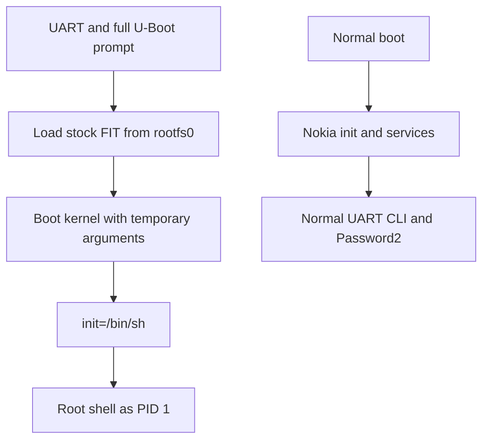

# Recovering a G6 root shell through stock U-Boot

What can you do if a firmware change removes the files that made the Beacon G6's normal UART root login possible? On a G6 where the full U-Boot prompt is still accessible, I demonstrated another route: load the installed stock kernel and ask Linux to start a shell instead of Nokia's normal startup process. The resulting UART shell ran as root and was Linux's first userspace process.

The test used the current `HJL.L91p01` image in `rootfs0`. U-Boot reported successful signature and hash checks on the stock image. This was a temporary change to the boot arguments, not a replacement bootloader or a modified firmware image. Access to the full U-Boot prompt is a prerequisite. A later recovery session reached the persistent configuration volume read-only; restoring files and returning them to use remain untested.

For the commands, prerequisites and recovery precautions, use the [step-by-step tutorial](../../tutorials/recover-uart-root-shell-from-uboot/README.md). This writeup explains why the route works, what the test showed and where its limits are.

## Why another route is useful

UART is the serial connection used to see and interact with the device's console. On the normal G6 route described in the [boot and console writeup](../boot-and-console/README.md), several stages stand between that connection and a root shell:

1. The serial console must be available.
2. The user must reach the full U-Boot prompt by passing Nokia's `en` gate.
3. After Linux starts normally, the UART login route reaches Nokia's CLI and its `Password2` check.

The existing root-login arrangement relies on persistent files and a startup hook to reinstall a runtime override for that last stage. If those files disappear, or a new firmware build stops calling the hook, the ordinary route may no longer provide a root shell. The recovery problem is how to reach Linux to inspect and restore that arrangement without relying on it already working.

The answer uses the first two stages. With full U-Boot access, I can start the installed kernel with a different instruction for its first userspace process. This avoids starting the normal CLI and reaching its `Password2` check; it does not recover or change that password.

## What changes when Linux starts a shell first?

U-Boot is the bootloader that prepares and starts Linux. In the usual G6 boot, Nokia's `bootcortina` command prepares the flash partition map, loads a **FIT** image from the selected firmware bank and constructs kernel boot arguments. The FIT contains the kernel and device tree data needed for boot. Once the kernel starts, it normally launches the device's init process, which brings up the rest of the system and its services.

Linux accepts an `init=` boot argument selecting the first userspace program. In the tested recovery boot, `init=/bin/sh` made that first program a shell. Because the normal init chain had not run, neither the usual services nor the CLI containing the `Password2` gate had started.



The shell being **PID 1** matters: it is standing in for init, not running inside an otherwise fully started router. That makes it useful for recovery, but it also means normal networking, services, account setup and writable mounts cannot be assumed to exist. Terminating PID 1 can panic Linux; the tutorial explains how to leave the session.

## What happened in the live test

On 24 October 2026, I loaded the stock `fit` volume from `rootfs0`, passed the recovery arguments and booted it from memory. At the resulting UART prompt:

```text
/ # id -u
0
/ # echo $$
1
```

The first result identifies the effective user as root; the second shows that the shell is PID 1. This is a live shell result, rather than a possibility inferred only from the firmware.

U-Boot reported successful `sha256,rsa2048` verification of the FIT configuration and matching SHA-256 checks for the kernel and device tree. The loaded FIT was 5,005,934 bytes, and the supplied kernel digest matches the captured current HJL images. The physical G6 used for the test was not explicitly identified, so the selected bank alone does not justify assigning it one of the project's device aliases.

The result establishes that the installed authenticated kernel accepted this startup choice. It does **not** show that the device accepts unsigned firmware, that secure boot was disabled, or that the bootloader or kernel was patched. The [secure boot writeup](../secure-boot/README.md) covers the separate verification stages.

## Why the partition map must be prepared

The stock image sits in a UBI volume named `fit` inside the `rootfs0` flash partition. UBI is the layer used to manage volumes on the NAND flash; a partition name must first be known to U-Boot before it can attach that partition and read the volume.

The first manual attempt began after a step that normal `bootcortina` would have performed. `ubi part rootfs0` failed because the partition map had not been registered in that U-Boot session. Trying `image0` did not solve it. An attempt to list `mtdparts` while its variable was unset caused a synchronous abort and CPU reset.

Offline traces of both captured G6 bootloaders showed the missing preparation: `bootcortina` sets `mtdids` and the full `mtdparts` map before it attaches UBI. The successful sequence reproduced those assignments in memory, loaded the FIT, set recovery boot arguments and called `bootm` on the image in RAM. Calling the normal `bootcortina` path instead would rebuild the arguments and discard the recovery choice. The [tutorial](../../tutorials/recover-uart-root-shell-from-uboot/README.md) gives the tested map and command sequence.

The attach called `rootfs0` **mtd5** in U-Boot; the captured Linux partition map calls it **mtd3**. Those numbers come from different registration contexts, so the verified partition name is the useful link between them. The captured NAND log reported correctable errors, followed by completed reads, passing image checks and the successful shell. It did not establish a need to erase the flash or a failed signature check.

The documented `setenv` changes are in RAM and are not saved with `saveenv`. The sequence contains no explicit flash write or erase; that is not a guarantee that UBI attachment and all bootloader state handling make no metadata writes.

## A root shell is the start of recovery

The early shell does not automatically mount the normal `/configs` store or establish the RAM overlay used during ordinary startup. The root filesystem is squashfs and is read-only in this boot. Having root privileges therefore does not mean that copying a file into `/usr` or `/etc` will repair the next normal boot.

On 16 November 2026, I mounted the persistent configuration volume read-only in a recovery session. The saved `cfg_partition` identified `rootfs_data1`; Linux exposed it as `mtd6` in that session. I attached it as UBI6 and mounted its `rootfs_data1` UBIFS volume at `/mnt`. The mount did not make the underlying `/configs` directory into the normal configuration mount. Partition and UBI numbers can differ, so the [tutorial](../../tutorials/recover-uart-root-shell-from-uboot/README.md) checks their names and mappings before using them.

The recovery environment needed preparation. Mounting `proc` and `sysfs` worked, but mounting `devtmpfs` failed with `No such device`. Instead, I created a UBI control device on a temporary RAM filesystem, using the major and minor numbers reported by that running kernel. An earlier attempt with a hardcoded control number failed with an ioctl error. The original optional helper remains untested and has been retired because it could mount over `/dev` and hide the serial console's device tree.

The read-only mount exposed the encrypted configuration database and its backup, but UBIFS reported **recovery needed** and **recovery deferred**. The two files matched each other in that view, yet their sizes and hashes differed from an earlier normal-boot observation. Neither observation establishes which contents are newer or what normal boot will expose after filesystem recovery. A read-only view is useful evidence, not a verified rollback point or permission to overwrite the database.

The intended next step would be to restore the missing helper, credential material or public key, and its startup caller, once a known-good backup and a safe restoration procedure have been established. Read/write mounting, journal recovery, file restoration and normal-boot acceptance have not been verified. The [Password2 tutorial](../../tutorials/unlock-uart-root-shell/README.MD) describes the existing arrangement; the [cross-bank startup tutorial](../../tutorials/setup-startup-across-firmware-banks/README.md) describes a caller present in both inspected builds. Preserve and merge multi-purpose scripts; restoring a hook alone will not help if future firmware no longer calls it.

For the public-key method, the public PEM and boot script can be recreated as text over UART; the signing private key stays on my computer. Neither that restoration nor a subsequent ordinary login was established by the PID 1 test.

## The reported reset and the watchdog

After the successful shell boot, I observed that the router resets after a while. A watchdog expiring while normal startup is bypassed is plausible, but the reset cause and elapsed time were not established.

I supplied commands to select and stop a watchdog in U-Boot. The tutorial places those commands before the recovery boot, but there is no sustained-session result showing that this updated sequence prevents the reset. The original live test proves entry into the shell; it does not prove that the shell remains available indefinitely or that the watchdog was the cause.

## Why flashing is a different operation

The examined U-Boot command tables expose NAND and UBI write operations as well as commands for booting an image from memory. That does not make flashing a convenient way to restore one missing script. I did not execute a `bn`, NAND-write or UBI-write command in this recovery test.

The vendor `bn` handler has a particularly important side effect. Tracing both captured bootloaders shows that, before writing `rootfs0` or `rootfs1`, it erases the correspondingly numbered `rootfs_data` partition. In the tested setup, `cfg_partition=rootfs_data1`, so the `bn image1` route can erase the store holding `/configs`. This differs from the Linux updater's opposite-bank data-formatting path.

A FIT volume, a squashfs filesystem and a complete rootfs-bank UBI image are different objects. Writing a prepared bank or volume would require a separately verified image, the correct geometry and backups; it is not a single-file edit. The [command inventory](resources/g6-uboot-command-inventory.py) and [evidence record](../../knowledgebases/uart-recovery-from-uboot-evidence.json) retain the traced details.

## What this depends on

The successful route reduces dependence on the stored `Password2` override and its Linux startup hook. It still depends on access to the full bootloader prompt, the appropriate partition layout and a bootable stock image whose kernel accepts the supplied startup arguments. Keeping the [recovery commands](../../tutorials/recover-uart-root-shell-from-uboot/README.md) and verified backups off the device makes them available if the persistent files are lost.

The older G6 `IJL.J03p01` bank has not been booted this way in a live test. Its captured kernel configuration supports the relevant filesystem layers and does not force a built-in command line, which supports further investigation but is not proof of successful recovery. A future firmware update could also change the bootloader, console or authentication policy, kernel command-line policy or storage layout. An off-device rescue kernel or initramfs is another possible route, but it was not validated here.

The [knowledgebase](../../knowledgebases/uart-recovery-from-uboot.md) retains the exact traces, test boundaries and outstanding work.
