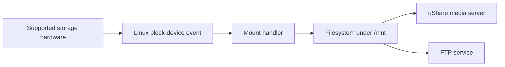

# USB storage and sharing: findings from G6 HomeOS 24.xx

The research below traces Beacon G6 HomeOS 24.02 `IJL.J03p01` and 24.04 `HJL.L91p01` captures. It does not establish that the software is unique to the G6 or that all HomeOS 24.xx products behave the same way. The examined XS-2426X-A 24.03 builds share a USB-named CGI between those ONT builds, but that observation alone does not compare their mounting or sharing paths.

What would the firmware do with a USB disk, and does that make the Beacon G6 a network storage device? The captured G6 firmware contains code for detecting and mounting removable storage, along with software for sharing media and serving files. The documented G6 enclosure, however, has **no external USB connector**. The presence of this software does not establish a usable USB host connection on the examined hardware.

This article follows the saved active `HJL.L91p01` and inactive `IJL.J03p01` firmware trees from [G6-B](../README.md#device-aliases). It explains the paths found in those files, not a successful disk or network-sharing session. No media was inserted and no sharing service was started or tested for this research. Nokia's [rear-panel reference](https://www.nokia.com/asset/f/215110/) and the project's [hardware inventory](../hardware/beacon-g6.md#ports-controls-and-power) show the documented connectors. USB-related firmware or hardware descriptions alone do not establish accessible wiring, power or a working controller.

## From a disk to files on the router

A storage device has to pass through several steps before a network client can use its files. Linux first needs to recognize the hardware and expose a **block device** representing the disk or partition. A mount operation then attaches the filesystem on that partition to a directory in the router's filesystem. Finally, a separate application can make selected files available over the network.

This is the relationship suggested by the shipped software, not a record of an end-to-end test. Detection does not guarantee a successful mount; a successful mount does not by itself mean that either sharing service is enabled or reachable.

### Detection and mount points

On HJL, Linux block-device events reach Nokia's `/etc/hotplug.d/block/10-mount` script. A *hotplug* handler runs in response to a device event, such as a disk being added or removed. The script looks for names resembling partition devices such as `sda1`, rather than a whole-disk name such as `sda`. For an ordinary event without a supplied label, it maps `sda1` to `/mnt/usb1_1` and `sdb2` to `/mnt/usb2_2`.

The naming code uses the disk letter and only the first character of the partition number. Consequently, `sda10` maps to the same conventional name as `sda1`; the code is not a general guarantee of distinct mount points for every partition. The script can also use a nonempty `label` variable, but its source in actual events was not established.

HJL waits while the router's uptime is below 50 seconds, then examines `fdisk -l` output for NTFS, FAT32 or FAT. This is text-based classification, not a demonstrated compatibility test. For FAT/FAT32 it first requests a read/write mount with `umask=000,utf8`, then retries without `utf8` if necessary. The mask requests broad local permissions. Other or unclassified partitions follow a generic mount path that tries `utf8` and then a plain mount.

The image includes FAT and ext4 support packages, FUSE, `ntfs-3g` and USB storage packages. Their presence is useful evidence of intended capabilities, but does not prove that every filesystem, partition layout or disk will work. A targeted HJL filename search found no exFAT-specific files; it was not a complete audit of built-in filesystem drivers.

### A listed disk is not necessarily a mounted disk

The handler creates its target directory and records an entry in `/tmp/usbinfo` even if both mount attempts fail. A directory under `/mnt`, or an inventory row, therefore does not establish that the disk's files are accessible. The script that lists USB storage for the WebUI reads four-field inventory rows and uses `df` for available space; an entry without a filesystem classification has fewer fields and is not handled in the same way.

For a device with a verified USB host connection, `/proc/mounts` is a better place to check whether the filesystem actually mounted and with which options. The firmware also records associations between devices and configured USB interfaces in `/tmp/.usb.intf.info`, using hardware configuration values. Those associations are not conditioned on a successful mount. G6-B's live values were not measured.

Both inventory files are under `/tmp`, so their contents are temporary and must be rebuilt after reboot. The firmware has a boot-time fstab service as well as the hotplug handler. Their ordering and any duplicate handling when a disk is already attached at boot were not tested.

## Removing a disk

On a removal event, the HJL handler looks for mounts associated with the device and tries to unmount them. If an unmount fails, it uses `fuser` to find processes using the mount, sends them SIGKILL and retries. It removes matching inventory entries after the attempt; those entries alone do not prove that the unmount succeeded.

On hardware with a supported port, stop applications that are writing and unmount cleanly before disconnecting media. The removal script's forced retry is not a substitute for a verified clean shutdown, and its behavior was not exercised on the G6.

## Media sharing with uShare

The HJL image contains **uShare**, a media server that can advertise and serve media using UPnP AV/DLNA. A compatible client can use a media server to discover and play its published content; this is different from mounting a general-purpose network file share. It is also separate from the router's [UPnP Internet Gateway Device service](../upnp-management/README.md), which concerns gateway controls.

The shipped `/usr/etc/ushare.conf` names the server `UPnP AV Media Server`, selects the LAN bridge `br-lan` and publishes from `/mnt`. It enables the uShare web interface and DLNA, while disabling its Telnet control. These are template settings, not proof that the service is running or reachable.

The HJL disk-event handler restarts uShare only if `/tmp/ushare_start` exists. On addition it kills an existing uShare process and starts it with that configuration. On removal it stops uShare and may restart it if its directory listing finds entries under `/mnt`; that check does not verify that a surviving filesystem is mounted. Configuration-manager references point to a media-server setting and a handoff toward gateway software, but the marker's creation path, the effective BOQA settings and live service state remain unverified.

## FTP, SFTP and file shares

Both examined G6 builds contain ProFTPD, an FTP server. FTP can offer network clients file access, but a packaged daemon is only one part of a working service: it also needs an effective configuration, a running process, a listening address and port, and appropriate accounts and permissions.

The HJL configuration manager references an FTP configuration profile and both packaged and temporary ProFTPD configuration files. The common ROM template specifies ordinary FTP `Port 0`, while its SFTP block declares port 2122 with `SFTPEngine off`. Those template values cannot establish the effective port, exposure or access policy of a running router. In particular, the declared SFTP port is not evidence of an active SFTP listener.

The template also has account and directory restrictions, including a rule limiting selected changes by a read account under `/mnt/*`. Without the generated configuration and provisioned accounts, it is not enough to determine who can access a real disk or what they can do. The checked HJL file inventory found no Samba server executable or package, so it supplies no evidence of an SMB file server.

| Capability | Evidence in the saved firmware | What remains unverified |
| --- | --- | --- |
| Disk mounting | Block-event handler, mount helpers and filesystem packages | Usable host connection and a successful physical mount |
| UPnP AV/DLNA | uShare, its configuration and marker-controlled restart path | Marker creation, effective setting, discovery and playback |
| FTP / SFTP | ProFTPD, configuration template and configuration-manager references | Effective configuration, listeners, accounts and access |
| SMB | No Samba server executable or package found in the targeted HJL inventory | A broader claim about every possible firmware or device |

## A configuration backup is not necessarily a USB backup

The WebUI's `usb_web_app.cgi?export` route returns a router configuration backup to the browser. Despite the name, the documented browser download does not require a removable disk. The separate [configuration import and export writeup](../configuration-import-export/README.md) explains what that backup contains and excludes.

The images also contain a separate `backup_usb.sh` helper that attempts to copy `/configs/config.cfg` into an `e8_Config_Backup` directory on a supplied mount. The existence of the helper does not establish that the source file is present during normal operation or that the G6 WebUI calls it. Another helper lists conventional USB directories and one level of child folders. No USB backup was tested.

## What differs in the older G6 build?

The inactive `IJL.J03p01` tree contains much of the same scaffolding: the event and fstab setup, inventory and hardware-association handling, removal retry, sharing templates and USB shell helpers. Its mount handler differs from HJL's:

| Mount-handler behavior | IJL.J03p01 | HJL.L91p01 |
| --- | --- | --- |
| Initial mount options | Tries `iocharset=cp936`, then `rw,umask=000` | Uses FAT-specific UTF-8 and fallback options, or a generic mount path |
| Wait for startup | No HJL-style uptime wait in this handler | Waits until uptime reaches at least 50 seconds |
| uShare on disk events | No marker-driven restart in this handler | Restarts conditionally on `/tmp/ushare_start` |

The recovered IJL comparison tree lacks its `bin` subtree. It therefore cannot establish whether the original IJL image contained `/bin/ushare`, or whether another path started a media service. The comparison is between these captured builds, not proof that every device running either release behaves identically.

## What would settle the open questions?

A useful next investigation needs a related device with a **verified USB host connection**. A baseline and a comparison after inserting disposable media could establish controller detection, mount options and inventory behavior; insertion itself may cause a read/write mount. A clean-unmount comparison could then test removal. Effective service configuration, running processes and listeners would be needed to establish whether DLNA or FTP is actually available, followed by authorized client tests of discovery and access.

The [USB storage knowledgebase](../../knowledgebases/usb-storage-and-sharing.md) records the exact scripts, file comparisons and proposed read-only checks. Until those observations exist, the G6 evidence describes firmware capabilities and code paths, not a verified storage feature.
