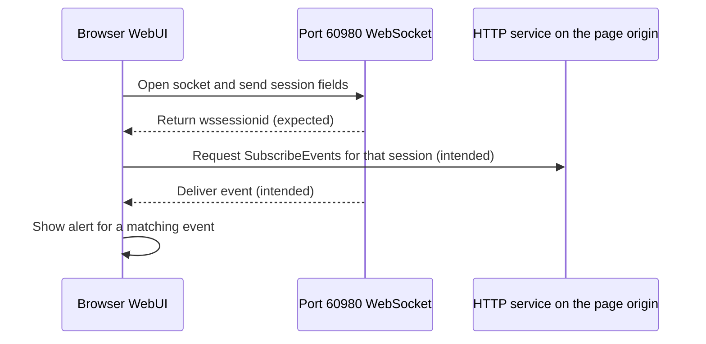

# Why does the WebUI mention port 60980?

While examining the Beacon's WebUI, we found browser code that tries to open a WebSocket on TCP port 60980. Does that mean the Beacon has another service we can connect to? On the checked Beacon G6, **no working service was found**. The code belongs to a cellular-device feature included in the shared WebUI, and the checks found neither a 60980 listener nor the expected HTTP handler on that router.

There is a second wrinkle: an offline replay of the browser code showed that it prepares an event subscription but sends a different request body. That result describes the client code; it does not tell us how a real 60980 server would behave.

We examined saved WebUI code from the Beacon G6 R24.02 `IJL.J03p01` and R24.04 `HJL.L91p01`, and the Beacon 9 R25.03 `JJM.K44p01`. The live checks were on a G6 running `HJL.L91p01` only. They included read-only router checks and requests for static WebUI files. No 60980 connection, WebSocket login, subscription, CGI operation, SIM operation or router-setting change was made. The [knowledgebase](../../knowledgebases/webui-event-service.md) and [evidence index](resources/README.md) retain the source fragments, captures and test limits.

To complete this writeup, we need a firmware dump from a Nokia FWA device. If you have one and are willing to help, please open a GitHub issue or contact me.

## A browser feature can exist without its service

The WebUI has two sides. The **frontend** is the JavaScript and page content sent to the browser. The **backend** is software on the device that receives requests and performs work or returns information. A manufacturer can ship the same frontend assets on several products, with code for features that only some models support. Seeing a function in JavaScript therefore tells us what the page is designed to ask for, not that this router can answer it.

That is what makes 60980 interesting. The checked G6 served the WebUI index, main JavaScript bundle and SIM component successfully; all three matched the saved HJL files. The code is really part of the UI delivered by that router, even though the checks below did not find its corresponding service.

The 60980 client is also separate from the G6's existing [TCP 8099 notification service](../app-websocket-notifications/README.md). Both involve WebSockets, which provide a continuing connection over which messages can be exchanged, but their authentication and message formats differ. A client for one cannot use the other merely by changing the port number.

## What feature uses the connection?

The only direct caller found in the examined JavaScript is the SIM-lock management component. This is part of the UI for cellular or **fixed wireless access** (FWA) devices: products that use a mobile network for their uplink. The component opens a PIN/PUK dialog and asks the event client to listen for event number `4`. A PIN or PUK is used to manage a SIM's lock; this research did not submit either one.

The component is behind an FWA feature gate. The fallback model lists in the three examined UI builds contain 16, 21 and 27 FWA models respectively; none lists Beacon G6, G6.2 or Beacon 9. In HJL and Beacon 9 code, product capability data can override the fallback classification. We did not query that live capability, so the lists alone do not prove every possible runtime UI state.

The event handler gives a clue to the intended purpose. For event `4`, it looks at the first payload and reacts when the origin is not `Web` and the action is `RebootSystem` or `Level2FactoryReset`. It then displays an alert and closes the socket. The callback **reacts to a notification**; it does not itself issue the reboot or reset. We have not established the meaning of other event numbers or a complete server event format.

## How the client intends to receive an event

The code uses two channels for different parts of the exchange: a WebSocket for the session and incoming events, and an HTTP request to ask for a subscription. The following is the intended client flow reconstructed from the saved code, not a recording of a successful session:



First, the browser constructs `ws://<current page hostname>:60980/` and sends a JSON object using the WebUI token and session ID stored in browser `localStorage`:

```json
{"CSRFtoken":"<WebUI token>","SessionID":"<WebUI sid>","PasswordType":3}
```

The code calls `.toString()` on both stored values, so they must be present. `PasswordType` is the literal value in the client; without a matching server we cannot establish what it means or what authorization the server requires. The client hardcodes `ws`, rather than choosing `wss` for an HTTPS page. We did not test HTTPS compatibility.

Next, when an incoming object contains a truthy `wssessionid`, the client prepares a subscription addressed to `Nokia.EventService`. In the example below the token and session number are dummy values. `eventlist: [4]` is the SIM component's requested event, and the empty timeout is the default it uses.

```json
{
  "version": 1,
  "csrf_token": "fixture-csrf",
  "id": 1,
  "interface": "Nokia.EventService",
  "service": "OAM",
  "function": "SubscribeEvents",
  "paralist": [
    {"Source": "Web"},
    {"wssessionid": 7},
    {"timeout": ""},
    {"eventlist": [4]}
  ]
}
```

The session ID links the requested subscription to the WebSocket session. The URL map puts this JSON request at `/service_function_web_app.cgi` on the page's HTTP or HTTPS origin, not on port 60980. The browser request is configured with `withCredentials: true`, so applicable session cookies can be included. The frontend names its method `callUBUS`, but that name and request envelope do not establish access to arbitrary OpenWrt ubus calls.

The client ignores a zero session ID. An optional truthy timer is converted to a string; passing zero does not replace an existing timer. The sole caller found supplies no timer. The code also creates a retry operator without applying it to the socket, so it does not demonstrate a reliable reconnect policy. Actual network timeout and reconnection behavior were not tested.

## The subscription request is wired to the wrong body

Preparing the subscription does not mean it is the object sent. The client keeps two request bodies: one for `Nokia.EventService`, and another for `Nokia.GenericService`, which the UI uses for other FWA operations. The subscription builder updates the event body, but the selected HTTP request path posts the generic body:

```text
createSocketBody()  -> prepares webSocketBody (EventService)
callUBUS()          -> selects the FWA HTTP request path
request()           -> posts body (GenericService)
```

To check the consequence, we replayed the extracted methods with fake browser storage and fake HTTP and WebSocket transports. In a fixture representing the SIM screen, `GetSIMInfo` first populated the generic body. A dummy incoming session ID then caused the event body to be prepared correctly, but the captured HTTP POST still contained `Nokia.GenericService/GetSIMInfo`. The same mismatch occurred in both saved G6 builds and the Beacon 9 build.

`GetSIMInfo` is the preceding operation in this fixture, not a claim that every attempt would send that function: the generic body can depend on what happened beforehand. The replay exercised selected original methods with mocked dependencies, not the full Angular application or a real server. It corrects the earlier implication that the prepared subscription was successfully sent; it does not establish a server response or a working event feed. The [replay results](resources/offline-frontend-results.json) record the cases.

A repair to the frontend would need to send the event body for this request while preserving the generic request path. It would still need a compatible backend; changing the JavaScript would not create one on the checked G6.

## What the G6 checks found

The live G6 ran `3FE49996HJLL91 / HJL.L91p01`, HomeOS `24.04.00`. The checks looked for the pieces the browser code expects and compared the running device's files with the saved firmware:

| Check | Observation |
| --- | --- |
| WebUI assets | The index, main bundle and SIM component returned HTTP 200 and matched the saved HJL bytes. |
| Selected live files | Five hashes matched: the web server, main and component JavaScript, and the 8099 executable and library. |
| Port 60980 | No listener appeared in the initial or final kernel listings. No connection was attempted. |
| Other listeners | The existing 8099 process, HTTP on port 80 and HTTPS on port 443 remained listening. |
| Expected HTTP handler | No file was present at `/webs/service_function_web_app.cgi` or `/www/service_function_web_app.cgi`. |
| `Nokia.*` ubus names | Neither checked default nor session broker advertised a matching object. |

The named CGI file was also absent from the three selected complete extracted image roots. An exact byte-string search of 14,541 regular files found the selected protocol markers in 11 JavaScript files, with no native backend match. That search does not decode port instructions or compressed resources, cover every live overlay, or rule out dynamically constructed names. Nor does the ubus name query prove how every HTTP route is implemented. Runtime alias routing was not exhaustively ruled out. No live Beacon 9 listener check was performed.

Together, the served assets and negative checks support a shared frontend with an FWA feature whose expected backend was not found on this G6. They do not prove that such a backend cannot exist on another product. The three UI build tags are `2402.28.06.A17`, `2404.26.12.A17` and `2503a.26.10.A19`; these are frontend tags, not firmware image or HomeOS version identifiers.

## Other cellular operations in the same frontend

The generic request path contains names for APN management, SIM/PIN/PUK, WAN access mode, cellular access, modem logging and operator locks. The Beacon 9 frontend also references GPS, roaming and cellular-band controls. The [call-site catalogue](resources/generic-function-literals.json) records 23, 39 and 49 distinct literal function names in the matching bundles for the two G6 builds and Beacon 9 respectively. These are references in browser code, not a count of operations accepted by a server or evidence that the Beacons have cellular hardware.

Ordinary WebUI form requests use another path with a CSRF/encryption wrapper; the FWA JSON branch does not invoke that wrapper. That client-side difference does not establish the server's authentication policy. Its HTTP branch also omits a timeout pipe used by several other request modes; actual timeout behavior remains untested.

To resolve the remaining questions, the useful evidence would be firmware or a server implementation from a matching FWA device, or observations from an actual 60980 listener. Those could show whether the service accepts the intended subscription and how it authenticates and delivers events. The current evidence does not provide an operational 60980 client.

